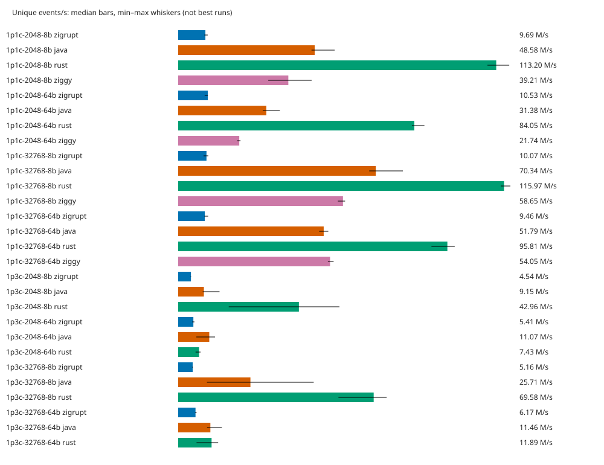

# Zigrupt competitive baseline

Run: 2026-10-07T02:43:54.026874+00:00. Host-local baseline; not a universal ranking.

- Physical CPUs: `[0, 1, 2, 3]`; one worker per physical core, fixed producer-then-consumer placement.
- 56 correctness cases passed; 0 invalid runs; 28 implementation/workload combinations blocked.
- 5 independent processes per measured cell, seeded randomized order. Target measurement 1.0 s; warmup 2.0 s (event counts calibrated, actual durations in JSON).
- Results are **median [minimum–maximum]**. Wins/losses require disjoint observed ranges and complete, valid repeats; overlapping ranges are inconclusive. This is not a confidence interval or a significance test.
- Runs shorter than 0.5 s, with warmup shorter than 0.5 s, or with measured JVM compilation activity cannot support wins/losses. Invalid runs are never ranked.
- Ratios are **Zigrupt / competitor**: throughput >1 favors Zigrupt; latency <1 favors Zigrupt. Latency comparisons use the worst consumer per run.
- CPU is process CPU seconds / measured wall seconds; RSS is the executable's address-space high-water RSS (`VmHWM`) before teardown, excluding launcher memory before exec. Startup is excluded from throughput/CPU, not RSS. JVM heap is fixed and pre-touched at 256 MiB.
- No production code or competitor implementation was changed. See `../../SPEC.md` for payload, validation, schedule, native batching and producer-backoff details.

## Coverage

| Workload | Status |
|---|---|
| 1p1c-2048-8b | Measured (see quality and variability below) |
| 1p1c-2048-64b | Measured (see quality and variability below) |
| 1p1c-32768-8b | Measured (see quality and variability below) |
| 1p1c-32768-64b | Measured (see quality and variability below) |
| 4p1c-2048-8b | requires 5 physical cores; only 4 available |
| 4p1c-2048-64b | requires 5 physical cores; only 4 available |
| 4p1c-32768-8b | requires 5 physical cores; only 4 available |
| 4p1c-32768-64b | requires 5 physical cores; only 4 available |
| 1p3c-2048-8b | Measured (see quality and variability below) |
| 1p3c-2048-64b | Measured (see quality and variability below) |
| 1p3c-32768-8b | Measured (see quality and variability below) |
| 1p3c-32768-64b | Measured (see quality and variability below) |
| 3p3c-2048-8b | requires 6 physical cores; only 4 available |
| 3p3c-2048-64b | requires 6 physical cores; only 4 available |
| 3p3c-32768-8b | requires 6 physical cores; only 4 available |
| 3p3c-32768-64b | requires 6 physical cores; only 4 available |

## Throughput and resource costs

| Workload | Implementation | M unique events/s | M deliveries/s | CPU cores | Peak RSS MiB | Quality |
|---|---|---:|---:|---:|---:|---|
| 1p1c-2048-64b | java | 31.380 [30.084–36.180] | 31.380 [30.084–36.180] | 1.750 [1.729–1.775] | 313.352 [313.066–313.645] | rankable |
| 1p1c-2048-64b | rust | 84.052 [83.171–87.637] | 84.052 [83.171–87.637] | 2.001 [2.000–2.005] | 2.461 [2.457–2.492] | rankable |
| 1p1c-2048-64b | ziggy | 21.743 [21.016–22.183] | 21.743 [21.016–22.183] | 2.001 [2.000–2.002] | 2.602 [2.574–2.656] | rankable |
| 1p1c-2048-64b | zigrupt | 10.530 [9.422–10.592] | 10.530 [9.422–10.592] | 2.001 [2.000–2.002] | 3.180 [3.012–3.234] | rankable |
| 1p1c-2048-8b | java | 48.585 [47.451–55.693] | 48.585 [47.451–55.693] | 1.661 [1.589–1.769] | 313.270 [313.188–313.375] | rankable |
| 1p1c-2048-8b | rust | 113.196 [110.075–117.834] | 113.196 [110.075–117.834] | 2.001 [2.000–2.002] | 2.371 [2.340–2.430] | rankable |
| 1p1c-2048-8b | ziggy | 39.205 [32.051–47.496] | 39.205 [32.051–47.496] | 2.001 [2.000–2.003] | 2.547 [2.426–2.551] | rankable |
| 1p1c-2048-8b | zigrupt | 9.686 [9.311–10.515] | 9.686 [9.311–10.515] | 2.000 [2.000–2.001] | 3.051 [3.008–3.141] | rankable |
| 1p1c-32768-64b | java | 51.789 [50.159–53.429] | 51.789 [50.159–53.429] | 1.873 [1.809–1.898] | 313.355 [313.340–313.398] | inconclusive |
| 1p1c-32768-64b | rust | 95.809 [90.141–98.431] | 95.809 [90.141–98.431] | 2.001 [2.000–2.002] | 4.328 [4.211–4.355] | rankable |
| 1p1c-32768-64b | ziggy | 54.050 [53.280–55.326] | 54.050 [53.280–55.326] | 2.000 [2.000–2.003] | 6.355 [6.234–6.410] | rankable |
| 1p1c-32768-64b | zigrupt | 9.458 [9.312–10.663] | 9.458 [9.312–10.663] | 2.001 [2.000–2.002] | 5.250 [5.227–5.359] | rankable |
| 1p1c-32768-8b | java | 70.335 [67.989–79.996] | 70.335 [67.989–79.996] | 1.905 [1.674–1.944] | 313.355 [313.297–314.074] | rankable |
| 1p1c-32768-8b | rust | 115.969 [114.788–118.235] | 115.969 [114.788–118.235] | 2.001 [2.000–2.002] | 2.613 [2.535–2.680] | rankable |
| 1p1c-32768-8b | ziggy | 58.648 [56.834–59.403] | 58.648 [56.834–59.403] | 2.000 [2.000–2.000] | 6.297 [6.270–6.305] | rankable |
| 1p1c-32768-8b | zigrupt | 10.072 [9.037–10.734] | 10.072 [9.037–10.734] | 2.000 [2.000–2.002] | 3.523 [3.492–3.527] | rankable |
| 1p3c-2048-64b | java | 11.068 [6.463–13.102] | 33.203 [19.388–39.307] | 3.688 [3.521–4.004] | 314.152 [313.516–314.582] | rankable |
| 1p3c-2048-64b | rust | 7.434 [6.185–7.982] | 22.301 [18.555–23.946] | 4.003 [4.000–4.007] | 2.461 [2.406–2.480] | rankable |
| 1p3c-2048-64b | zigrupt | 5.407 [4.992–5.792] | 16.221 [14.976–17.376] | 4.002 [4.001–4.003] | 3.676 [3.566–3.766] | rankable |
| 1p3c-2048-8b | java | 9.146 [8.715–14.718] | 27.439 [26.144–44.154] | 3.998 [3.963–3.999] | 313.324 [313.055–314.094] | inconclusive |
| 1p3c-2048-8b | rust | 42.964 [17.991–57.391] | 128.892 [53.973–172.172] | 4.001 [4.000–4.002] | 2.367 [2.266–2.461] | rankable |
| 1p3c-2048-8b | zigrupt | 4.544 [4.419–4.597] | 13.631 [13.258–13.792] | 4.002 [4.000–4.003] | 3.543 [3.418–3.598] | rankable |
| 1p3c-32768-64b | java | 11.459 [10.281–15.556] | 34.376 [30.844–46.669] | 3.815 [3.313–3.874] | 313.590 [313.566–314.941] | inconclusive |
| 1p3c-32768-64b | rust | 11.888 [6.532–14.230] | 35.664 [19.595–42.689] | 4.005 [3.999–4.008] | 4.340 [4.250–4.445] | rankable |
| 1p3c-32768-64b | zigrupt | 6.170 [5.962–6.555] | 18.511 [17.885–19.665] | 4.002 [4.001–4.003] | 5.809 [5.758–5.871] | rankable |
| 1p3c-32768-8b | java | 25.713 [10.227–48.238] | 77.139 [30.680–144.715] | 3.972 [3.774–4.000] | 313.055 [312.980–314.656] | rankable |
| 1p3c-32768-8b | rust | 69.582 [57.032–74.205] | 208.746 [171.095–222.615] | 4.000 [3.999–4.006] | 2.609 [2.504–2.699] | rankable |
| 1p3c-32768-8b | zigrupt | 5.158 [4.915–5.218] | 15.473 [14.744–15.653] | 4.002 [3.999–4.003] | 4.016 [3.926–4.066] | rankable |

## Zigrupt ratios and outcomes

Each entry is ratio + outcome for Zigrupt. **Tradeoff** means opposite outcomes across throughput or latency metrics, not an overall winner.

| Workload | Competitor | Throughput | p99 @50% | p99.9 @50% | p99 @90% | p99.9 @90% | Tradeoff |
|---|---|---|---|---|---|---|---|
| 1p1c-2048-8b | java | 0.199× loss | 1.029× inconclusive | 0.007× inconclusive | 4.935× loss | 17.409× loss | — |
| 1p1c-2048-8b | rust | 0.086× loss | 1.292× loss | 1.362× loss | 5.587× loss | 30.313× loss | — |
| 1p1c-2048-8b | ziggy | 0.247× loss | 1.250× loss | 1.361× loss | 4.922× loss | 25.821× loss | — |
| 1p1c-2048-64b | java | 0.336× loss | 1.046× inconclusive | 0.007× inconclusive | 565.088× loss | 360.190× loss | — |
| 1p1c-2048-64b | rust | 0.125× loss | 1.203× inconclusive | 1.202× inconclusive | 635.194× loss | 410.377× loss | — |
| 1p1c-2048-64b | ziggy | 0.484× loss | 1.001× inconclusive | 1.032× inconclusive | 3.074× inconclusive | 2.526× inconclusive | — |
| 1p1c-32768-8b | java | 0.143× loss | 1.124× loss | 0.969× inconclusive | 116.813× loss | 68.395× inconclusive | — |
| 1p1c-32768-8b | rust | 0.087× loss | 1.247× loss | 1.361× loss | 150.947× loss | 108.860× loss | — |
| 1p1c-32768-8b | ziggy | 0.172× loss | 1.276× loss | 1.221× inconclusive | 117.764× loss | 70.525× loss | — |
| 1p1c-32768-64b | java | 0.183× inconclusive | 1.055× inconclusive | 0.599× inconclusive | 3.085× inconclusive | 3.659× inconclusive | — |
| 1p1c-32768-64b | rust | 0.099× loss | 1.195× inconclusive | 0.926× inconclusive | 4.626× loss | 7.526× loss | — |
| 1p1c-32768-64b | ziggy | 0.175× loss | 1.089× inconclusive | 0.944× inconclusive | 2.124× inconclusive | 4.043× inconclusive | — |
| 4p1c-2048-8b | java | — inconclusive | — inconclusive | — inconclusive | — inconclusive | — inconclusive | — |
| 4p1c-2048-8b | rust | — inconclusive | — inconclusive | — inconclusive | — inconclusive | — inconclusive | — |
| 4p1c-2048-8b | ziggy | — inconclusive | — inconclusive | — inconclusive | — inconclusive | — inconclusive | — |
| 4p1c-2048-64b | java | — inconclusive | — inconclusive | — inconclusive | — inconclusive | — inconclusive | — |
| 4p1c-2048-64b | rust | — inconclusive | — inconclusive | — inconclusive | — inconclusive | — inconclusive | — |
| 4p1c-2048-64b | ziggy | — inconclusive | — inconclusive | — inconclusive | — inconclusive | — inconclusive | — |
| 4p1c-32768-8b | java | — inconclusive | — inconclusive | — inconclusive | — inconclusive | — inconclusive | — |
| 4p1c-32768-8b | rust | — inconclusive | — inconclusive | — inconclusive | — inconclusive | — inconclusive | — |
| 4p1c-32768-8b | ziggy | — inconclusive | — inconclusive | — inconclusive | — inconclusive | — inconclusive | — |
| 4p1c-32768-64b | java | — inconclusive | — inconclusive | — inconclusive | — inconclusive | — inconclusive | — |
| 4p1c-32768-64b | rust | — inconclusive | — inconclusive | — inconclusive | — inconclusive | — inconclusive | — |
| 4p1c-32768-64b | ziggy | — inconclusive | — inconclusive | — inconclusive | — inconclusive | — inconclusive | — |
| 1p3c-2048-8b | java | 0.497× inconclusive | 1.206× inconclusive | 0.003× inconclusive | 1391.229× loss | 476.977× loss | — |
| 1p3c-2048-8b | rust | 0.106× loss | 1.573× loss | 1.235× inconclusive | 1733.095× loss | 891.606× loss | — |
| 1p3c-2048-64b | java | 0.489× loss | 1.002× inconclusive | 0.894× win | 118.741× loss | 103.685× loss | **yes** |
| 1p3c-2048-64b | rust | 0.727× loss | 1.516× loss | 1.298× loss | 5031.466× loss | 2326.052× loss | — |
| 1p3c-32768-8b | java | 0.201× loss | 1.088× inconclusive | 0.743× inconclusive | 0.985× inconclusive | 1.066× inconclusive | — |
| 1p3c-32768-8b | rust | 0.074× loss | 1.909× loss | 1.340× loss | 1672.832× loss | 875.933× loss | — |
| 1p3c-32768-64b | java | 0.539× inconclusive | 2.209× loss | 1.101× inconclusive | 17296.952× loss | 3342.405× loss | — |
| 1p3c-32768-64b | rust | 0.519× inconclusive | 3.817× loss | 1.659× loss | 1410.338× loss | 558.848× loss | — |
| 3p3c-2048-8b | java | — inconclusive | — inconclusive | — inconclusive | — inconclusive | — inconclusive | — |
| 3p3c-2048-8b | rust | — inconclusive | — inconclusive | — inconclusive | — inconclusive | — inconclusive | — |
| 3p3c-2048-64b | java | — inconclusive | — inconclusive | — inconclusive | — inconclusive | — inconclusive | — |
| 3p3c-2048-64b | rust | — inconclusive | — inconclusive | — inconclusive | — inconclusive | — inconclusive | — |
| 3p3c-32768-8b | java | — inconclusive | — inconclusive | — inconclusive | — inconclusive | — inconclusive | — |
| 3p3c-32768-8b | rust | — inconclusive | — inconclusive | — inconclusive | — inconclusive | — inconclusive | — |
| 3p3c-32768-64b | java | — inconclusive | — inconclusive | — inconclusive | — inconclusive | — inconclusive | — |
| 3p3c-32768-64b | rust | — inconclusive | — inconclusive | — inconclusive | — inconclusive | — inconclusive | — |

## Scheduled-arrival latency

All values below are microseconds, median [min–max] across runs. Histograms report bucket upper bounds (≤0.2% relative quantization error above 1 µs; exact below 1,024 ns). **Worst** is the max consumer per run, not a merged histogram. Rates come from `rates.json`, independently per workload, using the slowest median saturation throughput.

| Workload | Implementation | Load | Offered events/s | Consumer | p50 µs | p99 µs | p99.9 µs |
|---|---|---:|---:|---|---:|---:|---:|
| 1p1c-2048-64b | java | 50% | 5265071 | 0 | 0.226 [0.221–0.254] | 2.967 [2.891–3.019] | 737.279 [668.671–825.343] |
| 1p1c-2048-64b | java | 50% | 5265071 | **worst** | 0.226 [0.221–0.254] | 2.967 [2.891–3.019] | 737.279 [668.671–825.343] |
| 1p1c-2048-64b | java | 90% | 9477127 | 0 | 0.306 [0.281–0.323] | 3.443 [3.187–3.835] | 6.607 [5.471–8.415] |
| 1p1c-2048-64b | java | 90% | 9477127 | **worst** | 0.306 [0.281–0.323] | 3.443 [3.187–3.835] | 6.607 [5.471–8.415] |
| 1p1c-2048-64b | rust | 50% | 5265071 | 0 | 0.201 [0.196–0.202] | 2.579 [2.391–26.655] | 4.247 [3.567–151.039] |
| 1p1c-2048-64b | rust | 50% | 5265071 | **worst** | 0.201 [0.196–0.202] | 2.579 [2.391–26.655] | 4.247 [3.567–151.039] |
| 1p1c-2048-64b | rust | 90% | 9477127 | 0 | 0.261 [0.246–0.274] | 3.063 [2.743–4.295] | 5.799 [5.279–18.527] |
| 1p1c-2048-64b | rust | 90% | 9477127 | **worst** | 0.261 [0.246–0.274] | 3.063 [2.743–4.295] | 5.799 [5.279–18.527] |
| 1p1c-2048-64b | ziggy | 50% | 5265071 | 0 | 0.178 [0.175–0.180] | 3.099 [2.983–3.139] | 4.943 [4.839–5.463] |
| 1p1c-2048-64b | ziggy | 50% | 5265071 | **worst** | 0.178 [0.175–0.180] | 3.099 [2.983–3.139] | 4.943 [4.839–5.463] |
| 1p1c-2048-64b | ziggy | 90% | 9477127 | 0 | 0.410 [0.325–16.367] | 632.831 [67.839–1716.223] | 942.079 [98.047–1912.831] |
| 1p1c-2048-64b | ziggy | 90% | 9477127 | **worst** | 0.410 [0.325–16.367] | 632.831 [67.839–1716.223] | 942.079 [98.047–1912.831] |
| 1p1c-2048-64b | zigrupt | 50% | 5265071 | 0 | 0.239 [0.235–0.243] | 3.103 [2.935–3.199] | 5.103 [4.959–5.151] |
| 1p1c-2048-64b | zigrupt | 50% | 5265071 | **worst** | 0.239 [0.235–0.243] | 3.103 [2.935–3.199] | 5.103 [4.959–5.151] |
| 1p1c-2048-64b | zigrupt | 90% | 9477127 | 0 | 17.279 [0.253–5758.975] | 1945.599 [188.159–11534.335] | 2379.775 [432.127–11763.711] |
| 1p1c-2048-64b | zigrupt | 90% | 9477127 | **worst** | 17.279 [0.253–5758.975] | 1945.599 [188.159–11534.335] | 2379.775 [432.127–11763.711] |
| 1p1c-2048-8b | java | 50% | 4842763 | 0 | 0.225 [0.214–0.240] | 2.995 [2.891–3.147] | 691.199 [667.647–1253.375] |
| 1p1c-2048-8b | java | 50% | 4842763 | **worst** | 0.225 [0.214–0.240] | 2.995 [2.891–3.147] | 691.199 [667.647–1253.375] |
| 1p1c-2048-8b | java | 90% | 8716975 | 0 | 0.263 [0.249–0.279] | 3.119 [2.967–3.187] | 7.367 [5.223–7.671] |
| 1p1c-2048-8b | java | 90% | 8716975 | **worst** | 0.263 [0.249–0.279] | 3.119 [2.967–3.187] | 7.367 [5.223–7.671] |
| 1p1c-2048-8b | rust | 50% | 4842763 | 0 | 0.194 [0.188–0.197] | 2.387 [2.351–2.419] | 3.687 [3.575–4.087] |
| 1p1c-2048-8b | rust | 50% | 4842763 | **worst** | 0.194 [0.188–0.197] | 2.387 [2.351–2.419] | 3.687 [3.575–4.087] |
| 1p1c-2048-8b | rust | 90% | 8716975 | 0 | 0.193 [0.187–0.212] | 2.755 [2.547–2.863] | 4.231 [3.755–5.023] |
| 1p1c-2048-8b | rust | 90% | 8716975 | **worst** | 0.193 [0.187–0.212] | 2.755 [2.547–2.863] | 4.231 [3.755–5.023] |
| 1p1c-2048-8b | ziggy | 50% | 4842763 | 0 | 0.169 [0.168–0.173] | 2.467 [2.163–2.539] | 3.691 [3.419–4.271] |
| 1p1c-2048-8b | ziggy | 50% | 4842763 | **worst** | 0.169 [0.168–0.173] | 2.467 [2.163–2.539] | 3.691 [3.419–4.271] |
| 1p1c-2048-8b | ziggy | 90% | 8716975 | 0 | 0.178 [0.176–0.182] | 3.127 [2.851–3.455] | 4.967 [4.895–5.303] |
| 1p1c-2048-8b | ziggy | 90% | 8716975 | **worst** | 0.178 [0.176–0.182] | 3.127 [2.851–3.455] | 4.967 [4.895–5.303] |
| 1p1c-2048-8b | zigrupt | 50% | 4842763 | 0 | 0.242 [0.238–0.244] | 3.083 [2.927–3.187] | 5.023 [4.663–5.503] |
| 1p1c-2048-8b | zigrupt | 50% | 4842763 | **worst** | 0.242 [0.238–0.244] | 3.083 [2.927–3.187] | 5.023 [4.663–5.503] |
| 1p1c-2048-8b | zigrupt | 90% | 8716975 | 0 | 0.260 [0.240–0.324] | 15.391 [5.879–352.767] | 128.255 [10.607–673.791] |
| 1p1c-2048-8b | zigrupt | 90% | 8716975 | **worst** | 0.260 [0.240–0.324] | 15.391 [5.879–352.767] | 128.255 [10.607–673.791] |
| 1p1c-32768-64b | java | 50% | 4729083 | 0 | 0.246 [0.240–0.253] | 2.691 [2.471–3.039] | 7.695 [5.647–1669.119] |
| 1p1c-32768-64b | java | 50% | 4729083 | **worst** | 0.246 [0.240–0.253] | 2.691 [2.471–3.039] | 7.695 [5.647–1669.119] |
| 1p1c-32768-64b | java | 90% | 8512351 | 0 | 0.315 [0.304–0.320] | 4.263 [3.867–11.007] | 13.311 [8.119–66.431] |
| 1p1c-32768-64b | java | 90% | 8512351 | **worst** | 0.315 [0.304–0.320] | 4.263 [3.867–11.007] | 13.311 [8.119–66.431] |
| 1p1c-32768-64b | rust | 50% | 4729083 | 0 | 0.196 [0.185–0.225] | 2.375 [2.027–2.427] | 4.975 [3.683–5.703] |
| 1p1c-32768-64b | rust | 50% | 4729083 | **worst** | 0.196 [0.185–0.225] | 2.375 [2.027–2.427] | 4.975 [3.683–5.703] |
| 1p1c-32768-64b | rust | 90% | 8512351 | 0 | 0.250 [0.212–0.270] | 2.843 [2.571–3.335] | 6.471 [4.431–8.943] |
| 1p1c-32768-64b | rust | 90% | 8512351 | **worst** | 0.250 [0.212–0.270] | 2.843 [2.571–3.335] | 6.471 [4.431–8.943] |
| 1p1c-32768-64b | ziggy | 50% | 4729083 | 0 | 0.169 [0.166–0.171] | 2.607 [2.487–2.843] | 4.879 [4.247–5.279] |
| 1p1c-32768-64b | ziggy | 50% | 4729083 | **worst** | 0.169 [0.166–0.171] | 2.607 [2.487–2.843] | 4.879 [4.247–5.279] |
| 1p1c-32768-64b | ziggy | 90% | 8512351 | 0 | 0.220 [0.209–0.230] | 6.191 [4.831–38.527] | 12.047 [10.767–186.879] |
| 1p1c-32768-64b | ziggy | 90% | 8512351 | **worst** | 0.220 [0.209–0.230] | 6.191 [4.831–38.527] | 12.047 [10.767–186.879] |
| 1p1c-32768-64b | zigrupt | 50% | 4729083 | 0 | 0.247 [0.245–0.250] | 2.839 [2.415–2.963] | 4.607 [4.111–6.775] |
| 1p1c-32768-64b | zigrupt | 50% | 4729083 | **worst** | 0.247 [0.245–0.250] | 2.839 [2.415–2.963] | 4.607 [4.111–6.775] |
| 1p1c-32768-64b | zigrupt | 90% | 8512351 | 0 | 0.257 [0.238–0.306] | 13.151 [6.511–992.255] | 48.703 [14.159–1308.671] |
| 1p1c-32768-64b | zigrupt | 90% | 8512351 | **worst** | 0.257 [0.238–0.306] | 13.151 [6.511–992.255] | 48.703 [14.159–1308.671] |
| 1p1c-32768-8b | java | 50% | 5036230 | 0 | 0.230 [0.218–0.245] | 2.715 [2.639–2.767] | 5.151 [4.903–7.055] |
| 1p1c-32768-8b | java | 50% | 5036230 | **worst** | 0.230 [0.218–0.245] | 2.715 [2.639–2.767] | 5.151 [4.903–7.055] |
| 1p1c-32768-8b | java | 90% | 9065215 | 0 | 0.290 [0.281–0.306] | 3.467 [3.143–3.771] | 6.887 [5.591–908.287] |
| 1p1c-32768-8b | java | 90% | 9065215 | **worst** | 0.290 [0.281–0.306] | 3.467 [3.143–3.771] | 6.887 [5.591–908.287] |
| 1p1c-32768-8b | rust | 50% | 5036230 | 0 | 0.191 [0.185–0.194] | 2.447 [2.299–2.559] | 3.667 [3.559–3.743] |
| 1p1c-32768-8b | rust | 50% | 5036230 | **worst** | 0.191 [0.185–0.194] | 2.447 [2.299–2.559] | 3.667 [3.559–3.743] |
| 1p1c-32768-8b | rust | 90% | 9065215 | 0 | 0.193 [0.188–0.214] | 2.683 [2.583–2.739] | 4.327 [4.111–4.599] |
| 1p1c-32768-8b | rust | 90% | 9065215 | **worst** | 0.193 [0.188–0.214] | 2.683 [2.583–2.739] | 4.327 [4.111–4.599] |
| 1p1c-32768-8b | ziggy | 50% | 5036230 | 0 | 0.165 [0.161–0.184] | 2.391 [2.255–2.667] | 4.087 [3.799–18.399] |
| 1p1c-32768-8b | ziggy | 50% | 5036230 | **worst** | 0.165 [0.161–0.184] | 2.391 [2.255–2.667] | 4.087 [3.799–18.399] |
| 1p1c-32768-8b | ziggy | 90% | 9065215 | 0 | 0.178 [0.176–0.183] | 3.439 [2.875–3.535] | 6.679 [5.271–6.919] |
| 1p1c-32768-8b | ziggy | 90% | 9065215 | **worst** | 0.178 [0.176–0.183] | 3.439 [2.875–3.535] | 6.679 [5.271–6.919] |
| 1p1c-32768-8b | zigrupt | 50% | 5036230 | 0 | 0.237 [0.235–0.242] | 3.051 [2.963–3.319] | 4.991 [4.751–6.007] |
| 1p1c-32768-8b | zigrupt | 50% | 5036230 | **worst** | 0.237 [0.235–0.242] | 3.051 [2.963–3.319] | 4.991 [4.751–6.007] |
| 1p1c-32768-8b | zigrupt | 90% | 9065215 | 0 | 0.369 [0.258–222.719] | 404.991 [81.535–3416.063] | 471.039 [199.935–4120.575] |
| 1p1c-32768-8b | zigrupt | 90% | 9065215 | **worst** | 0.369 [0.258–222.719] | 404.991 [81.535–3416.063] | 471.039 [199.935–4120.575] |
| 1p3c-2048-64b | java | 50% | 2703501 | 0 | 0.343 [0.333–0.421] | 2.679 [2.651–2.847] | 6.391 [5.831–8.991] |
| 1p3c-2048-64b | java | 50% | 2703501 | 1 | 0.401 [0.384–0.459] | 3.871 [3.639–3.943] | 7.951 [7.671–12.047] |
| 1p3c-2048-64b | java | 50% | 2703501 | 2 | 0.406 [0.397–0.461] | 3.547 [3.443–3.731] | 7.439 [6.831–11.631] |
| 1p3c-2048-64b | java | 50% | 2703501 | **worst** | 0.406 [0.397–0.461] | 3.871 [3.639–3.943] | 7.951 [7.671–12.047] |
| 1p3c-2048-64b | java | 90% | 4866303 | 0 | 0.458 [0.448–0.482] | 32.831 [4.951–74.751] | 86.271 [21.471–108.031] |
| 1p3c-2048-64b | java | 90% | 4866303 | 1 | 116.351 [0.469–133.631] | 216.831 [4.119–223.999] | 232.959 [20.767–244.735] |
| 1p3c-2048-64b | java | 90% | 4866303 | 2 | 3.299 [0.470–4.687] | 240.639 [4.027–279.551] | 285.695 [20.831–313.855] |
| 1p3c-2048-64b | java | 90% | 4866303 | **worst** | 116.351 [0.482–133.631] | 240.639 [4.951–279.551] | 285.695 [21.471–313.855] |
| 1p3c-2048-64b | rust | 50% | 2703501 | 0 | 0.294 [0.278–0.303] | 2.455 [1.551–2.711] | 5.303 [4.311–5.935] |
| 1p3c-2048-64b | rust | 50% | 2703501 | 1 | 0.282 [0.278–0.293] | 2.271 [1.477–2.767] | 4.911 [4.399–5.935] |
| 1p3c-2048-64b | rust | 50% | 2703501 | 2 | 0.288 [0.276–0.292] | 1.869 [1.507–2.463] | 4.559 [4.215–5.383] |
| 1p3c-2048-64b | rust | 50% | 2703501 | **worst** | 0.294 [0.281–0.303] | 2.559 [2.227–2.767] | 5.479 [4.943–5.935] |
| 1p3c-2048-64b | rust | 90% | 4866303 | 0 | 0.468 [0.418–0.530] | 5.671 [5.167–97.535] | 12.575 [7.063–1103.871] |
| 1p3c-2048-64b | rust | 90% | 4866303 | 1 | 0.466 [0.422–0.528] | 5.663 [5.119–97.535] | 12.735 [7.175–1103.871] |
| 1p3c-2048-64b | rust | 90% | 4866303 | 2 | 0.471 [0.425–0.524] | 5.679 [5.111–97.535] | 12.671 [7.247–1105.919] |
| 1p3c-2048-64b | rust | 90% | 4866303 | **worst** | 0.471 [0.425–0.530] | 5.679 [5.167–97.535] | 12.735 [7.247–1105.919] |
| 1p3c-2048-64b | zigrupt | 50% | 2703501 | 0 | 0.387 [0.377–0.394] | 3.699 [2.923–3.987] | 6.415 [5.815–7.255] |
| 1p3c-2048-64b | zigrupt | 50% | 2703501 | 1 | 0.388 [0.380–0.393] | 3.515 [3.011–3.739] | 6.559 [5.943–6.927] |
| 1p3c-2048-64b | zigrupt | 50% | 2703501 | 2 | 0.392 [0.381–0.398] | 3.607 [3.295–4.047] | 6.415 [5.855–7.231] |
| 1p3c-2048-64b | zigrupt | 50% | 2703501 | **worst** | 0.392 [0.381–0.398] | 3.879 [3.295–4.047] | 7.111 [5.943–7.255] |
| 1p3c-2048-64b | zigrupt | 90% | 4866303 | 0 | 7249.919 [4141.055–46858.239] | 28573.695 [12206.079–93716.479] | 29622.271 [12468.223–95027.199] |
| 1p3c-2048-64b | zigrupt | 90% | 4866303 | 1 | 7249.919 [4141.055–46858.239] | 28573.695 [12206.079–93716.479] | 29622.271 [12468.223–95027.199] |
| 1p3c-2048-64b | zigrupt | 90% | 4866303 | 2 | 7249.919 [4141.055–46858.239] | 28573.695 [12206.079–93716.479] | 29622.271 [12468.223–95027.199] |
| 1p3c-2048-64b | zigrupt | 90% | 4866303 | **worst** | 7249.919 [4141.055–46858.239] | 28573.695 [12206.079–93716.479] | 29622.271 [12468.223–95027.199] |
| 1p3c-2048-8b | java | 50% | 2271895 | 0 | 0.397 [0.298–0.418] | 2.963 [2.295–3.123] | 1912.831 [1791.999–2097.151] |
| 1p3c-2048-8b | java | 50% | 2271895 | 1 | 0.388 [0.286–0.407] | 2.915 [2.275–3.147] | 1914.879 [1771.519–2097.151] |
| 1p3c-2048-8b | java | 50% | 2271895 | 2 | 0.389 [0.284–0.408] | 2.383 [2.263–3.099] | 1916.927 [1798.143–2105.343] |
| 1p3c-2048-8b | java | 50% | 2271895 | **worst** | 0.397 [0.298–0.418] | 3.015 [2.947–3.147] | 1916.927 [1798.143–2105.343] |
| 1p3c-2048-8b | java | 90% | 4089411 | 0 | 0.477 [0.456–0.524] | 3.427 [3.295–4.447] | 10.511 [6.743–953.343] |
| 1p3c-2048-8b | java | 90% | 4089411 | 1 | 0.489 [0.474–0.521] | 2.887 [2.315–3.415] | 7.079 [4.871–950.271] |
| 1p3c-2048-8b | java | 90% | 4089411 | 2 | 0.488 [0.479–0.522] | 2.831 [2.283–3.407] | 7.335 [4.543–948.223] |
| 1p3c-2048-8b | java | 90% | 4089411 | **worst** | 0.489 [0.479–0.524] | 3.427 [3.295–4.447] | 10.511 [7.159–953.343] |
| 1p3c-2048-8b | rust | 50% | 2271895 | 0 | 0.271 [0.264–0.292] | 2.167 [1.305–2.539] | 4.431 [3.523–6.943] |
| 1p3c-2048-8b | rust | 50% | 2271895 | 1 | 0.277 [0.272–0.281] | 1.817 [1.377–2.311] | 4.111 [3.779–5.143] |
| 1p3c-2048-8b | rust | 50% | 2271895 | 2 | 0.275 [0.271–0.282] | 1.807 [1.599–2.127] | 4.055 [3.859–4.887] |
| 1p3c-2048-8b | rust | 50% | 2271895 | **worst** | 0.282 [0.272–0.292] | 2.311 [2.127–2.539] | 5.143 [4.431–6.943] |
| 1p3c-2048-8b | rust | 90% | 4089411 | 0 | 0.280 [0.267–0.296] | 2.179 [1.767–2.587] | 5.047 [4.767–5.711] |
| 1p3c-2048-8b | rust | 90% | 4089411 | 1 | 0.288 [0.278–0.294] | 2.211 [2.005–2.935] | 5.143 [4.975–6.103] |
| 1p3c-2048-8b | rust | 90% | 4089411 | 2 | 0.286 [0.281–0.290] | 2.419 [1.875–2.755] | 5.623 [5.047–7.103] |
| 1p3c-2048-8b | rust | 90% | 4089411 | **worst** | 0.290 [0.281–0.296] | 2.751 [2.555–2.935] | 5.623 [5.111–7.103] |
| 1p3c-2048-8b | zigrupt | 50% | 2271895 | 0 | 0.376 [0.371–0.379] | 3.591 [3.039–3.923] | 6.159 [5.831–6.495] |
| 1p3c-2048-8b | zigrupt | 50% | 2271895 | 1 | 0.381 [0.376–0.382] | 3.431 [3.367–3.947] | 6.351 [6.103–6.559] |
| 1p3c-2048-8b | zigrupt | 50% | 2271895 | 2 | 0.382 [0.376–0.384] | 3.363 [3.039–3.899] | 6.087 [5.863–6.431] |
| 1p3c-2048-8b | zigrupt | 50% | 2271895 | **worst** | 0.382 [0.376–0.384] | 3.635 [3.379–3.947] | 6.351 [6.103–6.559] |
| 1p3c-2048-8b | zigrupt | 90% | 4089411 | 0 | 876.543 [262.143–3813.375] | 4767.743 [3219.455–17399.807] | 5013.503 [3473.407–18481.151] |
| 1p3c-2048-8b | zigrupt | 90% | 4089411 | 1 | 876.543 [262.143–3813.375] | 4767.743 [3219.455–17399.807] | 5013.503 [3473.407–18481.151] |
| 1p3c-2048-8b | zigrupt | 90% | 4089411 | 2 | 876.543 [262.143–3813.375] | 4767.743 [3219.455–17399.807] | 5013.503 [3473.407–18481.151] |
| 1p3c-2048-8b | zigrupt | 90% | 4089411 | **worst** | 876.543 [262.143–3813.375] | 4767.743 [3219.455–17399.807] | 5013.503 [3473.407–18481.151] |
| 1p3c-32768-64b | java | 50% | 3085228 | 0 | 0.389 [0.311–0.403] | 2.719 [2.005–2.835] | 8.271 [4.359–9.839] |
| 1p3c-32768-64b | java | 50% | 3085228 | 1 | 0.375 [0.307–0.403] | 1.461 [1.127–2.891] | 7.079 [5.727–10.495] |
| 1p3c-32768-64b | java | 50% | 3085228 | 2 | 0.379 [0.306–0.405] | 1.485 [1.053–2.935] | 6.415 [4.735–10.143] |
| 1p3c-32768-64b | java | 50% | 3085228 | **worst** | 0.389 [0.311–0.405] | 2.759 [2.631–2.935] | 8.271 [7.791–10.495] |
| 1p3c-32768-64b | java | 90% | 5553411 | 0 | 0.502 [0.411–0.616] | 5.519 [4.311–69.631] | 33.215 [12.175–225.023] |
| 1p3c-32768-64b | java | 90% | 5553411 | 1 | 0.480 [0.416–0.580] | 6.335 [4.151–69.503] | 33.215 [15.567–224.767] |
| 1p3c-32768-64b | java | 90% | 5553411 | 2 | 0.490 [0.408–0.566] | 5.575 [5.391–69.631] | 32.959 [14.095–224.767] |
| 1p3c-32768-64b | java | 90% | 5553411 | **worst** | 0.502 [0.416–0.616] | 6.335 [5.391–69.631] | 33.215 [15.567–225.023] |
| 1p3c-32768-64b | rust | 50% | 3085228 | 0 | 0.269 [0.251–0.278] | 0.878 [0.613–1.597] | 4.719 [3.815–5.223] |
| 1p3c-32768-64b | rust | 50% | 3085228 | 1 | 0.260 [0.249–0.282] | 1.271 [0.630–2.095] | 5.487 [4.423–6.007] |
| 1p3c-32768-64b | rust | 50% | 3085228 | 2 | 0.260 [0.259–0.288] | 0.775 [0.635–1.002] | 4.615 [4.027–5.159] |
| 1p3c-32768-64b | rust | 50% | 3085228 | **worst** | 0.269 [0.260–0.288] | 1.597 [1.271–2.095] | 5.487 [4.719–6.007] |
| 1p3c-32768-64b | rust | 90% | 5553411 | 0 | 0.889 [0.675–2.715] | 77.695 [18.463–238.847] | 198.399 [38.463–1224.703] |
| 1p3c-32768-64b | rust | 90% | 5553411 | 1 | 0.915 [0.664–2.671] | 77.695 [18.495–239.871] | 198.143 [38.463–1224.703] |
| 1p3c-32768-64b | rust | 90% | 5553411 | 2 | 0.896 [0.670–2.679] | 77.695 [18.495–240.639] | 198.655 [38.463–1224.703] |
| 1p3c-32768-64b | rust | 90% | 5553411 | **worst** | 0.915 [0.675–2.715] | 77.695 [18.495–240.639] | 198.655 [38.463–1224.703] |
| 1p3c-32768-64b | zigrupt | 50% | 3085228 | 0 | 0.383 [0.380–0.386] | 5.919 [3.447–188.927] | 8.223 [6.799–285.695] |
| 1p3c-32768-64b | zigrupt | 50% | 3085228 | 1 | 0.386 [0.382–0.387] | 5.967 [3.887–188.927] | 8.687 [8.351–285.695] |
| 1p3c-32768-64b | zigrupt | 50% | 3085228 | 2 | 0.387 [0.383–0.390] | 6.095 [3.527–188.927] | 9.103 [7.351–285.695] |
| 1p3c-32768-64b | zigrupt | 50% | 3085228 | **worst** | 0.387 [0.383–0.390] | 6.095 [3.887–188.927] | 9.103 [8.351–285.695] |
| 1p3c-32768-64b | zigrupt | 90% | 5553411 | 0 | 63373.311 [26148.863–105381.887] | 109576.191 [39780.351–193200.127] | 111017.983 [40828.927–194772.991] |
| 1p3c-32768-64b | zigrupt | 90% | 5553411 | 1 | 63373.311 [26148.863–105381.887] | 109576.191 [39780.351–193200.127] | 111017.983 [40828.927–194772.991] |
| 1p3c-32768-64b | zigrupt | 90% | 5553411 | 2 | 63373.311 [26148.863–105381.887] | 109576.191 [39780.351–193200.127] | 111017.983 [40828.927–194772.991] |
| 1p3c-32768-64b | zigrupt | 90% | 5553411 | **worst** | 63373.311 [26148.863–105381.887] | 109576.191 [39780.351–193200.127] | 111017.983 [40828.927–194772.991] |
| 1p3c-32768-8b | java | 50% | 2578761 | 0 | 0.360 [0.348–0.434] | 1.969 [1.579–2.787] | 3.867 [3.415–8.191] |
| 1p3c-32768-8b | java | 50% | 2578761 | 1 | 0.500 [0.335–0.532] | 3.451 [1.595–4.767] | 6.735 [4.159–9.743] |
| 1p3c-32768-8b | java | 50% | 2578761 | 2 | 0.398 [0.339–0.429] | 3.035 [1.599–3.831] | 6.303 [3.951–8.991] |
| 1p3c-32768-8b | java | 50% | 2578761 | **worst** | 0.500 [0.348–0.532] | 3.831 [2.415–4.767] | 8.959 [5.855–9.743] |
| 1p3c-32768-8b | java | 90% | 4641771 | 0 | 0.477 [0.436–0.509] | 613.375 [3.251–946.175] | 850.943 [7.199–1366.015] |
| 1p3c-32768-8b | java | 90% | 4641771 | 1 | 904.191 [0.414–4095.999] | 4055.039 [3.235–4947.967] | 4210.687 [8.943–5201.919] |
| 1p3c-32768-8b | java | 90% | 4641771 | 2 | 246.015 [0.411–3297.279] | 850.943 [3.147–4939.775] | 1060.863 [7.039–5259.263] |
| 1p3c-32768-8b | java | 90% | 4641771 | **worst** | 3297.279 [0.477–4095.999] | 4849.663 [3.251–4947.967] | 4997.119 [8.943–5259.263] |
| 1p3c-32768-8b | rust | 50% | 2578761 | 0 | 0.274 [0.271–0.277] | 1.711 [1.391–2.519] | 4.051 [3.587–5.431] |
| 1p3c-32768-8b | rust | 50% | 2578761 | 1 | 0.279 [0.276–0.280] | 2.055 [1.515–2.367] | 4.751 [4.071–5.647] |
| 1p3c-32768-8b | rust | 50% | 2578761 | 2 | 0.278 [0.271–0.291] | 1.821 [1.511–2.147] | 4.271 [3.827–5.271] |
| 1p3c-32768-8b | rust | 50% | 2578761 | **worst** | 0.279 [0.278–0.291] | 2.183 [2.147–2.519] | 4.967 [4.751–5.647] |
| 1p3c-32768-8b | rust | 90% | 4641771 | 0 | 0.294 [0.280–0.300] | 2.691 [2.591–2.863] | 6.079 [5.143–6.127] |
| 1p3c-32768-8b | rust | 90% | 4641771 | 1 | 0.289 [0.280–0.300] | 2.259 [1.835–3.107] | 5.591 [4.935–6.015] |
| 1p3c-32768-8b | rust | 90% | 4641771 | 2 | 0.290 [0.285–0.304] | 2.199 [1.857–2.827] | 5.239 [4.903–5.991] |
| 1p3c-32768-8b | rust | 90% | 4641771 | **worst** | 0.298 [0.285–0.304] | 2.855 [2.591–3.107] | 6.079 [5.351–6.127] |
| 1p3c-32768-8b | zigrupt | 50% | 2578761 | 0 | 0.374 [0.372–0.383] | 4.127 [3.863–4.591] | 6.303 [6.191–7.911] |
| 1p3c-32768-8b | zigrupt | 50% | 2578761 | 1 | 0.379 [0.376–0.385] | 4.167 [3.947–4.591] | 6.655 [6.455–8.511] |
| 1p3c-32768-8b | zigrupt | 50% | 2578761 | 2 | 0.379 [0.376–0.389] | 4.127 [3.887–4.511] | 6.631 [6.111–7.991] |
| 1p3c-32768-8b | zigrupt | 50% | 2578761 | **worst** | 0.379 [0.376–0.389] | 4.167 [4.127–4.591] | 6.655 [6.455–8.511] |
| 1p3c-32768-8b | zigrupt | 90% | 4641771 | 0 | 0.454 [0.326–235.775] | 4775.935 [3256.319–6660.095] | 5324.799 [3796.991–7839.743] |
| 1p3c-32768-8b | zigrupt | 90% | 4641771 | 1 | 0.461 [0.326–235.775] | 4775.935 [3256.319–6660.095] | 5324.799 [3796.991–7839.743] |
| 1p3c-32768-8b | zigrupt | 90% | 4641771 | 2 | 0.453 [0.326–235.775] | 4775.935 [3256.319–6660.095] | 5324.799 [3796.991–7839.743] |
| 1p3c-32768-8b | zigrupt | 90% | 4641771 | **worst** | 0.461 [0.326–235.775] | 4775.935 [3256.319–6660.095] | 5324.799 [3796.991–7839.743] |

## Latency resource costs and allocation/GC evidence

Native allocation counts: Rust global allocator calls; Zig allocator supplied to the bus (measurement arrays allocated before warmup). Java: worker-thread allocated bytes, not total JVM/native allocation. These are different scopes, not interchangeable allocation counters. Missing means unmeasured, not zero. `summary.json` retains setup memory, durations and all resource ranges.

| Workload | Implementation | Mode/load | CPU cores | RSS MiB | Steady allocation calls / Java bytes | GC collections | JIT ms |
|---|---|---|---:|---:|---:|---:|---:|
| 1p1c-2048-64b | java | latency 50% | 2.000 [2.000–2.003] | 313.410 [313.367–313.457] | 72.000 [72.000–72.000] | 0.000 [0.000–0.000] | 2.000 [2.000–2.000] |
| 1p1c-2048-64b | java | latency 90% | 2.000 [2.000–2.002] | 313.555 [313.398–313.957] | 0.000 [0.000–0.000] | 0.000 [0.000–0.000] | 0.000 [0.000–0.000] |
| 1p1c-2048-64b | java | throughput | 1.750 [1.729–1.775] | 313.352 [313.066–313.645] | 0.000 [0.000–0.000] | 0.000 [0.000–0.000] | 0.000 [0.000–0.000] |
| 1p1c-2048-64b | rust | latency 50% | 2.001 [1.992–2.001] | 2.965 [2.867–3.055] | 0.000 [0.000–0.000] | N/A | N/A |
| 1p1c-2048-64b | rust | latency 90% | 2.000 [2.000–2.004] | 2.953 [2.934–3.043] | 0.000 [0.000–0.000] | N/A | N/A |
| 1p1c-2048-64b | rust | throughput | 2.001 [2.000–2.005] | 2.461 [2.457–2.492] | 0.000 [0.000–0.000] | N/A | N/A |
| 1p1c-2048-64b | ziggy | latency 50% | 2.001 [2.000–2.001] | 2.965 [2.961–3.160] | 0.000 [0.000–0.000] | N/A | N/A |
| 1p1c-2048-64b | ziggy | latency 90% | 2.001 [2.000–2.001] | 2.961 [2.859–3.160] | 0.000 [0.000–0.000] | N/A | N/A |
| 1p1c-2048-64b | ziggy | throughput | 2.001 [2.000–2.002] | 2.602 [2.574–2.656] | 0.000 [0.000–0.000] | N/A | N/A |
| 1p1c-2048-64b | zigrupt | latency 50% | 2.001 [2.000–2.001] | 3.551 [3.547–3.750] | 0.000 [0.000–0.000] | N/A | N/A |
| 1p1c-2048-64b | zigrupt | latency 90% | 2.001 [2.000–2.002] | 3.684 [3.449–3.750] | 0.000 [0.000–0.000] | N/A | N/A |
| 1p1c-2048-64b | zigrupt | throughput | 2.001 [2.000–2.002] | 3.180 [3.012–3.234] | 0.000 [0.000–0.000] | N/A | N/A |
| 1p1c-2048-8b | java | latency 50% | 2.000 [1.998–2.002] | 313.375 [313.359–313.516] | 72.000 [72.000–72.000] | 0.000 [0.000–0.000] | 2.000 [2.000–2.000] |
| 1p1c-2048-8b | java | latency 90% | 2.000 [2.000–2.000] | 313.441 [313.410–313.473] | 0.000 [0.000–0.000] | 0.000 [0.000–0.000] | 0.000 [0.000–0.000] |
| 1p1c-2048-8b | java | throughput | 1.661 [1.589–1.769] | 313.270 [313.188–313.375] | 0.000 [0.000–0.000] | 0.000 [0.000–0.000] | 0.000 [0.000–0.000] |
| 1p1c-2048-8b | rust | latency 50% | 2.001 [2.000–2.001] | 2.832 [2.777–2.938] | 0.000 [0.000–0.000] | N/A | N/A |
| 1p1c-2048-8b | rust | latency 90% | 2.001 [2.000–2.001] | 2.840 [2.742–2.945] | 0.000 [0.000–0.000] | N/A | N/A |
| 1p1c-2048-8b | rust | throughput | 2.001 [2.000–2.002] | 2.371 [2.340–2.430] | 0.000 [0.000–0.000] | N/A | N/A |
| 1p1c-2048-8b | ziggy | latency 50% | 2.000 [2.000–2.001] | 3.055 [2.809–3.090] | 0.000 [0.000–0.000] | N/A | N/A |
| 1p1c-2048-8b | ziggy | latency 90% | 2.000 [2.000–2.000] | 2.930 [2.738–3.090] | 0.000 [0.000–0.000] | N/A | N/A |
| 1p1c-2048-8b | ziggy | throughput | 2.001 [2.000–2.003] | 2.547 [2.426–2.551] | 0.000 [0.000–0.000] | N/A | N/A |
| 1p1c-2048-8b | zigrupt | latency 50% | 2.000 [2.000–2.001] | 3.543 [3.527–3.641] | 0.000 [0.000–0.000] | N/A | N/A |
| 1p1c-2048-8b | zigrupt | latency 90% | 2.000 [2.000–2.002] | 3.539 [3.438–3.547] | 0.000 [0.000–0.000] | N/A | N/A |
| 1p1c-2048-8b | zigrupt | throughput | 2.000 [2.000–2.001] | 3.051 [3.008–3.141] | 0.000 [0.000–0.000] | N/A | N/A |
| 1p1c-32768-64b | java | latency 50% | 2.001 [1.997–2.002] | 313.434 [313.340–313.465] | 0.000 [0.000–0.000] | 0.000 [0.000–0.000] | 0.000 [0.000–0.000] |
| 1p1c-32768-64b | java | latency 90% | 2.001 [2.000–2.003] | 313.445 [313.398–313.891] | 0.000 [0.000–0.000] | 0.000 [0.000–0.000] | 0.000 [0.000–0.000] |
| 1p1c-32768-64b | java | throughput | 1.873 [1.809–1.898] | 313.355 [313.340–313.398] | 0.000 [0.000–0.000] | 0.000 [0.000–0.000] | 0.000 [0.000–1.000] |
| 1p1c-32768-64b | rust | latency 50% | 2.001 [2.000–2.002] | 4.871 [4.812–4.918] | 0.000 [0.000–0.000] | N/A | N/A |
| 1p1c-32768-64b | rust | latency 90% | 2.001 [2.000–2.001] | 4.840 [4.812–4.930] | 0.000 [0.000–0.000] | N/A | N/A |
| 1p1c-32768-64b | rust | throughput | 2.001 [2.000–2.002] | 4.328 [4.211–4.355] | 0.000 [0.000–0.000] | N/A | N/A |
| 1p1c-32768-64b | ziggy | latency 50% | 2.000 [2.000–2.001] | 6.852 [6.547–6.906] | 0.000 [0.000–0.000] | N/A | N/A |
| 1p1c-32768-64b | ziggy | latency 90% | 2.001 [2.000–2.003] | 6.855 [6.707–6.906] | 0.000 [0.000–0.000] | N/A | N/A |
| 1p1c-32768-64b | ziggy | throughput | 2.000 [2.000–2.003] | 6.355 [6.234–6.410] | 0.000 [0.000–0.000] | N/A | N/A |
| 1p1c-32768-64b | zigrupt | latency 50% | 2.000 [2.000–2.002] | 5.844 [5.656–5.848] | 0.000 [0.000–0.000] | N/A | N/A |
| 1p1c-32768-64b | zigrupt | latency 90% | 2.000 [2.000–2.001] | 5.766 [5.664–5.793] | 0.000 [0.000–0.000] | N/A | N/A |
| 1p1c-32768-64b | zigrupt | throughput | 2.001 [2.000–2.002] | 5.250 [5.227–5.359] | 0.000 [0.000–0.000] | N/A | N/A |
| 1p1c-32768-8b | java | latency 50% | 2.000 [2.000–2.003] | 313.488 [313.379–314.094] | 0.000 [0.000–0.000] | 0.000 [0.000–0.000] | 0.000 [0.000–0.000] |
| 1p1c-32768-8b | java | latency 90% | 2.001 [2.000–2.002] | 313.445 [313.379–313.934] | 0.000 [0.000–0.000] | 0.000 [0.000–0.000] | 0.000 [0.000–0.000] |
| 1p1c-32768-8b | java | throughput | 1.905 [1.674–1.944] | 313.355 [313.297–314.074] | 0.000 [0.000–0.000] | 0.000 [0.000–0.000] | 0.000 [0.000–0.000] |
| 1p1c-32768-8b | rust | latency 50% | 2.001 [2.001–2.001] | 3.172 [3.090–3.176] | 0.000 [0.000–0.000] | N/A | N/A |
| 1p1c-32768-8b | rust | latency 90% | 2.001 [2.000–2.004] | 3.113 [3.020–3.172] | 0.000 [0.000–0.000] | N/A | N/A |
| 1p1c-32768-8b | rust | throughput | 2.001 [2.000–2.002] | 2.613 [2.535–2.680] | 0.000 [0.000–0.000] | N/A | N/A |
| 1p1c-32768-8b | ziggy | latency 50% | 2.000 [1.999–2.000] | 6.719 [6.559–6.852] | 0.000 [0.000–0.000] | N/A | N/A |
| 1p1c-32768-8b | ziggy | latency 90% | 2.001 [2.000–2.002] | 6.723 [6.492–6.855] | 0.000 [0.000–0.000] | N/A | N/A |
| 1p1c-32768-8b | ziggy | throughput | 2.000 [2.000–2.000] | 6.297 [6.270–6.305] | 0.000 [0.000–0.000] | N/A | N/A |
| 1p1c-32768-8b | zigrupt | latency 50% | 2.000 [2.000–2.002] | 3.910 [3.875–4.109] | 0.000 [0.000–0.000] | N/A | N/A |
| 1p1c-32768-8b | zigrupt | latency 90% | 2.000 [1.996–2.001] | 4.008 [3.805–4.109] | 0.000 [0.000–0.000] | N/A | N/A |
| 1p1c-32768-8b | zigrupt | throughput | 2.000 [2.000–2.002] | 3.523 [3.492–3.527] | 0.000 [0.000–0.000] | N/A | N/A |
| 1p3c-2048-64b | java | latency 50% | 4.002 [4.000–4.006] | 313.754 [313.652–314.156] | 0.000 [0.000–0.000] | 0.000 [0.000–0.000] | 0.000 [0.000–0.000] |
| 1p3c-2048-64b | java | latency 90% | 3.993 [3.969–4.004] | 313.734 [313.664–314.871] | 0.000 [0.000–0.000] | 0.000 [0.000–0.000] | 0.000 [0.000–0.000] |
| 1p3c-2048-64b | java | throughput | 3.688 [3.521–4.004] | 314.152 [313.516–314.582] | 0.000 [0.000–0.000] | 0.000 [0.000–0.000] | 0.000 [0.000–0.000] |
| 1p3c-2048-64b | rust | latency 50% | 4.002 [4.000–4.004] | 3.941 [3.914–4.090] | 0.000 [0.000–0.000] | N/A | N/A |
| 1p3c-2048-64b | rust | latency 90% | 4.002 [4.001–4.005] | 3.992 [3.984–4.094] | 0.000 [0.000–0.000] | N/A | N/A |
| 1p3c-2048-64b | rust | throughput | 4.003 [4.000–4.007] | 2.461 [2.406–2.480] | 0.000 [0.000–0.000] | N/A | N/A |
| 1p3c-2048-64b | zigrupt | latency 50% | 4.002 [4.000–4.004] | 5.176 [4.961–5.184] | 0.000 [0.000–0.000] | N/A | N/A |
| 1p3c-2048-64b | zigrupt | latency 90% | 4.002 [3.999–4.004] | 5.176 [5.062–5.254] | 0.000 [0.000–0.000] | N/A | N/A |
| 1p3c-2048-64b | zigrupt | throughput | 4.002 [4.001–4.003] | 3.676 [3.566–3.766] | 0.000 [0.000–0.000] | N/A | N/A |
| 1p3c-2048-8b | java | latency 50% | 4.000 [4.000–4.003] | 314.359 [313.559–314.516] | 72.000 [72.000–72.000] | 0.000 [0.000–0.000] | 2.000 [2.000–3.000] |
| 1p3c-2048-8b | java | latency 90% | 4.004 [4.001–4.006] | 313.695 [313.602–314.691] | 0.000 [0.000–0.000] | 0.000 [0.000–0.000] | 0.000 [0.000–0.000] |
| 1p3c-2048-8b | java | throughput | 3.998 [3.963–3.999] | 313.324 [313.055–314.094] | 0.000 [0.000–0.000] | 0.000 [0.000–0.000] | 3.000 [0.000–4.000] |
| 1p3c-2048-8b | rust | latency 50% | 4.001 [4.000–4.003] | 3.891 [3.773–3.977] | 0.000 [0.000–0.000] | N/A | N/A |
| 1p3c-2048-8b | rust | latency 90% | 4.002 [4.000–4.008] | 3.875 [3.871–3.918] | 0.000 [0.000–0.000] | N/A | N/A |
| 1p3c-2048-8b | rust | throughput | 4.001 [4.000–4.002] | 2.367 [2.266–2.461] | 0.000 [0.000–0.000] | N/A | N/A |
| 1p3c-2048-8b | zigrupt | latency 50% | 4.001 [4.000–4.002] | 5.094 [5.051–5.156] | 0.000 [0.000–0.000] | N/A | N/A |
| 1p3c-2048-8b | zigrupt | latency 90% | 4.002 [4.000–4.003] | 4.961 [4.922–5.047] | 0.000 [0.000–0.000] | N/A | N/A |
| 1p3c-2048-8b | zigrupt | throughput | 4.002 [4.000–4.003] | 3.543 [3.418–3.598] | 0.000 [0.000–0.000] | N/A | N/A |
| 1p3c-32768-64b | java | latency 50% | 4.006 [4.002–4.007] | 314.770 [314.172–314.859] | 0.000 [0.000–0.000] | 0.000 [0.000–0.000] | 0.000 [0.000–0.000] |
| 1p3c-32768-64b | java | latency 90% | 4.007 [4.002–4.011] | 314.551 [313.625–314.984] | 0.000 [0.000–0.000] | 0.000 [0.000–0.000] | 0.000 [0.000–0.000] |
| 1p3c-32768-64b | java | throughput | 3.815 [3.313–3.874] | 313.590 [313.566–314.941] | 0.000 [0.000–0.000] | 0.000 [0.000–0.000] | 0.000 [0.000–1.000] |
| 1p3c-32768-64b | rust | latency 50% | 4.005 [4.003–4.007] | 5.852 [5.801–5.871] | 0.000 [0.000–0.000] | N/A | N/A |
| 1p3c-32768-64b | rust | latency 90% | 4.003 [4.002–4.005] | 5.805 [5.793–5.879] | 0.000 [0.000–0.000] | N/A | N/A |
| 1p3c-32768-64b | rust | throughput | 4.005 [3.999–4.008] | 4.340 [4.250–4.445] | 0.000 [0.000–0.000] | N/A | N/A |
| 1p3c-32768-64b | zigrupt | latency 50% | 4.001 [4.000–4.003] | 7.258 [7.070–7.277] | 0.000 [0.000–0.000] | N/A | N/A |
| 1p3c-32768-64b | zigrupt | latency 90% | 4.001 [4.001–4.003] | 7.273 [7.176–7.312] | 0.000 [0.000–0.000] | N/A | N/A |
| 1p3c-32768-64b | zigrupt | throughput | 4.002 [4.001–4.003] | 5.809 [5.758–5.871] | 0.000 [0.000–0.000] | N/A | N/A |
| 1p3c-32768-8b | java | latency 50% | 4.001 [4.001–4.006] | 313.691 [313.668–314.625] | 0.000 [0.000–0.000] | 0.000 [0.000–0.000] | 0.000 [0.000–0.000] |
| 1p3c-32768-8b | java | latency 90% | 3.928 [3.897–4.011] | 314.523 [313.629–314.789] | 0.000 [0.000–0.000] | 0.000 [0.000–0.000] | 0.000 [0.000–0.000] |
| 1p3c-32768-8b | java | throughput | 3.972 [3.774–4.000] | 313.055 [312.980–314.656] | 0.000 [0.000–0.000] | 0.000 [0.000–0.000] | 0.000 [0.000–0.000] |
| 1p3c-32768-8b | rust | latency 50% | 4.002 [4.001–4.003] | 4.121 [4.051–4.207] | 0.000 [0.000–0.000] | N/A | N/A |
| 1p3c-32768-8b | rust | latency 90% | 4.001 [4.001–4.005] | 4.055 [4.047–4.203] | 0.000 [0.000–0.000] | N/A | N/A |
| 1p3c-32768-8b | rust | throughput | 4.000 [3.999–4.006] | 2.609 [2.504–2.699] | 0.000 [0.000–0.000] | N/A | N/A |
| 1p3c-32768-8b | zigrupt | latency 50% | 4.001 [4.000–4.001] | 5.535 [5.320–5.613] | 0.000 [0.000–0.000] | N/A | N/A |
| 1p3c-32768-8b | zigrupt | latency 90% | 4.001 [4.000–4.004] | 5.531 [5.426–5.625] | 0.000 [0.000–0.000] | N/A | N/A |
| 1p3c-32768-8b | zigrupt | throughput | 4.002 [3.999–4.003] | 4.016 [3.926–4.066] | 0.000 [0.000–0.000] | N/A | N/A |

## Interpretation and next experiments

Observed throughput comparisons: {'loss': 16, 'inconclusive': 4}. Latency and throughput must be read separately; no overall winner is asserted.

Ranked follow-up opportunities should be read with `../../FINDINGS.md` (measurement-specific analysis). The suite does not optimize Zigrupt. More cores are required to resolve the blocked multi-producer workloads.

## Reproducibility and limitations

- `manifest.json`: CPU topology/governor, OS, toolchain versions, pinned commits, source/binary hashes, JVM flags, run settings and load averages.
- `runs.jsonl`: every correctness, calibration, throughput and latency run, exact commands, per-consumer results, errors and exclusions.
- `rates.json`: auditable common-rate derivation; `summary.json`/`summary.csv`: all statistical summaries and ratios.
- Shared laptop, dynamic frequency, no OS CPU isolation or thermal control. Fixed placement and randomized order reduce bias but do not eliminate noise. Short samples are particularly weak evidence for p99.9.
- Payload checksum, per-producer order checks and rolling broadcast hash are included in all handlers. Results measure this verified application workload, not a zero-work queue microbenchmark.
- Cumulative checksums/hashes are not a mathematical proof against every possible corruption. Preflight additionally compares exact broadcast traces, wraps repeatedly and deliberately blocks the slowest consumer.
