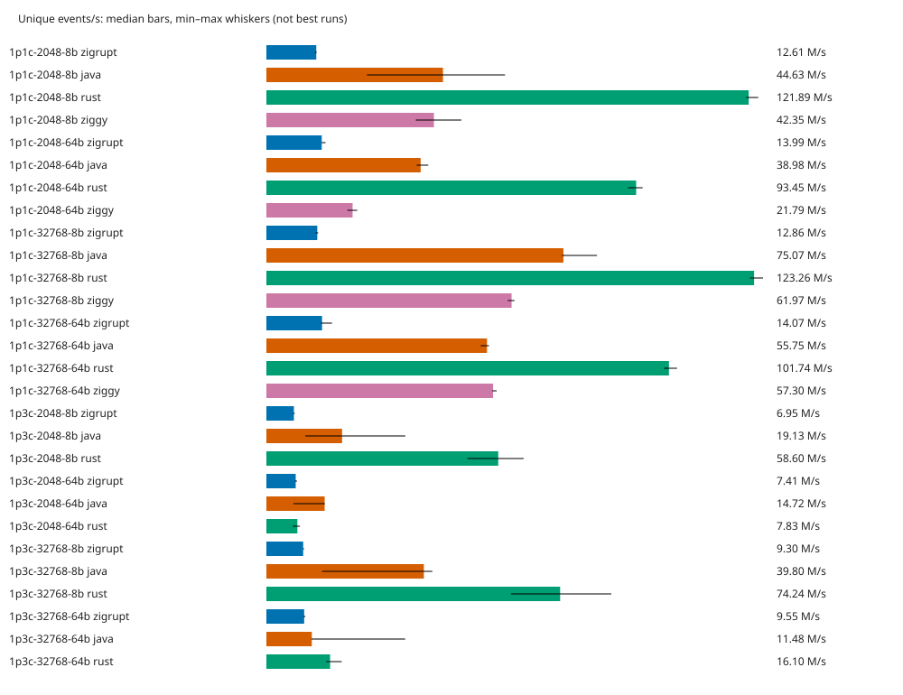

# Zigrupt competitive baseline

Run: 2026-10-07T08:45:34.522313+00:00. Host-local baseline; not a universal ranking.

- Physical CPUs: `[0, 1, 2, 3]`; one worker per physical core, fixed producer-then-consumer placement.
- 56 correctness cases passed; 0 invalid runs; 28 implementation/workload combinations blocked.
- 5 independent processes per measured cell, seeded randomized order. Target measurement 1.0 s; warmup 2.0 s (event counts calibrated, actual durations in JSON).
- Results are **median [minimum–maximum]**. Wins/losses require disjoint observed ranges and complete, valid repeats; overlapping ranges are inconclusive. This is not a confidence interval or a significance test.
- Runs shorter than 0.5 s, with warmup shorter than 0.5 s, or with measured JVM compilation activity cannot support wins/losses. Invalid runs are never ranked.
- Ratios are **Zigrupt / competitor**: throughput >1 favors Zigrupt; latency <1 favors Zigrupt. Latency comparisons use the worst consumer per run.
- CPU is process CPU seconds / measured wall seconds; RSS is the executable's address-space high-water RSS (`VmHWM`) before teardown, excluding launcher memory before exec. Startup is excluded from throughput/CPU, not RSS. JVM heap is fixed and pre-touched at 256 MiB.
- No production code or competitor implementation was changed. See `../../SPEC.md` for payload, validation, schedule, native batching and producer-backoff details.

## Coverage

| Workload | Status |
|---|---|
| 1p1c-2048-8b | Measured (see quality and variability below) |
| 1p1c-2048-64b | Measured (see quality and variability below) |
| 1p1c-32768-8b | Measured (see quality and variability below) |
| 1p1c-32768-64b | Measured (see quality and variability below) |
| 4p1c-2048-8b | requires 5 physical cores; only 4 available |
| 4p1c-2048-64b | requires 5 physical cores; only 4 available |
| 4p1c-32768-8b | requires 5 physical cores; only 4 available |
| 4p1c-32768-64b | requires 5 physical cores; only 4 available |
| 1p3c-2048-8b | Measured (see quality and variability below) |
| 1p3c-2048-64b | Measured (see quality and variability below) |
| 1p3c-32768-8b | Measured (see quality and variability below) |
| 1p3c-32768-64b | Measured (see quality and variability below) |
| 3p3c-2048-8b | requires 6 physical cores; only 4 available |
| 3p3c-2048-64b | requires 6 physical cores; only 4 available |
| 3p3c-32768-8b | requires 6 physical cores; only 4 available |
| 3p3c-32768-64b | requires 6 physical cores; only 4 available |

## Throughput and resource costs

| Workload | Implementation | M unique events/s | M deliveries/s | CPU cores | Peak RSS MiB | Quality |
|---|---|---:|---:|---:|---:|---|
| 1p1c-2048-64b | java | 38.985 [37.974–40.920] | 38.985 [37.974–40.920] | 1.667 [1.649–1.764] | 313.344 [313.324–313.949] | rankable |
| 1p1c-2048-64b | rust | 93.450 [91.402–95.101] | 93.450 [91.402–95.101] | 2.001 [2.000–2.001] | 2.449 [2.352–2.473] | rankable |
| 1p1c-2048-64b | ziggy | 21.791 [20.472–22.958] | 21.791 [20.472–22.958] | 2.001 [2.000–2.001] | 2.602 [2.461–2.609] | rankable |
| 1p1c-2048-64b | zigrupt | 13.990 [13.959–14.943] | 13.990 [13.959–14.943] | 2.000 [1.998–2.000] | 3.156 [3.051–3.250] | rankable |
| 1p1c-2048-8b | java | 44.629 [25.385–60.305] | 44.629 [25.385–60.305] | 1.813 [1.733–1.984] | 313.398 [313.355–313.398] | inconclusive |
| 1p1c-2048-8b | rust | 121.890 [121.229–124.306] | 121.890 [121.229–124.306] | 2.000 [2.000–2.002] | 2.340 [2.324–2.438] | rankable |
| 1p1c-2048-8b | ziggy | 42.349 [37.765–49.269] | 42.349 [37.765–49.269] | 2.001 [2.000–2.004] | 2.547 [2.238–2.594] | rankable |
| 1p1c-2048-8b | zigrupt | 12.611 [12.254–12.695] | 12.611 [12.254–12.695] | 2.000 [2.000–2.003] | 3.012 [2.844–3.074] | rankable |
| 1p1c-32768-64b | java | 55.751 [54.176–56.259] | 55.751 [54.176–56.259] | 1.853 [1.812–1.861] | 313.332 [313.309–313.414] | inconclusive |
| 1p1c-32768-64b | rust | 101.736 [100.496–103.787] | 101.736 [100.496–103.787] | 2.001 [2.000–2.002] | 4.324 [4.223–4.422] | rankable |
| 1p1c-32768-64b | ziggy | 57.296 [57.058–58.194] | 57.296 [57.058–58.194] | 2.000 [2.000–2.003] | 6.363 [6.109–6.406] | rankable |
| 1p1c-32768-64b | zigrupt | 14.071 [13.763–16.593] | 14.071 [13.763–16.593] | 2.000 [2.000–2.001] | 5.277 [5.125–5.348] | rankable |
| 1p1c-32768-8b | java | 75.066 [74.701–83.551] | 75.066 [74.701–83.551] | 1.926 [1.719–1.932] | 313.336 [313.309–313.441] | inconclusive |
| 1p1c-32768-8b | rust | 123.257 [122.206–125.516] | 123.257 [122.206–125.516] | 2.001 [2.000–2.002] | 2.574 [2.465–2.664] | rankable |
| 1p1c-32768-8b | ziggy | 61.970 [60.991–62.703] | 61.970 [60.991–62.703] | 2.001 [2.000–2.003] | 6.223 [6.059–6.266] | rankable |
| 1p1c-32768-8b | zigrupt | 12.856 [12.454–13.075] | 12.856 [12.454–13.075] | 2.001 [2.000–2.003] | 3.523 [3.520–3.555] | rankable |
| 1p3c-2048-64b | java | 14.722 [6.835–14.778] | 44.167 [20.505–44.335] | 3.513 [3.391–4.001] | 314.215 [313.590–314.320] | rankable |
| 1p3c-2048-64b | rust | 7.829 [6.669–8.462] | 23.487 [20.008–25.387] | 4.003 [4.000–4.009] | 2.504 [2.469–2.570] | rankable |
| 1p3c-2048-64b | zigrupt | 7.410 [7.185–7.735] | 22.229 [21.554–23.204] | 4.001 [4.000–4.003] | 3.574 [3.465–3.707] | rankable |
| 1p3c-2048-8b | java | 19.128 [9.851–35.124] | 57.385 [29.553–105.373] | 3.938 [3.788–4.007] | 314.191 [313.562–314.500] | inconclusive |
| 1p3c-2048-8b | rust | 58.597 [50.823–65.007] | 175.790 [152.469–195.022] | 4.003 [4.000–4.004] | 2.363 [2.293–2.379] | rankable |
| 1p3c-2048-8b | zigrupt | 6.954 [6.730–7.153] | 20.862 [20.191–21.459] | 4.002 [4.000–4.002] | 3.574 [3.516–3.605] | rankable |
| 1p3c-32768-64b | java | 11.477 [11.366–35.085] | 34.430 [34.097–105.254] | 3.886 [3.846–3.934] | 314.727 [314.117–314.867] | inconclusive |
| 1p3c-32768-64b | rust | 16.101 [15.139–19.036] | 48.302 [45.416–57.109] | 4.009 [4.000–4.017] | 4.352 [4.242–4.391] | rankable |
| 1p3c-32768-64b | zigrupt | 9.549 [9.367–9.829] | 28.647 [28.100–29.487] | 4.002 [4.001–4.002] | 5.770 [5.742–5.879] | rankable |
| 1p3c-32768-8b | java | 39.799 [14.081–41.942] | 119.397 [42.244–125.825] | 3.866 [3.859–3.996] | 314.531 [314.055–314.859] | inconclusive |
| 1p3c-32768-8b | rust | 74.240 [61.809–87.173] | 222.720 [185.426–261.520] | 4.001 [4.000–4.001] | 2.586 [2.504–2.695] | rankable |
| 1p3c-32768-8b | zigrupt | 9.299 [9.250–9.547] | 27.898 [27.751–28.640] | 4.001 [3.999–4.004] | 4.066 [4.062–4.086] | rankable |

## Zigrupt ratios and outcomes

Each entry is ratio + outcome for Zigrupt. **Tradeoff** means opposite outcomes across throughput or latency metrics, not an overall winner.

| Workload | Competitor | Throughput | p99 @50% | p99.9 @50% | p99 @90% | p99.9 @90% | Tradeoff |
|---|---|---|---|---|---|---|---|
| 1p1c-2048-8b | java | 0.283× inconclusive | 0.950× win | 0.710× win | 0.983× inconclusive | 1.081× inconclusive | — |
| 1p1c-2048-8b | rust | 0.103× loss | 1.171× loss | 1.052× loss | 1.273× loss | 1.392× loss | — |
| 1p1c-2048-8b | ziggy | 0.298× loss | 1.009× inconclusive | 1.029× inconclusive | 0.790× win | 0.899× inconclusive | **yes** |
| 1p1c-2048-64b | java | 0.359× loss | 0.977× inconclusive | 0.869× win | 1.047× inconclusive | 1.078× loss | **yes** |
| 1p1c-2048-64b | rust | 0.150× loss | 1.106× loss | 1.087× inconclusive | 1.281× loss | 1.165× inconclusive | — |
| 1p1c-2048-64b | ziggy | 0.642× loss | 0.673× win | 0.679× win | 0.000× win | 0.000× win | **yes** |
| 1p1c-32768-8b | java | 0.171× inconclusive | 0.934× win | 0.819× win | 0.950× inconclusive | 1.045× inconclusive | — |
| 1p1c-32768-8b | rust | 0.104× loss | 1.112× loss | 1.045× loss | 1.254× loss | 1.442× loss | — |
| 1p1c-32768-8b | ziggy | 0.207× loss | 1.003× inconclusive | 0.930× win | 0.846× inconclusive | 0.910× win | **yes** |
| 1p1c-32768-64b | java | 0.252× inconclusive | 0.910× inconclusive | 0.818× inconclusive | 0.825× inconclusive | 0.924× inconclusive | — |
| 1p1c-32768-64b | rust | 0.138× loss | 1.130× loss | 1.141× loss | 1.218× inconclusive | 1.252× inconclusive | — |
| 1p1c-32768-64b | ziggy | 0.246× loss | 0.679× win | 0.694× inconclusive | 0.001× win | 0.002× win | **yes** |
| 4p1c-2048-8b | java | — inconclusive | — inconclusive | — inconclusive | — inconclusive | — inconclusive | — |
| 4p1c-2048-8b | rust | — inconclusive | — inconclusive | — inconclusive | — inconclusive | — inconclusive | — |
| 4p1c-2048-8b | ziggy | — inconclusive | — inconclusive | — inconclusive | — inconclusive | — inconclusive | — |
| 4p1c-2048-64b | java | — inconclusive | — inconclusive | — inconclusive | — inconclusive | — inconclusive | — |
| 4p1c-2048-64b | rust | — inconclusive | — inconclusive | — inconclusive | — inconclusive | — inconclusive | — |
| 4p1c-2048-64b | ziggy | — inconclusive | — inconclusive | — inconclusive | — inconclusive | — inconclusive | — |
| 4p1c-32768-8b | java | — inconclusive | — inconclusive | — inconclusive | — inconclusive | — inconclusive | — |
| 4p1c-32768-8b | rust | — inconclusive | — inconclusive | — inconclusive | — inconclusive | — inconclusive | — |
| 4p1c-32768-8b | ziggy | — inconclusive | — inconclusive | — inconclusive | — inconclusive | — inconclusive | — |
| 4p1c-32768-64b | java | — inconclusive | — inconclusive | — inconclusive | — inconclusive | — inconclusive | — |
| 4p1c-32768-64b | rust | — inconclusive | — inconclusive | — inconclusive | — inconclusive | — inconclusive | — |
| 4p1c-32768-64b | ziggy | — inconclusive | — inconclusive | — inconclusive | — inconclusive | — inconclusive | — |
| 1p3c-2048-8b | java | 0.364× inconclusive | 0.983× inconclusive | 0.864× win | 8.439× inconclusive | 6.971× inconclusive | — |
| 1p3c-2048-8b | rust | 0.119× loss | 1.197× loss | 1.083× loss | 11.221× loss | 27.645× loss | — |
| 1p3c-2048-64b | java | 0.503× inconclusive | 0.770× inconclusive | 0.847× inconclusive | 0.061× inconclusive | 0.088× inconclusive | — |
| 1p3c-2048-64b | rust | 0.946× inconclusive | 0.894× inconclusive | 0.928× inconclusive | 0.118× win | 0.128× inconclusive | **yes** |
| 1p3c-32768-8b | java | 0.234× inconclusive | 0.001× inconclusive | 0.001× inconclusive | 0.829× inconclusive | 35.844× inconclusive | — |
| 1p3c-32768-8b | rust | 0.125× loss | 1.005× inconclusive | 1.122× loss | 1.212× inconclusive | 75.038× loss | **yes** |
| 1p3c-32768-64b | java | 0.832× inconclusive | 1.000× inconclusive | 0.801× win | 394.253× loss | 38.014× loss | **yes** |
| 1p3c-32768-64b | rust | 0.593× loss | 0.990× inconclusive | 0.932× inconclusive | 6.098× loss | 3.846× loss | — |
| 3p3c-2048-8b | java | — inconclusive | — inconclusive | — inconclusive | — inconclusive | — inconclusive | — |
| 3p3c-2048-8b | rust | — inconclusive | — inconclusive | — inconclusive | — inconclusive | — inconclusive | — |
| 3p3c-2048-64b | java | — inconclusive | — inconclusive | — inconclusive | — inconclusive | — inconclusive | — |
| 3p3c-2048-64b | rust | — inconclusive | — inconclusive | — inconclusive | — inconclusive | — inconclusive | — |
| 3p3c-32768-8b | java | — inconclusive | — inconclusive | — inconclusive | — inconclusive | — inconclusive | — |
| 3p3c-32768-8b | rust | — inconclusive | — inconclusive | — inconclusive | — inconclusive | — inconclusive | — |
| 3p3c-32768-64b | java | — inconclusive | — inconclusive | — inconclusive | — inconclusive | — inconclusive | — |
| 3p3c-32768-64b | rust | — inconclusive | — inconclusive | — inconclusive | — inconclusive | — inconclusive | — |

## Scheduled-arrival latency

All values below are microseconds, median [min–max] across runs. Histograms report bucket upper bounds (≤0.2% relative quantization error above 1 µs; exact below 1,024 ns). **Worst** is the max consumer per run, not a merged histogram. Rates come from `rates.json`, independently per workload, using the slowest median saturation throughput.

| Workload | Implementation | Load | Offered events/s | Consumer | p50 µs | p99 µs | p99.9 µs |
|---|---|---:|---:|---|---:|---:|---:|
| 1p1c-2048-64b | java | 50% | 6995154 | 0 | 0.230 [0.227–0.252] | 2.735 [2.607–2.811] | 4.351 [4.295–4.503] |
| 1p1c-2048-64b | java | 50% | 6995154 | **worst** | 0.230 [0.227–0.252] | 2.735 [2.607–2.811] | 4.351 [4.295–4.503] |
| 1p1c-2048-64b | java | 90% | 12591278 | 0 | 0.285 [0.268–0.339] | 4.287 [3.767–4.431] | 5.863 [5.583–6.103] |
| 1p1c-2048-64b | java | 90% | 12591278 | **worst** | 0.285 [0.268–0.339] | 4.287 [3.767–4.431] | 5.863 [5.583–6.103] |
| 1p1c-2048-64b | rust | 50% | 6995154 | 0 | 0.193 [0.192–0.219] | 2.415 [2.331–2.499] | 3.479 [3.435–3.779] |
| 1p1c-2048-64b | rust | 50% | 6995154 | **worst** | 0.193 [0.192–0.219] | 2.415 [2.331–2.499] | 3.479 [3.435–3.779] |
| 1p1c-2048-64b | rust | 90% | 12591278 | 0 | 0.281 [0.277–0.290] | 3.503 [3.439–3.847] | 5.423 [5.231–75.007] |
| 1p1c-2048-64b | rust | 90% | 12591278 | **worst** | 0.281 [0.277–0.290] | 3.503 [3.439–3.847] | 5.423 [5.231–75.007] |
| 1p1c-2048-64b | ziggy | 50% | 6995154 | 0 | 0.187 [0.184–0.191] | 3.971 [3.951–4.011] | 5.575 [5.543–7.031] |
| 1p1c-2048-64b | ziggy | 50% | 6995154 | **worst** | 0.187 [0.184–0.191] | 3.971 [3.951–4.011] | 5.575 [5.543–7.031] |
| 1p1c-2048-64b | ziggy | 90% | 12591278 | 0 | 25460.735 [381.439–117047.295] | 48431.103 [1521.663–236978.175] | 48889.855 [2166.783–238026.751] |
| 1p1c-2048-64b | ziggy | 90% | 12591278 | **worst** | 25460.735 [381.439–117047.295] | 48431.103 [1521.663–236978.175] | 48889.855 [2166.783–238026.751] |
| 1p1c-2048-64b | zigrupt | 50% | 6995154 | 0 | 0.212 [0.210–0.216] | 2.671 [2.643–2.803] | 3.783 [3.687–3.979] |
| 1p1c-2048-64b | zigrupt | 50% | 6995154 | **worst** | 0.212 [0.210–0.216] | 2.671 [2.643–2.803] | 3.783 [3.687–3.979] |
| 1p1c-2048-64b | zigrupt | 90% | 12591278 | 0 | 0.282 [0.271–0.296] | 4.487 [4.119–4.719] | 6.319 [6.127–6.663] |
| 1p1c-2048-64b | zigrupt | 90% | 12591278 | **worst** | 0.282 [0.271–0.296] | 4.487 [4.119–4.719] | 6.319 [6.127–6.663] |
| 1p1c-2048-8b | java | 50% | 6305546 | 0 | 0.212 [0.210–0.230] | 2.715 [2.655–2.979] | 5.015 [4.839–2404.351] |
| 1p1c-2048-8b | java | 50% | 6305546 | **worst** | 0.212 [0.210–0.230] | 2.715 [2.655–2.979] | 5.015 [4.839–2404.351] |
| 1p1c-2048-8b | java | 90% | 11349983 | 0 | 0.266 [0.263–0.298] | 3.515 [3.327–3.611] | 5.063 [4.903–30.303] |
| 1p1c-2048-8b | java | 90% | 11349983 | **worst** | 0.266 [0.263–0.298] | 3.515 [3.327–3.611] | 5.063 [4.903–30.303] |
| 1p1c-2048-8b | rust | 50% | 6305546 | 0 | 0.185 [0.181–0.187] | 2.203 [2.127–2.307] | 3.383 [3.315–3.439] |
| 1p1c-2048-8b | rust | 50% | 6305546 | **worst** | 0.185 [0.181–0.187] | 2.203 [2.127–2.307] | 3.383 [3.315–3.439] |
| 1p1c-2048-8b | rust | 90% | 11349983 | 0 | 0.210 [0.195–0.244] | 2.715 [2.555–2.843] | 3.931 [3.719–4.031] |
| 1p1c-2048-8b | rust | 90% | 11349983 | **worst** | 0.210 [0.195–0.244] | 2.715 [2.555–2.843] | 3.931 [3.719–4.031] |
| 1p1c-2048-8b | ziggy | 50% | 6305546 | 0 | 0.166 [0.165–0.167] | 2.555 [2.515–2.699] | 3.459 [3.435–521.215] |
| 1p1c-2048-8b | ziggy | 50% | 6305546 | **worst** | 0.166 [0.165–0.167] | 2.555 [2.515–2.699] | 3.459 [3.435–521.215] |
| 1p1c-2048-8b | ziggy | 90% | 11349983 | 0 | 0.181 [0.181–0.185] | 4.375 [4.191–4.735] | 6.087 [5.831–6.727] |
| 1p1c-2048-8b | ziggy | 90% | 11349983 | **worst** | 0.181 [0.181–0.185] | 4.375 [4.191–4.735] | 6.087 [5.831–6.727] |
| 1p1c-2048-8b | zigrupt | 50% | 6305546 | 0 | 0.213 [0.212–0.216] | 2.579 [2.467–2.615] | 3.559 [3.503–4.019] |
| 1p1c-2048-8b | zigrupt | 50% | 6305546 | **worst** | 0.213 [0.212–0.216] | 2.579 [2.467–2.615] | 3.559 [3.503–4.019] |
| 1p1c-2048-8b | zigrupt | 90% | 11349983 | 0 | 0.236 [0.232–0.249] | 3.455 [3.371–3.935] | 5.471 [5.351–6.311] |
| 1p1c-2048-8b | zigrupt | 90% | 11349983 | **worst** | 0.236 [0.232–0.249] | 3.455 [3.371–3.935] | 5.471 [5.351–6.311] |
| 1p1c-32768-64b | java | 50% | 7035341 | 0 | 0.251 [0.236–0.269] | 3.011 [2.711–3.631] | 4.959 [4.679–5.519] |
| 1p1c-32768-64b | java | 50% | 7035341 | **worst** | 0.251 [0.236–0.269] | 3.011 [2.711–3.631] | 4.959 [4.679–5.519] |
| 1p1c-32768-64b | java | 90% | 12663613 | 0 | 0.350 [0.320–0.384] | 4.903 [4.455–5.111] | 6.919 [6.615–91.135] |
| 1p1c-32768-64b | java | 90% | 12663613 | **worst** | 0.350 [0.320–0.384] | 4.903 [4.455–5.111] | 6.919 [6.615–91.135] |
| 1p1c-32768-64b | rust | 50% | 7035341 | 0 | 0.200 [0.193–0.219] | 2.423 [2.279–2.563] | 3.555 [3.479–3.659] |
| 1p1c-32768-64b | rust | 50% | 7035341 | **worst** | 0.200 [0.193–0.219] | 2.423 [2.279–2.563] | 3.555 [3.479–3.659] |
| 1p1c-32768-64b | rust | 90% | 12663613 | 0 | 0.265 [0.263–0.290] | 3.323 [3.107–3.963] | 5.103 [5.071–843.775] |
| 1p1c-32768-64b | rust | 90% | 12663613 | **worst** | 0.265 [0.263–0.290] | 3.323 [3.107–3.963] | 5.103 [5.071–843.775] |
| 1p1c-32768-64b | ziggy | 50% | 7035341 | 0 | 0.185 [0.180–0.266] | 4.031 [3.491–1961.983] | 5.847 [5.551–2510.847] |
| 1p1c-32768-64b | ziggy | 50% | 7035341 | **worst** | 0.185 [0.180–0.266] | 4.031 [3.491–1961.983] | 5.847 [5.551–2510.847] |
| 1p1c-32768-64b | ziggy | 90% | 12663613 | 0 | 525.311 [61.183–719.871] | 3260.415 [215.551–5439.487] | 3969.023 [251.647–6283.263] |
| 1p1c-32768-64b | ziggy | 90% | 12663613 | **worst** | 525.311 [61.183–719.871] | 3260.415 [215.551–5439.487] | 3969.023 [251.647–6283.263] |
| 1p1c-32768-64b | zigrupt | 50% | 7035341 | 0 | 0.214 [0.212–0.215] | 2.739 [2.711–2.851] | 4.055 [3.783–715.775] |
| 1p1c-32768-64b | zigrupt | 50% | 7035341 | **worst** | 0.214 [0.212–0.215] | 2.739 [2.711–2.851] | 4.055 [3.783–715.775] |
| 1p1c-32768-64b | zigrupt | 90% | 12663613 | 0 | 0.271 [0.261–0.282] | 4.047 [3.919–4.607] | 6.391 [6.159–6.775] |
| 1p1c-32768-64b | zigrupt | 90% | 12663613 | **worst** | 0.271 [0.261–0.282] | 4.047 [3.919–4.607] | 6.391 [6.159–6.775] |
| 1p1c-32768-8b | java | 50% | 6428164 | 0 | 0.219 [0.214–0.223] | 2.715 [2.663–2.867] | 4.311 [4.239–6.327] |
| 1p1c-32768-8b | java | 50% | 6428164 | **worst** | 0.219 [0.214–0.223] | 2.715 [2.663–2.867] | 4.311 [4.239–6.327] |
| 1p1c-32768-8b | java | 90% | 11570696 | 0 | 0.299 [0.293–0.313] | 3.663 [3.555–4.199] | 5.359 [5.271–752.639] |
| 1p1c-32768-8b | java | 90% | 11570696 | **worst** | 0.299 [0.293–0.313] | 3.663 [3.555–4.199] | 5.359 [5.271–752.639] |
| 1p1c-32768-8b | rust | 50% | 6428164 | 0 | 0.184 [0.175–0.188] | 2.279 [2.203–2.307] | 3.379 [3.359–3.399] |
| 1p1c-32768-8b | rust | 50% | 6428164 | **worst** | 0.184 [0.175–0.188] | 2.279 [2.203–2.307] | 3.379 [3.359–3.399] |
| 1p1c-32768-8b | rust | 90% | 11570696 | 0 | 0.222 [0.213–0.250] | 2.775 [2.707–2.951] | 3.883 [3.827–4.159] |
| 1p1c-32768-8b | rust | 90% | 11570696 | **worst** | 0.222 [0.213–0.250] | 2.775 [2.707–2.951] | 3.883 [3.827–4.159] |
| 1p1c-32768-8b | ziggy | 50% | 6428164 | 0 | 0.165 [0.163–0.166] | 2.527 [2.455–2.759] | 3.795 [3.615–5.335] |
| 1p1c-32768-8b | ziggy | 50% | 6428164 | **worst** | 0.165 [0.163–0.166] | 2.527 [2.455–2.759] | 3.795 [3.615–5.335] |
| 1p1c-32768-8b | ziggy | 90% | 11570696 | 0 | 0.177 [0.176–0.183] | 4.111 [3.655–4.695] | 6.151 [5.847–6.719] |
| 1p1c-32768-8b | ziggy | 90% | 11570696 | **worst** | 0.177 [0.176–0.183] | 4.111 [3.655–4.695] | 6.151 [5.847–6.719] |
| 1p1c-32768-8b | zigrupt | 50% | 6428164 | 0 | 0.213 [0.209–0.214] | 2.535 [2.387–2.619] | 3.531 [3.507–3.543] |
| 1p1c-32768-8b | zigrupt | 50% | 6428164 | **worst** | 0.213 [0.209–0.214] | 2.535 [2.387–2.619] | 3.531 [3.507–3.543] |
| 1p1c-32768-8b | zigrupt | 90% | 11570696 | 0 | 0.239 [0.232–0.243] | 3.479 [3.395–3.659] | 5.599 [5.487–5.671] |
| 1p1c-32768-8b | zigrupt | 90% | 11570696 | **worst** | 0.239 [0.232–0.243] | 3.479 [3.395–3.659] | 5.599 [5.487–5.671] |
| 1p3c-2048-64b | java | 50% | 3704791 | 0 | 0.359 [0.308–0.381] | 2.847 [2.679–3.043] | 5.415 [5.311–5.743] |
| 1p3c-2048-64b | java | 50% | 3704791 | 1 | 0.380 [0.308–0.551] | 3.051 [2.843–5.007] | 5.439 [5.303–7.999] |
| 1p3c-2048-64b | java | 50% | 3704791 | 2 | 0.381 [0.306–0.505] | 3.059 [2.851–4.127] | 5.447 [5.319–7.007] |
| 1p3c-2048-64b | java | 50% | 3704791 | **worst** | 0.381 [0.308–0.551] | 3.059 [2.851–5.007] | 5.447 [5.319–7.999] |
| 1p3c-2048-64b | java | 90% | 6668624 | 0 | 23.743 [0.601–36.927] | 153.087 [8.207–242.687] | 223.231 [16.015–375.807] |
| 1p3c-2048-64b | java | 90% | 6668624 | 1 | 119.679 [0.590–134.143] | 228.095 [8.223–319.999] | 285.695 [16.063–438.271] |
| 1p3c-2048-64b | java | 90% | 6668624 | 2 | 185.855 [0.592–195.839] | 287.231 [8.223–410.111] | 336.383 [16.047–512.511] |
| 1p3c-2048-64b | java | 90% | 6668624 | **worst** | 185.855 [0.601–195.839] | 287.231 [8.223–410.111] | 336.383 [16.063–512.511] |
| 1p3c-2048-64b | rust | 50% | 3704791 | 0 | 0.274 [0.270–0.277] | 2.219 [2.139–2.735] | 4.727 [4.447–4.903] |
| 1p3c-2048-64b | rust | 50% | 3704791 | 1 | 0.271 [0.266–0.280] | 2.499 [2.215–2.739] | 4.751 [4.639–4.895] |
| 1p3c-2048-64b | rust | 50% | 3704791 | 2 | 0.266 [0.263–0.283] | 2.563 [2.175–2.915] | 4.975 [4.503–5.095] |
| 1p3c-2048-64b | rust | 50% | 3704791 | **worst** | 0.277 [0.270–0.283] | 2.635 [2.499–2.915] | 4.975 [4.639–5.095] |
| 1p3c-2048-64b | rust | 90% | 6668624 | 0 | 10.687 [3.343–17.727] | 147.199 [40.255–658.431] | 230.143 [66.815–1003.519] |
| 1p3c-2048-64b | rust | 90% | 6668624 | 1 | 10.671 [3.363–17.823] | 147.199 [40.255–658.431] | 230.143 [66.943–1003.519] |
| 1p3c-2048-64b | rust | 90% | 6668624 | 2 | 10.671 [3.343–17.791] | 147.199 [40.191–658.431] | 230.143 [66.815–1003.519] |
| 1p3c-2048-64b | rust | 90% | 6668624 | **worst** | 10.687 [3.363–17.823] | 147.199 [40.255–658.431] | 230.143 [66.943–1003.519] |
| 1p3c-2048-64b | zigrupt | 50% | 3704791 | 0 | 0.316 [0.308–0.324] | 1.885 [1.681–3.203] | 4.127 [3.927–134.143] |
| 1p3c-2048-64b | zigrupt | 50% | 3704791 | 1 | 0.318 [0.310–0.328] | 1.925 [1.719–2.871] | 4.199 [4.103–134.143] |
| 1p3c-2048-64b | zigrupt | 50% | 3704791 | 2 | 0.319 [0.310–0.329] | 2.355 [1.675–2.855] | 4.615 [3.875–134.143] |
| 1p3c-2048-64b | zigrupt | 50% | 3704791 | **worst** | 0.319 [0.310–0.329] | 2.355 [2.239–3.203] | 4.615 [4.399–134.143] |
| 1p3c-2048-64b | zigrupt | 90% | 6668624 | 0 | 0.822 [0.415–0.867] | 17.375 [7.175–27.295] | 29.375 [10.367–1380.351] |
| 1p3c-2048-64b | zigrupt | 90% | 6668624 | 1 | 0.838 [0.418–0.873] | 17.407 [7.159–27.295] | 29.471 [10.319–1380.351] |
| 1p3c-2048-64b | zigrupt | 90% | 6668624 | 2 | 0.832 [0.421–0.882] | 17.375 [7.143–27.327] | 29.407 [10.303–1380.351] |
| 1p3c-2048-64b | zigrupt | 90% | 6668624 | **worst** | 0.838 [0.421–0.882] | 17.407 [7.175–27.327] | 29.471 [10.367–1380.351] |
| 1p3c-2048-8b | java | 50% | 3476971 | 0 | 0.309 [0.306–0.386] | 2.311 [1.927–2.683] | 5.063 [3.491–5.287] |
| 1p3c-2048-8b | java | 50% | 3476971 | 1 | 0.295 [0.291–0.380] | 2.303 [1.753–2.659] | 5.239 [3.383–5.319] |
| 1p3c-2048-8b | java | 50% | 3476971 | 2 | 0.294 [0.291–0.382] | 2.643 [2.187–2.663] | 5.343 [4.839–6.207] |
| 1p3c-2048-8b | java | 50% | 3476971 | **worst** | 0.309 [0.306–0.386] | 2.643 [2.263–2.683] | 5.343 [4.839–6.207] |
| 1p3c-2048-8b | java | 90% | 6258548 | 0 | 0.527 [0.505–0.538] | 2.947 [2.735–3.895] | 13.663 [10.655–142.847] |
| 1p3c-2048-8b | java | 90% | 6258548 | 1 | 0.518 [0.505–0.539] | 3.655 [2.663–3.807] | 19.199 [9.951–148.223] |
| 1p3c-2048-8b | java | 90% | 6258548 | 2 | 0.519 [0.510–0.527] | 2.883 [2.683–3.759] | 21.247 [10.383–148.735] |
| 1p3c-2048-8b | java | 90% | 6258548 | **worst** | 0.530 [0.511–0.539] | 3.807 [3.671–3.895] | 21.887 [10.655–148.735] |
| 1p3c-2048-8b | rust | 50% | 3476971 | 0 | 0.245 [0.238–0.263] | 1.979 [1.173–2.203] | 4.167 [3.343–4.303] |
| 1p3c-2048-8b | rust | 50% | 3476971 | 1 | 0.257 [0.248–0.258] | 1.727 [1.249–1.855] | 3.839 [3.287–4.063] |
| 1p3c-2048-8b | rust | 50% | 3476971 | 2 | 0.259 [0.249–0.266] | 1.701 [1.151–2.175] | 3.835 [3.287–4.367] |
| 1p3c-2048-8b | rust | 50% | 3476971 | **worst** | 0.261 [0.249–0.266] | 2.171 [1.855–2.203] | 4.263 [4.063–4.367] |
| 1p3c-2048-8b | rust | 90% | 6258548 | 0 | 0.429 [0.401–0.443] | 2.519 [2.051–3.083] | 5.175 [4.775–5.767] |
| 1p3c-2048-8b | rust | 90% | 6258548 | 1 | 0.425 [0.394–0.450] | 2.783 [2.139–2.951] | 5.519 [4.959–5.863] |
| 1p3c-2048-8b | rust | 90% | 6258548 | 2 | 0.422 [0.395–0.442] | 2.383 [2.033–2.807] | 5.271 [4.775–5.831] |
| 1p3c-2048-8b | rust | 90% | 6258548 | **worst** | 0.429 [0.401–0.450] | 2.863 [2.575–3.083] | 5.519 [4.959–5.863] |
| 1p3c-2048-8b | zigrupt | 50% | 3476971 | 0 | 0.320 [0.316–0.326] | 2.571 [2.227–2.779] | 4.607 [4.511–4.815] |
| 1p3c-2048-8b | zigrupt | 50% | 3476971 | 1 | 0.322 [0.318–0.330] | 2.307 [2.103–2.775] | 4.503 [4.367–4.823] |
| 1p3c-2048-8b | zigrupt | 50% | 3476971 | 2 | 0.324 [0.320–0.332] | 2.223 [2.123–2.771] | 4.479 [4.399–4.799] |
| 1p3c-2048-8b | zigrupt | 50% | 3476971 | **worst** | 0.324 [0.320–0.332] | 2.599 [2.511–2.779] | 4.615 [4.583–4.823] |
| 1p3c-2048-8b | zigrupt | 90% | 6258548 | 0 | 0.435 [0.325–0.482] | 31.871 [6.087–123.519] | 152.575 [9.167–251.903] |
| 1p3c-2048-8b | zigrupt | 90% | 6258548 | 1 | 0.436 [0.328–0.486] | 32.127 [6.071–123.519] | 152.319 [9.183–252.159] |
| 1p3c-2048-8b | zigrupt | 90% | 6258548 | 2 | 0.434 [0.328–0.484] | 31.871 [6.071–123.519] | 152.575 [9.327–251.903] |
| 1p3c-2048-8b | zigrupt | 90% | 6258548 | **worst** | 0.436 [0.328–0.486] | 32.127 [6.087–123.519] | 152.575 [9.327–252.159] |
| 1p3c-32768-64b | java | 50% | 4774483 | 0 | 0.392 [0.370–0.473] | 2.303 [1.547–3.347] | 5.599 [5.175–1015.807] |
| 1p3c-32768-64b | java | 50% | 4774483 | 1 | 0.381 [0.370–0.425] | 2.223 [0.958–3.363] | 5.071 [4.727–1014.783] |
| 1p3c-32768-64b | java | 50% | 4774483 | 2 | 0.376 [0.371–0.429] | 3.047 [2.599–3.479] | 6.719 [6.311–1015.807] |
| 1p3c-32768-64b | java | 50% | 4774483 | **worst** | 0.392 [0.371–0.473] | 3.047 [2.599–3.479] | 6.719 [6.311–1015.807] |
| 1p3c-32768-64b | java | 90% | 8594070 | 0 | 0.706 [0.647–0.822] | 7.823 [6.431–548.863] | 91.263 [11.839–1130.495] |
| 1p3c-32768-64b | java | 90% | 8594070 | 1 | 0.700 [0.624–0.778] | 7.831 [6.327–548.863] | 91.007 [11.727–1132.543] |
| 1p3c-32768-64b | java | 90% | 8594070 | 2 | 0.714 [0.629–0.831] | 7.927 [6.943–549.887] | 91.007 [13.439–1136.639] |
| 1p3c-32768-64b | java | 90% | 8594070 | **worst** | 0.714 [0.647–0.831] | 7.927 [6.943–549.887] | 91.263 [13.439–1136.639] |
| 1p3c-32768-64b | rust | 50% | 4774483 | 0 | 0.277 [0.241–0.318] | 2.995 [2.543–3.079] | 5.735 [5.439–5.927] |
| 1p3c-32768-64b | rust | 50% | 4774483 | 1 | 0.270 [0.242–0.323] | 2.707 [2.655–3.347] | 5.775 [5.319–6.079] |
| 1p3c-32768-64b | rust | 50% | 4774483 | 2 | 0.270 [0.248–0.323] | 2.719 [2.355–3.119] | 5.647 [5.407–5.927] |
| 1p3c-32768-64b | rust | 50% | 4774483 | **worst** | 0.277 [0.248–0.323] | 3.079 [2.659–3.347] | 5.775 [5.439–6.079] |
| 1p3c-32768-64b | rust | 90% | 8594070 | 0 | 9.455 [3.951–11.663] | 511.999 [174.847–683.007] | 902.143 [285.695–1124.351] |
| 1p3c-32768-64b | rust | 90% | 8594070 | 1 | 9.423 [4.027–11.599] | 512.511 [174.847–683.007] | 902.143 [285.695–1124.351] |
| 1p3c-32768-64b | rust | 90% | 8594070 | 2 | 9.551 [3.987–11.615] | 512.511 [174.847–684.031] | 902.143 [286.207–1126.399] |
| 1p3c-32768-64b | rust | 90% | 8594070 | **worst** | 9.551 [4.027–11.663] | 512.511 [174.847–684.031] | 902.143 [286.207–1126.399] |
| 1p3c-32768-64b | zigrupt | 50% | 4774483 | 0 | 0.308 [0.304–0.314] | 2.747 [2.595–3.031] | 5.215 [5.183–5.583] |
| 1p3c-32768-64b | zigrupt | 50% | 4774483 | 1 | 0.309 [0.304–0.315] | 2.971 [2.735–3.155] | 5.335 [5.207–6.015] |
| 1p3c-32768-64b | zigrupt | 50% | 4774483 | 2 | 0.310 [0.305–0.317] | 2.875 [2.659–3.091] | 5.359 [5.223–5.687] |
| 1p3c-32768-64b | zigrupt | 50% | 4774483 | **worst** | 0.310 [0.305–0.317] | 3.047 [2.955–3.155] | 5.383 [5.335–6.015] |
| 1p3c-32768-64b | zigrupt | 90% | 8594070 | 0 | 32.575 [5.191–252.159] | 3125.247 [2453.503–3227.647] | 3469.311 [3006.463–4087.807] |
| 1p3c-32768-64b | zigrupt | 90% | 8594070 | 1 | 32.575 [5.255–252.159] | 3125.247 [2453.503–3227.647] | 3469.311 [3006.463–4087.807] |
| 1p3c-32768-64b | zigrupt | 90% | 8594070 | 2 | 32.575 [5.207–252.159] | 3125.247 [2453.503–3227.647] | 3469.311 [3006.463–4087.807] |
| 1p3c-32768-64b | zigrupt | 90% | 8594070 | **worst** | 32.575 [5.255–252.159] | 3125.247 [2453.503–3227.647] | 3469.311 [3006.463–4087.807] |
| 1p3c-32768-8b | java | 50% | 4649584 | 0 | 0.396 [0.376–0.411] | 213.247 [2.017–279.551] | 430.591 [3.963–3371.007] |
| 1p3c-32768-8b | java | 50% | 4649584 | 1 | 3727.359 [7.695–3756.031] | 4243.455 [2174.975–4382.719] | 4358.143 [2527.231–4538.367] |
| 1p3c-32768-8b | java | 50% | 4649584 | 2 | 45.439 [0.976–124.415] | 411.647 [5.975–1027.071] | 523.775 [12.463–3567.615] |
| 1p3c-32768-8b | java | 50% | 4649584 | **worst** | 3727.359 [7.695–3756.031] | 4243.455 [2174.975–4382.719] | 4358.143 [2527.231–4538.367] |
| 1p3c-32768-8b | java | 90% | 8369252 | 0 | 0.682 [0.630–63832.063] | 5.087 [3.867–139460.607] | 12.079 [7.239–141295.615] |
| 1p3c-32768-8b | java | 90% | 8369252 | 1 | 0.552 [0.521–66912.255] | 4.287 [3.291–142344.191] | 8.135 [6.895–143917.055] |
| 1p3c-32768-8b | java | 90% | 8369252 | 2 | 0.552 [0.526–63963.135] | 4.407 [3.923–139460.607] | 8.495 [6.879–141295.615] |
| 1p3c-32768-8b | java | 90% | 8369252 | **worst** | 0.682 [0.630–66912.255] | 5.087 [4.335–142344.191] | 12.927 [7.239–143917.055] |
| 1p3c-32768-8b | rust | 50% | 4649584 | 0 | 0.266 [0.263–0.275] | 2.183 [1.899–2.395] | 4.447 [4.239–4.663] |
| 1p3c-32768-8b | rust | 50% | 4649584 | 1 | 0.266 [0.264–0.268] | 2.271 [1.693–2.463] | 4.487 [3.999–4.879] |
| 1p3c-32768-8b | rust | 50% | 4649584 | 2 | 0.268 [0.263–0.273] | 1.965 [1.627–2.115] | 4.287 [3.799–4.727] |
| 1p3c-32768-8b | rust | 50% | 4649584 | **worst** | 0.272 [0.268–0.275] | 2.395 [2.243–2.463] | 4.543 [4.383–4.879] |
| 1p3c-32768-8b | rust | 90% | 8369252 | 0 | 0.575 [0.570–0.590] | 3.383 [3.151–3.459] | 6.119 [5.983–6.335] |
| 1p3c-32768-8b | rust | 90% | 8369252 | 1 | 0.576 [0.565–0.614] | 3.447 [3.155–3.543] | 6.175 [5.999–6.359] |
| 1p3c-32768-8b | rust | 90% | 8369252 | 2 | 0.577 [0.565–0.601] | 3.299 [3.163–3.699] | 6.119 [5.983–6.687] |
| 1p3c-32768-8b | rust | 90% | 8369252 | **worst** | 0.577 [0.570–0.614] | 3.479 [3.383–3.699] | 6.175 [6.119–6.687] |
| 1p3c-32768-8b | zigrupt | 50% | 4649584 | 0 | 0.286 [0.283–0.292] | 1.917 [1.795–3.023] | 4.959 [4.775–5.335] |
| 1p3c-32768-8b | zigrupt | 50% | 4649584 | 1 | 0.287 [0.284–0.292] | 2.407 [2.383–3.023] | 5.095 [5.015–5.335] |
| 1p3c-32768-8b | zigrupt | 50% | 4649584 | 2 | 0.288 [0.285–0.294] | 1.917 [1.801–3.011] | 4.943 [4.767–5.311] |
| 1p3c-32768-8b | zigrupt | 50% | 4649584 | **worst** | 0.288 [0.285–0.294] | 2.407 [2.383–3.023] | 5.095 [5.015–5.335] |
| 1p3c-32768-8b | zigrupt | 90% | 8369252 | 0 | 0.273 [0.255–0.296] | 4.207 [0.644–304.639] | 463.359 [84.223–1282.047] |
| 1p3c-32768-8b | zigrupt | 90% | 8369252 | 1 | 0.272 [0.253–0.301] | 4.215 [0.650–305.151] | 463.359 [84.223–1282.047] |
| 1p3c-32768-8b | zigrupt | 90% | 8369252 | 2 | 0.278 [0.259–0.297] | 4.191 [2.119–304.639] | 463.359 [84.223–1282.047] |
| 1p3c-32768-8b | zigrupt | 90% | 8369252 | **worst** | 0.278 [0.259–0.301] | 4.215 [2.119–305.151] | 463.359 [84.223–1282.047] |

## Latency resource costs and allocation/GC evidence

Native allocation counts: Rust global allocator calls; Zig allocator supplied to the bus (measurement arrays allocated before warmup). Java: worker-thread allocated bytes, not total JVM/native allocation. These are different scopes, not interchangeable allocation counters. Missing means unmeasured, not zero. `summary.json` retains setup memory, durations and all resource ranges.

| Workload | Implementation | Mode/load | CPU cores | RSS MiB | Steady allocation calls / Java bytes | GC collections | JIT ms |
|---|---|---|---:|---:|---:|---:|---:|
| 1p1c-2048-64b | java | latency 50% | 2.000 [2.000–2.000] | 313.363 [313.320–313.500] | 0.000 [0.000–0.000] | 0.000 [0.000–0.000] | 0.000 [0.000–0.000] |
| 1p1c-2048-64b | java | latency 90% | 2.001 [2.001–2.003] | 313.387 [313.367–313.461] | 0.000 [0.000–0.000] | 0.000 [0.000–0.000] | 0.000 [0.000–0.000] |
| 1p1c-2048-64b | java | throughput | 1.667 [1.649–1.764] | 313.344 [313.324–313.949] | 0.000 [0.000–0.000] | 0.000 [0.000–0.000] | 0.000 [0.000–0.000] |
| 1p1c-2048-64b | rust | latency 50% | 2.001 [2.000–2.001] | 2.949 [2.852–3.055] | 0.000 [0.000–0.000] | N/A | N/A |
| 1p1c-2048-64b | rust | latency 90% | 2.000 [2.000–2.001] | 2.895 [2.840–2.945] | 0.000 [0.000–0.000] | N/A | N/A |
| 1p1c-2048-64b | rust | throughput | 2.001 [2.000–2.001] | 2.449 [2.352–2.473] | 0.000 [0.000–0.000] | N/A | N/A |
| 1p1c-2048-64b | ziggy | latency 50% | 2.000 [2.000–2.001] | 3.078 [2.965–3.113] | 0.000 [0.000–0.000] | N/A | N/A |
| 1p1c-2048-64b | ziggy | latency 90% | 2.000 [1.999–2.000] | 3.113 [2.980–3.145] | 0.000 [0.000–0.000] | N/A | N/A |
| 1p1c-2048-64b | ziggy | throughput | 2.001 [2.000–2.001] | 2.602 [2.461–2.609] | 0.000 [0.000–0.000] | N/A | N/A |
| 1p1c-2048-64b | zigrupt | latency 50% | 2.000 [2.000–2.001] | 3.688 [3.617–3.695] | 0.000 [0.000–0.000] | N/A | N/A |
| 1p1c-2048-64b | zigrupt | latency 90% | 2.000 [2.000–2.000] | 3.660 [3.551–3.668] | 0.000 [0.000–0.000] | N/A | N/A |
| 1p1c-2048-64b | zigrupt | throughput | 2.000 [1.998–2.000] | 3.156 [3.051–3.250] | 0.000 [0.000–0.000] | N/A | N/A |
| 1p1c-2048-8b | java | latency 50% | 2.003 [1.996–2.003] | 313.418 [313.336–313.957] | 0.000 [0.000–0.000] | 0.000 [0.000–0.000] | 0.000 [0.000–0.000] |
| 1p1c-2048-8b | java | latency 90% | 2.000 [1.999–2.001] | 313.367 [313.328–313.418] | 0.000 [0.000–0.000] | 0.000 [0.000–0.000] | 0.000 [0.000–0.000] |
| 1p1c-2048-8b | java | throughput | 1.813 [1.733–1.984] | 313.398 [313.355–313.398] | 0.000 [0.000–0.000] | 0.000 [0.000–0.000] | 0.000 [0.000–1.000] |
| 1p1c-2048-8b | rust | latency 50% | 2.000 [2.000–2.000] | 2.855 [2.828–2.938] | 0.000 [0.000–0.000] | N/A | N/A |
| 1p1c-2048-8b | rust | latency 90% | 2.000 [2.000–2.000] | 2.836 [2.742–2.941] | 0.000 [0.000–0.000] | N/A | N/A |
| 1p1c-2048-8b | rust | throughput | 2.000 [2.000–2.002] | 2.340 [2.324–2.438] | 0.000 [0.000–0.000] | N/A | N/A |
| 1p1c-2048-8b | ziggy | latency 50% | 2.000 [1.999–2.001] | 2.969 [2.902–2.973] | 0.000 [0.000–0.000] | N/A | N/A |
| 1p1c-2048-8b | ziggy | latency 90% | 2.000 [2.000–2.000] | 3.047 [3.023–3.105] | 0.000 [0.000–0.000] | N/A | N/A |
| 1p1c-2048-8b | ziggy | throughput | 2.001 [2.000–2.004] | 2.547 [2.238–2.594] | 0.000 [0.000–0.000] | N/A | N/A |
| 1p1c-2048-8b | zigrupt | latency 50% | 2.000 [2.000–2.000] | 3.559 [3.441–3.586] | 0.000 [0.000–0.000] | N/A | N/A |
| 1p1c-2048-8b | zigrupt | latency 90% | 2.000 [2.000–2.000] | 3.527 [3.449–3.531] | 0.000 [0.000–0.000] | N/A | N/A |
| 1p1c-2048-8b | zigrupt | throughput | 2.000 [2.000–2.003] | 3.012 [2.844–3.074] | 0.000 [0.000–0.000] | N/A | N/A |
| 1p1c-32768-64b | java | latency 50% | 2.000 [2.000–2.001] | 313.445 [313.375–314.078] | 0.000 [0.000–0.000] | 0.000 [0.000–0.000] | 0.000 [0.000–0.000] |
| 1p1c-32768-64b | java | latency 90% | 2.001 [2.000–2.002] | 313.418 [313.398–313.883] | 0.000 [0.000–0.000] | 0.000 [0.000–0.000] | 0.000 [0.000–0.000] |
| 1p1c-32768-64b | java | throughput | 1.853 [1.812–1.861] | 313.332 [313.309–313.414] | 0.000 [0.000–0.000] | 0.000 [0.000–0.000] | 0.000 [0.000–2.000] |
| 1p1c-32768-64b | rust | latency 50% | 2.000 [2.000–2.002] | 4.836 [4.812–4.844] | 0.000 [0.000–0.000] | N/A | N/A |
| 1p1c-32768-64b | rust | latency 90% | 2.000 [1.999–2.003] | 4.840 [4.770–4.934] | 0.000 [0.000–0.000] | N/A | N/A |
| 1p1c-32768-64b | rust | throughput | 2.001 [2.000–2.002] | 4.324 [4.223–4.422] | 0.000 [0.000–0.000] | N/A | N/A |
| 1p1c-32768-64b | ziggy | latency 50% | 2.000 [1.997–2.001] | 6.852 [6.734–6.895] | 0.000 [0.000–0.000] | N/A | N/A |
| 1p1c-32768-64b | ziggy | latency 90% | 2.000 [2.000–2.001] | 6.828 [6.711–6.863] | 0.000 [0.000–0.000] | N/A | N/A |
| 1p1c-32768-64b | ziggy | throughput | 2.000 [2.000–2.003] | 6.363 [6.109–6.406] | 0.000 [0.000–0.000] | N/A | N/A |
| 1p1c-32768-64b | zigrupt | latency 50% | 2.000 [1.999–2.000] | 5.668 [5.660–5.773] | 0.000 [0.000–0.000] | N/A | N/A |
| 1p1c-32768-64b | zigrupt | latency 90% | 2.000 [2.000–2.001] | 5.750 [5.562–5.852] | 0.000 [0.000–0.000] | N/A | N/A |
| 1p1c-32768-64b | zigrupt | throughput | 2.000 [2.000–2.001] | 5.277 [5.125–5.348] | 0.000 [0.000–0.000] | N/A | N/A |
| 1p1c-32768-8b | java | latency 50% | 2.000 [2.000–2.002] | 313.457 [313.336–313.477] | 0.000 [0.000–0.000] | 0.000 [0.000–0.000] | 0.000 [0.000–0.000] |
| 1p1c-32768-8b | java | latency 90% | 2.000 [1.999–2.001] | 313.422 [313.363–313.961] | 0.000 [0.000–0.000] | 0.000 [0.000–0.000] | 0.000 [0.000–0.000] |
| 1p1c-32768-8b | java | throughput | 1.926 [1.719–1.932] | 313.336 [313.309–313.441] | 0.000 [0.000–0.000] | 0.000 [0.000–0.000] | 0.000 [0.000–8.000] |
| 1p1c-32768-8b | rust | latency 50% | 2.000 [2.000–2.000] | 3.090 [3.020–3.180] | 0.000 [0.000–0.000] | N/A | N/A |
| 1p1c-32768-8b | rust | latency 90% | 2.000 [2.000–2.001] | 3.117 [3.070–3.176] | 0.000 [0.000–0.000] | N/A | N/A |
| 1p1c-32768-8b | rust | throughput | 2.001 [2.000–2.002] | 2.574 [2.465–2.664] | 0.000 [0.000–0.000] | N/A | N/A |
| 1p1c-32768-8b | ziggy | latency 50% | 2.000 [2.000–2.000] | 6.723 [6.680–6.766] | 0.000 [0.000–0.000] | N/A | N/A |
| 1p1c-32768-8b | ziggy | latency 90% | 2.001 [2.000–2.001] | 6.801 [6.797–6.809] | 0.000 [0.000–0.000] | N/A | N/A |
| 1p1c-32768-8b | ziggy | throughput | 2.001 [2.000–2.003] | 6.223 [6.059–6.266] | 0.000 [0.000–0.000] | N/A | N/A |
| 1p1c-32768-8b | zigrupt | latency 50% | 2.000 [2.000–2.000] | 4.012 [3.809–4.109] | 0.000 [0.000–0.000] | N/A | N/A |
| 1p1c-32768-8b | zigrupt | latency 90% | 2.000 [2.000–2.000] | 4.023 [3.914–4.102] | 0.000 [0.000–0.000] | N/A | N/A |
| 1p1c-32768-8b | zigrupt | throughput | 2.001 [2.000–2.003] | 3.523 [3.520–3.555] | 0.000 [0.000–0.000] | N/A | N/A |
| 1p3c-2048-64b | java | latency 50% | 4.004 [4.001–4.010] | 314.195 [313.648–314.441] | 0.000 [0.000–0.000] | 0.000 [0.000–0.000] | 0.000 [0.000–0.000] |
| 1p3c-2048-64b | java | latency 90% | 3.643 [3.631–4.003] | 314.223 [313.695–314.480] | 0.000 [0.000–0.000] | 0.000 [0.000–0.000] | 0.000 [0.000–0.000] |
| 1p3c-2048-64b | java | throughput | 3.513 [3.391–4.001] | 314.215 [313.590–314.320] | 0.000 [0.000–0.000] | 0.000 [0.000–0.000] | 0.000 [0.000–0.000] |
| 1p3c-2048-64b | rust | latency 50% | 4.004 [4.003–4.011] | 3.930 [3.902–4.000] | 0.000 [0.000–0.000] | N/A | N/A |
| 1p3c-2048-64b | rust | latency 90% | 4.006 [4.002–4.008] | 3.996 [3.980–4.074] | 0.000 [0.000–0.000] | N/A | N/A |
| 1p3c-2048-64b | rust | throughput | 4.003 [4.000–4.009] | 2.504 [2.469–2.570] | 0.000 [0.000–0.000] | N/A | N/A |
| 1p3c-2048-64b | zigrupt | latency 50% | 4.000 [3.999–4.001] | 5.133 [5.070–5.180] | 0.000 [0.000–0.000] | N/A | N/A |
| 1p3c-2048-64b | zigrupt | latency 90% | 4.002 [3.999–4.002] | 5.156 [5.070–5.211] | 0.000 [0.000–0.000] | N/A | N/A |
| 1p3c-2048-64b | zigrupt | throughput | 4.001 [4.000–4.003] | 3.574 [3.465–3.707] | 0.000 [0.000–0.000] | N/A | N/A |
| 1p3c-2048-8b | java | latency 50% | 4.005 [4.001–4.009] | 313.637 [313.598–313.715] | 0.000 [0.000–0.000] | 0.000 [0.000–0.000] | 0.000 [0.000–0.000] |
| 1p3c-2048-8b | java | latency 90% | 4.005 [4.001–4.011] | 314.438 [313.691–314.477] | 0.000 [0.000–0.000] | 0.000 [0.000–0.000] | 1.000 [0.000–1.000] |
| 1p3c-2048-8b | java | throughput | 3.938 [3.788–4.007] | 314.191 [313.562–314.500] | 0.000 [0.000–0.000] | 0.000 [0.000–0.000] | 0.000 [0.000–0.000] |
| 1p3c-2048-8b | rust | latency 50% | 4.002 [4.002–4.004] | 3.965 [3.875–3.977] | 0.000 [0.000–0.000] | N/A | N/A |
| 1p3c-2048-8b | rust | latency 90% | 4.004 [4.003–4.006] | 3.848 [3.805–3.973] | 0.000 [0.000–0.000] | N/A | N/A |
| 1p3c-2048-8b | rust | throughput | 4.003 [4.000–4.004] | 2.363 [2.293–2.379] | 0.000 [0.000–0.000] | N/A | N/A |
| 1p3c-2048-8b | zigrupt | latency 50% | 4.000 [4.000–4.001] | 5.121 [5.012–5.211] | 0.000 [0.000–0.000] | N/A | N/A |
| 1p3c-2048-8b | zigrupt | latency 90% | 4.003 [4.000–4.003] | 5.117 [4.910–5.141] | 0.000 [0.000–0.000] | N/A | N/A |
| 1p3c-2048-8b | zigrupt | throughput | 4.002 [4.000–4.002] | 3.574 [3.516–3.605] | 0.000 [0.000–0.000] | N/A | N/A |
| 1p3c-32768-64b | java | latency 50% | 4.007 [3.999–4.011] | 313.754 [313.688–314.902] | 0.000 [0.000–0.000] | 0.000 [0.000–0.000] | 0.000 [0.000–0.000] |
| 1p3c-32768-64b | java | latency 90% | 4.004 [4.000–4.007] | 313.676 [313.641–314.535] | 0.000 [0.000–0.000] | 0.000 [0.000–0.000] | 0.000 [0.000–0.000] |
| 1p3c-32768-64b | java | throughput | 3.886 [3.846–3.934] | 314.727 [314.117–314.867] | 0.000 [0.000–72.000] | 0.000 [0.000–0.000] | 0.000 [0.000–4.000] |
| 1p3c-32768-64b | rust | latency 50% | 4.002 [4.001–4.006] | 5.945 [5.797–5.965] | 0.000 [0.000–0.000] | N/A | N/A |
| 1p3c-32768-64b | rust | latency 90% | 4.004 [4.003–4.005] | 5.863 [5.785–5.895] | 0.000 [0.000–0.000] | N/A | N/A |
| 1p3c-32768-64b | rust | throughput | 4.009 [4.000–4.017] | 4.352 [4.242–4.391] | 0.000 [0.000–0.000] | N/A | N/A |
| 1p3c-32768-64b | zigrupt | latency 50% | 4.000 [4.000–4.001] | 7.262 [7.141–7.320] | 0.000 [0.000–0.000] | N/A | N/A |
| 1p3c-32768-64b | zigrupt | latency 90% | 4.001 [4.000–4.005] | 7.266 [7.066–7.277] | 0.000 [0.000–0.000] | N/A | N/A |
| 1p3c-32768-64b | zigrupt | throughput | 4.002 [4.001–4.002] | 5.770 [5.742–5.879] | 0.000 [0.000–0.000] | N/A | N/A |
| 1p3c-32768-8b | java | latency 50% | 3.965 [3.957–4.002] | 314.141 [313.594–314.637] | 0.000 [0.000–0.000] | 0.000 [0.000–0.000] | 0.000 [0.000–1.000] |
| 1p3c-32768-8b | java | latency 90% | 4.002 [3.317–4.003] | 313.746 [313.625–314.262] | 0.000 [0.000–0.000] | 0.000 [0.000–0.000] | 0.000 [0.000–0.000] |
| 1p3c-32768-8b | java | throughput | 3.866 [3.859–3.996] | 314.531 [314.055–314.859] | 0.000 [0.000–0.000] | 0.000 [0.000–0.000] | 0.000 [0.000–0.000] |
| 1p3c-32768-8b | rust | latency 50% | 4.005 [4.004–4.006] | 4.211 [4.152–4.219] | 0.000 [0.000–0.000] | N/A | N/A |
| 1p3c-32768-8b | rust | latency 90% | 4.005 [4.001–4.011] | 4.109 [4.051–4.215] | 0.000 [0.000–0.000] | N/A | N/A |
| 1p3c-32768-8b | rust | throughput | 4.001 [4.000–4.001] | 2.586 [2.504–2.695] | 0.000 [0.000–0.000] | N/A | N/A |
| 1p3c-32768-8b | zigrupt | latency 50% | 4.001 [4.000–4.001] | 5.574 [5.379–5.598] | 0.000 [0.000–0.000] | N/A | N/A |
| 1p3c-32768-8b | zigrupt | latency 90% | 4.002 [4.001–4.004] | 5.543 [5.484–5.621] | 0.000 [0.000–0.000] | N/A | N/A |
| 1p3c-32768-8b | zigrupt | throughput | 4.001 [3.999–4.004] | 4.066 [4.062–4.086] | 0.000 [0.000–0.000] | N/A | N/A |

## Interpretation and next experiments

Observed throughput comparisons: {'inconclusive': 8, 'loss': 12}. Latency and throughput must be read separately; no overall winner is asserted.

Ranked follow-up opportunities should be read with `../../FINDINGS.md` (measurement-specific analysis). The suite does not optimize Zigrupt. More cores are required to resolve the blocked multi-producer workloads.

## Reproducibility and limitations

- `manifest.json`: CPU topology/governor, OS, toolchain versions, pinned commits, source/binary hashes, JVM flags, run settings and load averages.
- `runs.jsonl`: every correctness, calibration, throughput and latency run, exact commands, per-consumer results, errors and exclusions.
- `rates.json`: auditable common-rate derivation; `summary.json`/`summary.csv`: all statistical summaries and ratios.
- Shared laptop, dynamic frequency, no OS CPU isolation or thermal control. Fixed placement and randomized order reduce bias but do not eliminate noise. Short samples are particularly weak evidence for p99.9.
- Payload checksum, per-producer order checks and rolling broadcast hash are included in all handlers. Results measure this verified application workload, not a zero-work queue microbenchmark.
- Cumulative checksums/hashes are not a mathematical proof against every possible corruption. Preflight additionally compares exact broadcast traces, wraps repeatedly and deliberately blocks the slowest consumer.
