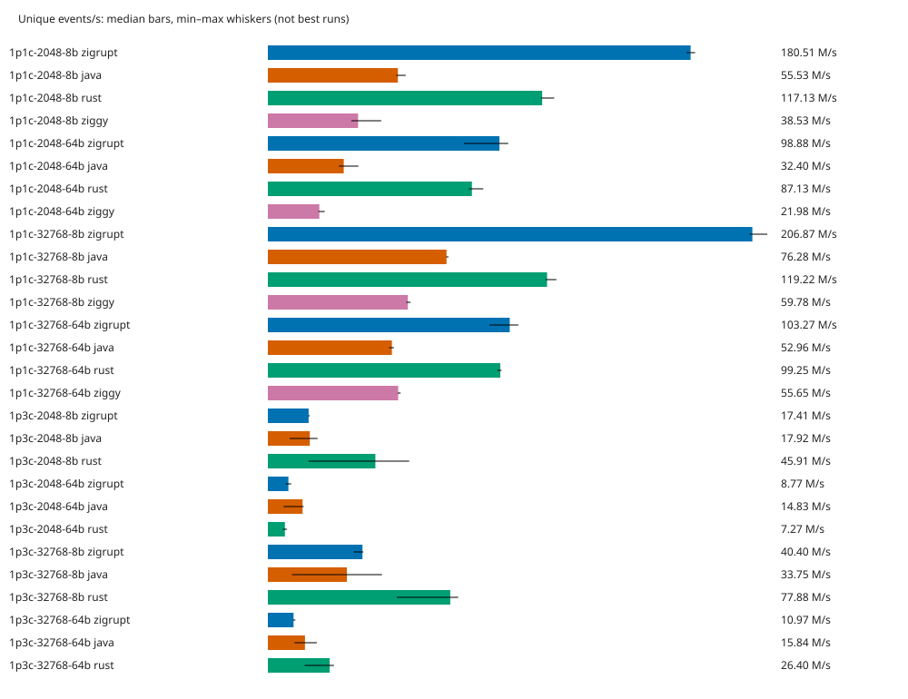

# Zigrupt competitive baseline

Run: 2026-10-08T13:59:48.419476+00:00. Host-local baseline; not a universal ranking.

- Physical CPUs: `[0, 1, 2, 3]`; one worker per physical core, fixed producer-then-consumer placement.
- 56 correctness cases passed; 0 invalid runs; 28 implementation/workload combinations blocked.
- 5 independent processes per measured cell, seeded randomized order. Target measurement 2 s; warmup 3 s (event counts calibrated, actual durations in JSON).
- Results are **median [minimum–maximum]**. Wins/losses require disjoint observed ranges and complete, valid repeats; overlapping ranges are inconclusive. This is not a confidence interval or a significance test.
- Runs shorter than 0.5 s, with warmup shorter than 0.5 s, or with measured JVM compilation activity cannot support wins/losses. Invalid runs are never ranked.
- Ratios are **Zigrupt / competitor**: throughput >1 favors Zigrupt; latency <1 favors Zigrupt. Latency comparisons use the worst consumer per run.
- CPU is process CPU seconds / measured wall seconds; RSS is the executable's address-space high-water RSS (`VmHWM`) before teardown, excluding launcher memory before exec. Startup is excluded from throughput/CPU, not RSS. JVM heap is fixed and pre-touched at 256 MiB.
- No production code or competitor implementation was changed. See `../../SPEC.md` for payload, validation, schedule, native batching and producer-backoff details.

## Coverage

| Workload | Status |
|---|---|
| 1p1c-2048-8b | Measured (see quality and variability below) |
| 1p1c-2048-64b | Measured (see quality and variability below) |
| 1p1c-32768-8b | Measured (see quality and variability below) |
| 1p1c-32768-64b | Measured (see quality and variability below) |
| 4p1c-2048-8b | requires 5 physical cores; only 4 available |
| 4p1c-2048-64b | requires 5 physical cores; only 4 available |
| 4p1c-32768-8b | requires 5 physical cores; only 4 available |
| 4p1c-32768-64b | requires 5 physical cores; only 4 available |
| 1p3c-2048-8b | Measured (see quality and variability below) |
| 1p3c-2048-64b | Measured (see quality and variability below) |
| 1p3c-32768-8b | Measured (see quality and variability below) |
| 1p3c-32768-64b | Measured (see quality and variability below) |
| 3p3c-2048-8b | requires 6 physical cores; only 4 available |
| 3p3c-2048-64b | requires 6 physical cores; only 4 available |
| 3p3c-32768-8b | requires 6 physical cores; only 4 available |
| 3p3c-32768-64b | requires 6 physical cores; only 4 available |

## Throughput and resource costs

| Workload | Implementation | M unique events/s | M deliveries/s | CPU cores | Peak RSS MiB | Quality |
|---|---|---:|---:|---:|---:|---|
| 1p1c-2048-64b | java | 32.404 [30.321–38.659] | 32.404 [30.321–38.659] | 1.736 [1.727–1.751] | 313.008 [312.891–313.223] | inconclusive |
| 1p1c-2048-64b | rust | 87.134 [85.854–91.983] | 87.134 [85.854–91.983] | 2.000 [2.000–2.001] | 2.465 [2.348–2.539] | rankable |
| 1p1c-2048-64b | ziggy | 21.979 [21.580–24.291] | 21.979 [21.580–24.291] | 2.000 [2.000–2.001] | 2.602 [2.359–2.613] | rankable |
| 1p1c-2048-64b | zigrupt | 98.884 [83.692–102.641] | 98.884 [83.692–102.641] | 2.000 [2.000–2.001] | 3.145 [3.047–3.156] | rankable |
| 1p1c-2048-8b | java | 55.527 [54.805–58.856] | 55.527 [54.805–58.856] | 1.664 [1.661–1.849] | 313.332 [313.289–313.355] | inconclusive |
| 1p1c-2048-8b | rust | 117.129 [116.687–122.261] | 117.129 [116.687–122.261] | 2.000 [2.000–2.001] | 2.344 [2.328–2.379] | rankable |
| 1p1c-2048-8b | ziggy | 38.528 [35.645–48.397] | 38.528 [35.645–48.397] | 2.000 [2.000–2.000] | 2.551 [2.410–2.590] | rankable |
| 1p1c-2048-8b | zigrupt | 180.512 [178.794–182.441] | 180.512 [178.794–182.441] | 2.000 [2.000–2.001] | 3.027 [2.902–3.125] | rankable |
| 1p1c-32768-64b | java | 52.962 [51.819–53.822] | 52.962 [51.819–53.822] | 1.843 [1.746–1.844] | 313.078 [312.883–313.172] | rankable |
| 1p1c-32768-64b | rust | 99.254 [98.016–99.773] | 99.254 [98.016–99.773] | 2.000 [2.000–2.001] | 4.355 [4.262–4.422] | rankable |
| 1p1c-32768-64b | ziggy | 55.652 [55.422–56.666] | 55.652 [55.422–56.666] | 2.000 [2.000–2.001] | 6.273 [6.211–6.398] | rankable |
| 1p1c-32768-64b | zigrupt | 103.272 [94.633–106.938] | 103.272 [94.633–106.938] | 2.000 [2.000–2.001] | 5.219 [5.055–5.266] | rankable |
| 1p1c-32768-8b | java | 76.282 [76.091–77.097] | 76.282 [76.091–77.097] | 1.924 [1.695–1.984] | 313.199 [313.078–313.738] | rankable |
| 1p1c-32768-8b | rust | 119.219 [118.537–123.202] | 119.219 [118.537–123.202] | 2.000 [2.000–2.000] | 2.578 [2.566–2.676] | rankable |
| 1p1c-32768-8b | ziggy | 59.782 [59.127–60.908] | 59.782 [59.127–60.908] | 2.000 [2.000–2.002] | 6.203 [6.055–6.301] | rankable |
| 1p1c-32768-8b | zigrupt | 206.873 [205.694–213.237] | 206.873 [205.694–213.237] | 2.000 [2.000–2.002] | 3.504 [3.305–3.605] | rankable |
| 1p3c-2048-64b | java | 14.828 [6.716–15.233] | 44.484 [20.148–45.698] | 3.483 [3.405–3.999] | 313.977 [313.086–314.145] | inconclusive |
| 1p3c-2048-64b | rust | 7.272 [6.377–8.185] | 21.815 [19.130–24.555] | 4.002 [4.000–4.004] | 2.492 [2.395–2.578] | rankable |
| 1p3c-2048-64b | zigrupt | 8.769 [7.728–9.975] | 26.306 [23.183–29.926] | 4.000 [4.000–4.001] | 3.664 [3.527–3.672] | rankable |
| 1p3c-2048-8b | java | 17.917 [9.308–21.228] | 53.751 [27.925–63.683] | 3.950 [3.936–3.999] | 314.031 [313.074–314.328] | rankable |
| 1p3c-2048-8b | rust | 45.908 [17.399–60.354] | 137.725 [52.196–181.062] | 4.000 [4.000–4.000] | 2.402 [2.266–2.465] | rankable |
| 1p3c-2048-8b | zigrupt | 17.407 [17.257–17.907] | 52.220 [51.770–53.721] | 4.001 [4.000–4.002] | 3.590 [3.469–3.648] | rankable |
| 1p3c-32768-64b | java | 15.839 [11.360–20.905] | 47.516 [34.079–62.715] | 3.401 [3.309–3.977] | 314.469 [313.098–314.617] | rankable |
| 1p3c-32768-64b | rust | 26.405 [15.719–28.239] | 79.214 [47.156–84.718] | 4.005 [4.000–4.006] | 4.359 [4.344–4.383] | rankable |
| 1p3c-32768-64b | zigrupt | 10.971 [10.741–11.753] | 32.912 [32.224–35.260] | 4.000 [4.000–4.002] | 5.766 [5.758–5.859] | rankable |
| 1p3c-32768-8b | java | 33.748 [10.346–48.740] | 101.243 [31.039–146.219] | 3.996 [3.762–4.007] | 314.227 [313.637–314.832] | inconclusive |
| 1p3c-32768-8b | rust | 77.880 [55.086–81.277] | 233.640 [165.259–243.832] | 4.001 [3.999–4.001] | 2.594 [2.586–2.617] | rankable |
| 1p3c-32768-8b | zigrupt | 40.398 [36.594–40.704] | 121.193 [109.783–122.111] | 4.000 [4.000–4.002] | 4.094 [4.059–4.117] | rankable |

## Zigrupt ratios and outcomes

Each entry is ratio + outcome for Zigrupt. **Tradeoff** means opposite outcomes across throughput or latency metrics, not an overall winner.

| Workload | Competitor | Throughput | p99 @50% | p99.9 @50% | p99 @90% | p99.9 @90% | Tradeoff |
|---|---|---|---|---|---|---|---|
| 1p1c-2048-8b | java | 3.251× inconclusive | 0.118× win | 0.160× win | 0.191× inconclusive | 0.191× inconclusive | — |
| 1p1c-2048-8b | rust | 1.541× win | 0.841× win | 0.916× inconclusive | 0.413× win | 0.413× win | — |
| 1p1c-2048-8b | ziggy | 4.685× win | 0.000× win | 0.000× win | 0.115× win | 0.115× win | — |
| 1p1c-2048-64b | java | 3.052× inconclusive | 0.755× win | 0.741× win | 0.065× win | 0.276× win | — |
| 1p1c-2048-64b | rust | 1.135× inconclusive | 0.924× win | 0.465× win | 11.049× inconclusive | 3.021× inconclusive | — |
| 1p1c-2048-64b | ziggy | 4.499× win | 0.000× win | 0.000× win | 0.000× win | 0.000× win | — |
| 1p1c-32768-8b | java | 2.712× win | 0.001× inconclusive | 0.001× inconclusive | 0.480× inconclusive | 0.480× inconclusive | — |
| 1p1c-32768-8b | rust | 1.735× win | 0.003× win | 0.004× win | 0.735× win | 0.735× win | — |
| 1p1c-32768-8b | ziggy | 3.460× win | 0.002× win | 0.002× win | 0.659× win | 0.658× win | — |
| 1p1c-32768-64b | java | 1.950× win | 0.001× inconclusive | 0.001× inconclusive | 0.454× inconclusive | 0.454× inconclusive | — |
| 1p1c-32768-64b | rust | 1.040× inconclusive | 0.019× win | 0.029× win | 0.751× win | 0.750× win | — |
| 1p1c-32768-64b | ziggy | 1.856× win | 0.003× win | 0.005× win | 0.668× win | 0.668× win | — |
| 4p1c-2048-8b | java | — inconclusive | — inconclusive | — inconclusive | — inconclusive | — inconclusive | — |
| 4p1c-2048-8b | rust | — inconclusive | — inconclusive | — inconclusive | — inconclusive | — inconclusive | — |
| 4p1c-2048-8b | ziggy | — inconclusive | — inconclusive | — inconclusive | — inconclusive | — inconclusive | — |
| 4p1c-2048-64b | java | — inconclusive | — inconclusive | — inconclusive | — inconclusive | — inconclusive | — |
| 4p1c-2048-64b | rust | — inconclusive | — inconclusive | — inconclusive | — inconclusive | — inconclusive | — |
| 4p1c-2048-64b | ziggy | — inconclusive | — inconclusive | — inconclusive | — inconclusive | — inconclusive | — |
| 4p1c-32768-8b | java | — inconclusive | — inconclusive | — inconclusive | — inconclusive | — inconclusive | — |
| 4p1c-32768-8b | rust | — inconclusive | — inconclusive | — inconclusive | — inconclusive | — inconclusive | — |
| 4p1c-32768-8b | ziggy | — inconclusive | — inconclusive | — inconclusive | — inconclusive | — inconclusive | — |
| 4p1c-32768-64b | java | — inconclusive | — inconclusive | — inconclusive | — inconclusive | — inconclusive | — |
| 4p1c-32768-64b | rust | — inconclusive | — inconclusive | — inconclusive | — inconclusive | — inconclusive | — |
| 4p1c-32768-64b | ziggy | — inconclusive | — inconclusive | — inconclusive | — inconclusive | — inconclusive | — |
| 1p3c-2048-8b | java | 0.972× inconclusive | 0.225× win | 0.070× win | 0.002× win | 0.003× win | — |
| 1p3c-2048-8b | rust | 0.379× inconclusive | 0.892× win | 0.971× inconclusive | 0.810× win | 0.546× win | — |
| 1p3c-2048-64b | java | 0.591× inconclusive | 0.426× inconclusive | 0.005× inconclusive | 0.001× win | 0.001× win | — |
| 1p3c-2048-64b | rust | 1.206× inconclusive | 0.832× win | 0.883× inconclusive | 0.010× win | 0.007× win | **yes** |
| 1p3c-32768-8b | java | 1.197× inconclusive | 0.000× inconclusive | 0.000× inconclusive | 0.064× inconclusive | 0.064× inconclusive | — |
| 1p3c-32768-8b | rust | 0.519× loss | 0.760× win | 0.228× win | 0.519× win | 0.520× win | **yes** |
| 1p3c-32768-64b | java | 0.693× inconclusive | 0.682× inconclusive | 0.654× win | 0.120× inconclusive | 0.143× inconclusive | — |
| 1p3c-32768-64b | rust | 0.415× loss | 0.261× win | 0.153× win | 0.010× win | 0.024× win | **yes** |
| 3p3c-2048-8b | java | — inconclusive | — inconclusive | — inconclusive | — inconclusive | — inconclusive | — |
| 3p3c-2048-8b | rust | — inconclusive | — inconclusive | — inconclusive | — inconclusive | — inconclusive | — |
| 3p3c-2048-64b | java | — inconclusive | — inconclusive | — inconclusive | — inconclusive | — inconclusive | — |
| 3p3c-2048-64b | rust | — inconclusive | — inconclusive | — inconclusive | — inconclusive | — inconclusive | — |
| 3p3c-32768-8b | java | — inconclusive | — inconclusive | — inconclusive | — inconclusive | — inconclusive | — |
| 3p3c-32768-8b | rust | — inconclusive | — inconclusive | — inconclusive | — inconclusive | — inconclusive | — |
| 3p3c-32768-64b | java | — inconclusive | — inconclusive | — inconclusive | — inconclusive | — inconclusive | — |
| 3p3c-32768-64b | rust | — inconclusive | — inconclusive | — inconclusive | — inconclusive | — inconclusive | — |

## Scheduled-arrival latency

All values below are microseconds, median [min–max] across runs. Histograms report bucket upper bounds (≤0.2% relative quantization error above 1 µs; exact below 1,024 ns). **Worst** is the max consumer per run, not a merged histogram. Rates come from `rates.json`, independently per workload, using the slowest median saturation throughput.

| Workload | Implementation | Load | Offered events/s | Consumer | p50 µs | p99 µs | p99.9 µs |
|---|---|---:|---:|---|---:|---:|---:|
| 1p1c-2048-64b | java | 50% | 10989405 | 0 | 0.275 [0.261–0.290] | 3.867 [3.623–4.287] | 6.487 [6.103–125.567] |
| 1p1c-2048-64b | java | 50% | 10989405 | **worst** | 0.275 [0.261–0.290] | 3.867 [3.623–4.287] | 6.487 [6.103–125.567] |
| 1p1c-2048-64b | java | 90% | 19780929 | 0 | 746.495 [10.527–1812.479] | 1005.567 [345.599–3559.423] | 1069.055 [480.767–3747.839] |
| 1p1c-2048-64b | java | 90% | 19780929 | **worst** | 746.495 [10.527–1812.479] | 1005.567 [345.599–3559.423] | 1069.055 [480.767–3747.839] |
| 1p1c-2048-64b | rust | 50% | 10989405 | 0 | 0.276 [0.262–0.279] | 3.159 [3.051–3.555] | 10.335 [4.871–22.911] |
| 1p1c-2048-64b | rust | 50% | 10989405 | **worst** | 0.276 [0.262–0.279] | 3.159 [3.051–3.555] | 10.335 [4.871–22.911] |
| 1p1c-2048-64b | rust | 90% | 19780929 | 0 | 0.439 [0.394–0.449] | 5.943 [5.591–253.183] | 97.791 [23.007–923.647] |
| 1p1c-2048-64b | rust | 90% | 19780929 | **worst** | 0.439 [0.394–0.449] | 5.943 [5.591–253.183] | 97.791 [23.007–923.647] |
| 1p1c-2048-64b | ziggy | 50% | 10989405 | 0 | 42401.791 [27.807–61865.983] | 107085.823 [224.511–115081.215] | 107741.183 [345.599–116391.935] |
| 1p1c-2048-64b | ziggy | 50% | 10989405 | **worst** | 42401.791 [27.807–61865.983] | 107085.823 [224.511–115081.215] | 107741.183 [345.599–116391.935] |
| 1p1c-2048-64b | ziggy | 90% | 19780929 | 0 | 861929.471 [548405.247–894435.327] | 1711276.031 [868220.927–1755316.223] | 1723858.943 [868220.927–1769996.287] |
| 1p1c-2048-64b | ziggy | 90% | 19780929 | **worst** | 861929.471 [548405.247–894435.327] | 1711276.031 [868220.927–1755316.223] | 1723858.943 [868220.927–1769996.287] |
| 1p1c-2048-64b | zigrupt | 50% | 10989405 | 0 | 0.188 [0.185–0.192] | 2.919 [2.759–2.995] | 4.807 [4.447–4.839] |
| 1p1c-2048-64b | zigrupt | 50% | 10989405 | **worst** | 0.188 [0.185–0.192] | 2.919 [2.759–2.995] | 4.807 [4.447–4.839] |
| 1p1c-2048-64b | zigrupt | 90% | 19780929 | 0 | 0.480 [0.407–0.516] | 65.663 [5.087–131.327] | 295.423 [12.719–332.799] |
| 1p1c-2048-64b | zigrupt | 90% | 19780929 | **worst** | 0.480 [0.407–0.516] | 65.663 [5.087–131.327] | 295.423 [12.719–332.799] |
| 1p1c-2048-8b | java | 50% | 19264097 | 0 | 0.909 [0.478–7.639] | 33.471 [9.023–360.959] | 36.031 [20.255–622.591] |
| 1p1c-2048-8b | java | 50% | 19264097 | **worst** | 0.909 [0.478–7.639] | 33.471 [9.023–360.959] | 36.031 [20.255–622.591] |
| 1p1c-2048-8b | java | 90% | 34675376 | 0 | 611319.807 [606076.927–615514.111] | 1207959.551 [1201668.095–1222639.615] | 1218445.311 [1212153.855–1233125.375] |
| 1p1c-2048-8b | java | 90% | 34675376 | **worst** | 611319.807 [606076.927–615514.111] | 1207959.551 [1201668.095–1222639.615] | 1218445.311 [1212153.855–1233125.375] |
| 1p1c-2048-8b | rust | 50% | 19264097 | 0 | 0.460 [0.454–0.465] | 4.703 [4.575–4.823] | 6.295 [5.951–7.031] |
| 1p1c-2048-8b | rust | 50% | 19264097 | **worst** | 0.460 [0.454–0.465] | 4.703 [4.575–4.823] | 6.295 [5.951–7.031] |
| 1p1c-2048-8b | rust | 90% | 34675376 | 0 | 281018.367 [278396.927–293601.279] | 557842.431 [553648.127–576716.799] | 563085.311 [558891.007–581959.679] |
| 1p1c-2048-8b | rust | 90% | 34675376 | **worst** | 281018.367 [278396.927–293601.279] | 557842.431 [553648.127–576716.799] | 563085.311 [558891.007–581959.679] |
| 1p1c-2048-8b | ziggy | 50% | 19264097 | 0 | 222822.399 [35651.583–245628.927] | 448266.239 [35979.263–476053.503] | 452460.543 [36372.479–480772.095] |
| 1p1c-2048-8b | ziggy | 50% | 19264097 | **worst** | 222822.399 [35651.583–245628.927] | 448266.239 [35979.263–476053.503] | 452460.543 [36372.479–480772.095] |
| 1p1c-2048-8b | ziggy | 90% | 34675376 | 0 | 1008730.111 [974127.103–1174405.119] | 2002780.159 [1925185.535–2361393.151] | 2019557.375 [1946157.055–2386558.975] |
| 1p1c-2048-8b | ziggy | 90% | 34675376 | **worst** | 1008730.111 [974127.103–1174405.119] | 2002780.159 [1925185.535–2361393.151] | 2019557.375 [1946157.055–2386558.975] |
| 1p1c-2048-8b | zigrupt | 50% | 19264097 | 0 | 0.421 [0.419–0.429] | 3.955 [3.923–4.151] | 5.767 [5.639–6.151] |
| 1p1c-2048-8b | zigrupt | 50% | 19264097 | **worst** | 0.421 [0.419–0.429] | 3.955 [3.923–4.151] | 5.767 [5.639–6.151] |
| 1p1c-2048-8b | zigrupt | 90% | 34675376 | 0 | 114950.143 [113901.567–130416.639] | 230424.575 [224657.407–260571.135] | 232521.727 [226492.415–262668.287] |
| 1p1c-2048-8b | zigrupt | 90% | 34675376 | **worst** | 114950.143 [113901.567–130416.639] | 230424.575 [224657.407–260571.135] | 232521.727 [226492.415–262668.287] |
| 1p1c-32768-64b | java | 50% | 26481144 | 0 | 298319.871 [257949.695–330301.439] | 589299.711 [512229.375–653262.847] | 594542.591 [516947.967–659554.303] |
| 1p1c-32768-64b | java | 50% | 26481144 | **worst** | 298319.871 [257949.695–330301.439] | 589299.711 [512229.375–653262.847] | 594542.591 [516947.967–659554.303] |
| 1p1c-32768-64b | java | 90% | 47666060 | 0 | 1346371.583 [1327497.215–1367343.103] | 2667577.343 [2634022.911–2696937.471] | 2692743.167 [2659188.735–2717908.991] |
| 1p1c-32768-64b | java | 90% | 47666060 | **worst** | 1346371.583 [1327497.215–1367343.103] | 2667577.343 [2634022.911–2696937.471] | 2692743.167 [2659188.735–2717908.991] |
| 1p1c-32768-64b | rust | 50% | 26481144 | 0 | 14565.375 [5668.863–19759.103] | 23396.351 [8601.599–43646.975] | 23461.887 [8699.903–43974.655] |
| 1p1c-32768-64b | rust | 50% | 26481144 | **worst** | 14565.375 [5668.863–19759.103] | 23396.351 [8601.599–43646.975] | 23461.887 [8699.903–43974.655] |
| 1p1c-32768-64b | rust | 90% | 47666060 | 0 | 814743.551 [810549.247–838860.799] | 1614807.039 [1606418.431–1669332.991] | 1629487.103 [1621098.495–1681915.903] |
| 1p1c-32768-64b | rust | 90% | 47666060 | **worst** | 814743.551 [810549.247–838860.799] | 1614807.039 [1606418.431–1669332.991] | 1629487.103 [1621098.495–1681915.903] |
| 1p1c-32768-64b | ziggy | 50% | 26481144 | 0 | 77725.695 [56229.887–99221.503] | 139984.895 [115081.215–172228.607] | 141033.471 [115998.719–173539.327] |
| 1p1c-32768-64b | ziggy | 50% | 26481144 | **worst** | 77725.695 [56229.887–99221.503] | 139984.895 [115081.215–172228.607] | 141033.471 [115998.719–173539.327] |
| 1p1c-32768-64b | ziggy | 90% | 47666060 | 0 | 916455.423 [878706.687–957349.887] | 1814036.479 [1749024.767–1860173.823] | 1830813.695 [1763704.831–1876951.039] |
| 1p1c-32768-64b | ziggy | 90% | 47666060 | **worst** | 916455.423 [878706.687–957349.887] | 1814036.479 [1749024.767–1860173.823] | 1830813.695 [1763704.831–1876951.039] |
| 1p1c-32768-64b | zigrupt | 50% | 26481144 | 0 | 1.105 [1.016–1.163] | 433.151 [331.775–605.183] | 669.695 [511.999–1771.519] |
| 1p1c-32768-64b | zigrupt | 50% | 26481144 | **worst** | 1.105 [1.016–1.163] | 433.151 [331.775–605.183] | 669.695 [511.999–1771.519] |
| 1p1c-32768-64b | zigrupt | 90% | 47666060 | 0 | 614465.535 [597688.319–628097.023] | 1212153.855 [1176502.271–1239416.831] | 1222639.615 [1189085.183–1251999.743] |
| 1p1c-32768-64b | zigrupt | 90% | 47666060 | **worst** | 614465.535 [597688.319–628097.023] | 1212153.855 [1176502.271–1239416.831] | 1222639.615 [1189085.183–1251999.743] |
| 1p1c-32768-8b | java | 50% | 29890805 | 0 | 407371.775 [371195.903–410517.503] | 811597.823 [736100.351–816840.703] | 818937.855 [742391.807–825229.311] |
| 1p1c-32768-8b | java | 50% | 29890805 | **worst** | 407371.775 [371195.903–410517.503] | 811597.823 [736100.351–816840.703] | 818937.855 [742391.807–825229.311] |
| 1p1c-32768-8b | java | 90% | 53803449 | 0 | 1501560.831 [1430257.663–1528823.807] | 2977955.839 [2822766.591–3024093.183] | 3003121.663 [2847932.415–3053453.311] |
| 1p1c-32768-8b | java | 90% | 53803449 | **worst** | 1501560.831 [1430257.663–1528823.807] | 2977955.839 [2822766.591–3024093.183] | 3003121.663 [2847932.415–3053453.311] |
| 1p1c-32768-8b | rust | 50% | 29890805 | 0 | 96075.775 [86114.303–120979.455] | 191102.975 [172228.607–234356.735] | 192937.983 [174063.615–236453.887] |
| 1p1c-32768-8b | rust | 50% | 29890805 | **worst** | 96075.775 [86114.303–120979.455] | 191102.975 [172228.607–234356.735] | 192937.983 [174063.615–236453.887] |
| 1p1c-32768-8b | rust | 90% | 53803449 | 0 | 983564.287 [960495.615–1021313.023] | 1944059.903 [1895825.407–2021654.527] | 1960837.119 [1914699.775–2038431.743] |
| 1p1c-32768-8b | rust | 90% | 53803449 | **worst** | 983564.287 [960495.615–1021313.023] | 1944059.903 [1895825.407–2021654.527] | 1960837.119 [1914699.775–2038431.743] |
| 1p1c-32768-8b | ziggy | 50% | 29890805 | 0 | 158072.831 [147849.215–165412.863] | 309854.207 [299892.735–321388.543] | 312475.647 [302514.175–324534.271] |
| 1p1c-32768-8b | ziggy | 50% | 29890805 | **worst** | 158072.831 [147849.215–165412.863] | 309854.207 [299892.735–321388.543] | 312475.647 [302514.175–324534.271] |
| 1p1c-32768-8b | ziggy | 90% | 53803449 | 0 | 1090519.039 [1053818.879–2566914.047] | 2168455.167 [2088763.391–5091885.055] | 2189426.687 [2107637.759–5133828.095] |
| 1p1c-32768-8b | ziggy | 90% | 53803449 | **worst** | 1090519.039 [1053818.879–2566914.047] | 2168455.167 [2088763.391–5091885.055] | 2189426.687 [2107637.759–5133828.095] |
| 1p1c-32768-8b | zigrupt | 50% | 29890805 | 0 | 119.295 [7.071–419.839] | 553.983 [48.255–1593.343] | 689.151 [71.551–1830.911] |
| 1p1c-32768-8b | zigrupt | 50% | 29890805 | **worst** | 119.295 [7.071–419.839] | 553.983 [48.255–1593.343] | 689.151 [71.551–1830.911] |
| 1p1c-32768-8b | zigrupt | 90% | 53803449 | 0 | 723517.439 [705691.647–739246.079] | 1428160.511 [1394606.079–1476395.007] | 1440743.423 [1407188.991–1488977.919] |
| 1p1c-32768-8b | zigrupt | 90% | 53803449 | **worst** | 723517.439 [705691.647–739246.079] | 1428160.511 [1394606.079–1476395.007] | 1440743.423 [1407188.991–1488977.919] |
| 1p3c-2048-64b | java | 50% | 3635790 | 0 | 0.409 [0.387–0.433] | 3.143 [3.115–3.563] | 1018.879 [9.279–3563.519] |
| 1p3c-2048-64b | java | 50% | 3635790 | 1 | 0.583 [0.399–0.598] | 5.471 [3.159–5.695] | 1021.951 [31.679–3588.095] |
| 1p3c-2048-64b | java | 50% | 3635790 | 2 | 0.530 [0.400–0.599] | 4.751 [3.395–5.007] | 1018.879 [17.151–3645.439] |
| 1p3c-2048-64b | java | 50% | 3635790 | **worst** | 0.583 [0.400–0.599] | 5.471 [3.395–5.695] | 1021.951 [31.679–3645.439] |
| 1p3c-2048-64b | java | 90% | 6544423 | 0 | 2506.751 [1.085–4399.103] | 6791.167 [30.975–10829.823] | 7684.095 [132.351–11665.407] |
| 1p3c-2048-64b | java | 90% | 6544423 | 1 | 2596.863 [1.059–4497.407] | 6864.895 [32.063–10911.743] | 7766.015 [132.863–11747.327] |
| 1p3c-2048-64b | java | 90% | 6544423 | 2 | 2658.303 [1.059–4546.559] | 6946.815 [30.975–10993.663] | 7847.935 [132.351–11829.247] |
| 1p3c-2048-64b | java | 90% | 6544423 | **worst** | 2658.303 [1.085–4546.559] | 6946.815 [32.063–10993.663] | 7847.935 [132.863–11829.247] |
| 1p3c-2048-64b | rust | 50% | 3635790 | 0 | 0.275 [0.271–0.281] | 2.687 [2.503–2.787] | 5.159 [4.967–5.495] |
| 1p3c-2048-64b | rust | 50% | 3635790 | 1 | 0.276 [0.270–0.282] | 2.495 [2.207–2.975] | 4.983 [4.959–5.703] |
| 1p3c-2048-64b | rust | 50% | 3635790 | 2 | 0.281 [0.269–0.291] | 2.651 [2.227–2.887] | 5.063 [4.943–5.527] |
| 1p3c-2048-64b | rust | 50% | 3635790 | **worst** | 0.281 [0.275–0.291] | 2.803 [2.687–2.975] | 5.335 [5.159–5.703] |
| 1p3c-2048-64b | rust | 90% | 6544423 | 0 | 29.183 [8.735–38.911] | 440.831 [115.967–1040.383] | 1105.919 [212.991–1894.399] |
| 1p3c-2048-64b | rust | 90% | 6544423 | 1 | 29.119 [8.783–38.911] | 440.319 [116.095–1037.311] | 1105.919 [212.991–1894.399] |
| 1p3c-2048-64b | rust | 90% | 6544423 | 2 | 29.119 [8.751–38.911] | 440.831 [116.095–1037.311] | 1105.919 [213.247–1894.399] |
| 1p3c-2048-64b | rust | 90% | 6544423 | **worst** | 29.183 [8.783–38.911] | 440.831 [116.095–1040.383] | 1105.919 [213.247–1894.399] |
| 1p3c-2048-64b | zigrupt | 50% | 3635790 | 0 | 0.315 [0.311–0.322] | 2.255 [1.369–2.415] | 4.655 [4.067–5.199] |
| 1p3c-2048-64b | zigrupt | 50% | 3635790 | 1 | 0.318 [0.314–0.325] | 2.015 [1.555–2.331] | 4.711 [4.247–5.279] |
| 1p3c-2048-64b | zigrupt | 50% | 3635790 | 2 | 0.319 [0.315–0.326] | 1.647 [1.375–1.937] | 4.215 [4.047–4.855] |
| 1p3c-2048-64b | zigrupt | 50% | 3635790 | **worst** | 0.319 [0.315–0.326] | 2.331 [2.235–2.415] | 4.711 [4.655–5.279] |
| 1p3c-2048-64b | zigrupt | 90% | 6544423 | 0 | 0.394 [0.385–0.467] | 4.391 [3.275–6.255] | 7.543 [6.111–85.119] |
| 1p3c-2048-64b | zigrupt | 90% | 6544423 | 1 | 0.397 [0.385–0.466] | 4.151 [3.063–6.431] | 7.559 [6.063–85.119] |
| 1p3c-2048-64b | zigrupt | 90% | 6544423 | 2 | 0.396 [0.387–0.468] | 4.087 [3.111–6.303] | 7.247 [5.927–85.119] |
| 1p3c-2048-64b | zigrupt | 90% | 6544423 | **worst** | 0.397 [0.387–0.468] | 4.391 [3.275–6.431] | 7.559 [6.111–85.119] |
| 1p3c-2048-8b | java | 50% | 8703317 | 0 | 0.792 [0.790–0.816] | 13.487 [4.567–23.167] | 95.231 [8.255–146.175] |
| 1p3c-2048-8b | java | 50% | 8703317 | 1 | 0.730 [0.685–0.738] | 13.887 [4.591–23.839] | 95.487 [10.207–146.175] |
| 1p3c-2048-8b | java | 50% | 8703317 | 2 | 0.735 [0.691–0.750] | 14.927 [5.031–23.487] | 95.871 [10.543–145.919] |
| 1p3c-2048-8b | java | 50% | 8703317 | **worst** | 0.792 [0.790–0.816] | 14.927 [5.351–23.839] | 95.871 [10.895–146.175] |
| 1p3c-2048-8b | java | 90% | 15665971 | 0 | 13.215 [11.455–3137.535] | 2240.511 [181.759–6291.455] | 2469.887 [236.287–7086.079] |
| 1p3c-2048-8b | java | 90% | 15665971 | 1 | 35.135 [11.999–3137.535] | 2236.415 [167.679–6316.031] | 2478.079 [223.487–7094.271] |
| 1p3c-2048-8b | java | 90% | 15665971 | 2 | 19.775 [13.215–3170.303] | 2248.703 [171.263–6299.647] | 2461.695 [227.071–7086.079] |
| 1p3c-2048-8b | java | 90% | 15665971 | **worst** | 35.135 [17.535–3170.303] | 2248.703 [181.759–6316.031] | 2478.079 [236.287–7094.271] |
| 1p3c-2048-8b | rust | 50% | 8703317 | 0 | 0.650 [0.616–0.702] | 3.635 [3.427–3.907] | 6.607 [6.567–7.191] |
| 1p3c-2048-8b | rust | 50% | 8703317 | 1 | 0.660 [0.615–0.712] | 3.631 [3.371–4.019] | 6.919 [6.567–7.303] |
| 1p3c-2048-8b | rust | 50% | 8703317 | 2 | 0.659 [0.620–0.715] | 3.511 [3.411–3.695] | 6.519 [6.471–7.071] |
| 1p3c-2048-8b | rust | 50% | 8703317 | **worst** | 0.660 [0.620–0.715] | 3.767 [3.635–4.019] | 6.919 [6.567–7.303] |
| 1p3c-2048-8b | rust | 90% | 15665971 | 0 | 0.765 [0.719–0.787] | 5.423 [4.575–6.135] | 9.999 [7.271–70.655] |
| 1p3c-2048-8b | rust | 90% | 15665971 | 1 | 0.765 [0.719–0.790] | 5.343 [4.983–12.735] | 14.863 [8.463–69.887] |
| 1p3c-2048-8b | rust | 90% | 15665971 | 2 | 0.772 [0.726–0.796] | 5.487 [4.775–12.815] | 10.079 [7.743–70.015] |
| 1p3c-2048-8b | rust | 90% | 15665971 | **worst** | 0.772 [0.726–0.796] | 5.767 [4.983–12.815] | 14.863 [8.463–70.655] |
| 1p3c-2048-8b | zigrupt | 50% | 8703317 | 0 | 0.629 [0.617–0.631] | 2.943 [2.887–3.259] | 6.191 [6.167–6.287] |
| 1p3c-2048-8b | zigrupt | 50% | 8703317 | 1 | 0.632 [0.619–0.634] | 2.919 [2.843–3.471] | 6.343 [6.255–6.719] |
| 1p3c-2048-8b | zigrupt | 50% | 8703317 | 2 | 0.628 [0.620–0.634] | 3.167 [2.855–3.367] | 6.599 [6.143–6.847] |
| 1p3c-2048-8b | zigrupt | 50% | 8703317 | **worst** | 0.634 [0.620–0.634] | 3.359 [3.259–3.471] | 6.719 [6.287–6.847] |
| 1p3c-2048-8b | zigrupt | 90% | 15665971 | 0 | 0.683 [0.675–0.708] | 4.615 [4.231–4.719] | 7.751 [6.967–7.807] |
| 1p3c-2048-8b | zigrupt | 90% | 15665971 | 1 | 0.673 [0.662–0.698] | 4.367 [4.111–4.871] | 8.119 [7.047–8.143] |
| 1p3c-2048-8b | zigrupt | 90% | 15665971 | 2 | 0.682 [0.675–0.715] | 4.343 [4.231–4.679] | 7.599 [7.255–7.911] |
| 1p3c-2048-8b | zigrupt | 90% | 15665971 | **worst** | 0.683 [0.675–0.715] | 4.671 [4.615–4.871] | 8.119 [7.663–8.143] |
| 1p3c-32768-64b | java | 50% | 5485413 | 0 | 0.452 [0.432–0.553] | 4.019 [2.651–4.663] | 8.479 [6.663–635.903] |
| 1p3c-32768-64b | java | 50% | 5485413 | 1 | 0.459 [0.422–0.505] | 3.263 [1.901–4.279] | 7.359 [6.487–641.023] |
| 1p3c-32768-64b | java | 50% | 5485413 | 2 | 0.450 [0.420–0.514] | 3.379 [2.355–4.103] | 9.055 [6.455–623.615] |
| 1p3c-32768-64b | java | 50% | 5485413 | **worst** | 0.459 [0.432–0.553] | 4.279 [2.991–4.663] | 9.055 [7.751–641.023] |
| 1p3c-32768-64b | java | 90% | 9873744 | 0 | 0.998 [0.784–1.373] | 103.551 [29.119–569.343] | 380.927 [124.671–2023.423] |
| 1p3c-32768-64b | java | 90% | 9873744 | 1 | 0.872 [0.641–1.249] | 104.831 [28.223–571.391] | 382.975 [122.367–2023.423] |
| 1p3c-32768-64b | java | 90% | 9873744 | 2 | 0.895 [0.654–1.279] | 105.215 [28.511–574.463] | 383.487 [122.367–2023.423] |
| 1p3c-32768-64b | java | 90% | 9873744 | **worst** | 0.998 [0.784–1.373] | 105.215 [29.119–574.463] | 383.487 [124.671–2023.423] |
| 1p3c-32768-64b | rust | 50% | 5485413 | 0 | 0.513 [0.483–0.834] | 11.199 [6.551–83.967] | 38.591 [11.919–736.255] |
| 1p3c-32768-64b | rust | 50% | 5485413 | 1 | 0.513 [0.484–0.846] | 11.151 [6.559–83.839] | 38.079 [12.527–735.231] |
| 1p3c-32768-64b | rust | 50% | 5485413 | 2 | 0.515 [0.484–0.833] | 11.167 [6.527–83.839] | 38.399 [12.031–735.231] |
| 1p3c-32768-64b | rust | 50% | 5485413 | **worst** | 0.515 [0.486–0.846] | 11.199 [6.559–83.967] | 38.591 [12.527–736.255] |
| 1p3c-32768-64b | rust | 90% | 9873744 | 0 | 22.687 [11.295–26.975] | 1290.239 [1017.855–1595.391] | 2289.663 [1744.895–3112.959] |
| 1p3c-32768-64b | rust | 90% | 9873744 | 1 | 23.071 [11.295–26.719] | 1290.239 [1018.879–1595.391] | 2289.663 [1744.895–3108.863] |
| 1p3c-32768-64b | rust | 90% | 9873744 | 2 | 22.911 [11.455–26.943] | 1292.287 [1019.903–1599.487] | 2293.759 [1746.943–3108.863] |
| 1p3c-32768-64b | rust | 90% | 9873744 | **worst** | 23.071 [11.455–26.975] | 1292.287 [1019.903–1599.487] | 2293.759 [1746.943–3112.959] |
| 1p3c-32768-64b | zigrupt | 50% | 5485413 | 0 | 0.320 [0.307–0.322] | 2.739 [2.155–3.043] | 5.623 [5.095–6.431] |
| 1p3c-32768-64b | zigrupt | 50% | 5485413 | 1 | 0.319 [0.308–0.321] | 2.747 [2.375–3.115] | 5.879 [5.375–7.159] |
| 1p3c-32768-64b | zigrupt | 50% | 5485413 | 2 | 0.320 [0.308–0.322] | 2.443 [2.263–3.095] | 5.591 [5.271–6.487] |
| 1p3c-32768-64b | zigrupt | 50% | 5485413 | **worst** | 0.320 [0.308–0.322] | 2.919 [2.739–3.115] | 5.919 [5.375–7.159] |
| 1p3c-32768-64b | zigrupt | 90% | 9873744 | 0 | 0.622 [0.598–0.714] | 12.591 [10.047–95.359] | 54.847 [20.831–373.247] |
| 1p3c-32768-64b | zigrupt | 90% | 9873744 | 1 | 0.625 [0.588–0.704] | 12.639 [10.271–94.847] | 54.655 [21.311–370.687] |
| 1p3c-32768-64b | zigrupt | 90% | 9873744 | 2 | 0.620 [0.592–0.708] | 12.527 [10.095–95.359] | 54.847 [20.991–370.687] |
| 1p3c-32768-64b | zigrupt | 90% | 9873744 | **worst** | 0.625 [0.598–0.714] | 12.639 [10.271–95.359] | 54.847 [21.311–373.247] |
| 1p3c-32768-8b | java | 50% | 16873777 | 0 | 1392508.927 [2101.247–1610612.735] | 2747269.119 [4227.071–3166699.519] | 2768240.639 [4251.647–3196059.647] |
| 1p3c-32768-8b | java | 50% | 16873777 | 1 | 1394606.079 [1787.903–1612709.887] | 2747269.119 [3723.263–3166699.519] | 2772434.943 [3772.415–3196059.647] |
| 1p3c-32768-8b | java | 50% | 16873777 | 2 | 1392508.927 [1685.503–1612709.887] | 2747269.119 [3805.183–3166699.519] | 2768240.639 [3911.679–3196059.647] |
| 1p3c-32768-8b | java | 50% | 16873777 | **worst** | 1394606.079 [2101.247–1612709.887] | 2747269.119 [4227.071–3166699.519] | 2772434.943 [4251.647–3196059.647] |
| 1p3c-32768-8b | java | 90% | 30372800 | 0 | 3737124.863 [829423.615–3841982.463] | 7398752.255 [1646264.319–7591690.239] | 7465861.119 [1660944.383–7667187.711] |
| 1p3c-32768-8b | java | 90% | 30372800 | 1 | 3737124.863 [830472.191–3841982.463] | 7398752.255 [1646264.319–7591690.239] | 7465861.119 [1660944.383–7667187.711] |
| 1p3c-32768-8b | java | 90% | 30372800 | 2 | 3741319.167 [829423.615–3841982.463] | 7407140.863 [1646264.319–7591690.239] | 7474249.727 [1660944.383–7667187.711] |
| 1p3c-32768-8b | java | 90% | 30372800 | **worst** | 3741319.167 [830472.191–3841982.463] | 7407140.863 [1646264.319–7591690.239] | 7474249.727 [1660944.383–7667187.711] |
| 1p3c-32768-8b | rust | 50% | 16873777 | 0 | 0.939 [0.864–0.949] | 6.943 [5.599–8.127] | 40.767 [11.535–289.791] |
| 1p3c-32768-8b | rust | 50% | 16873777 | 1 | 0.938 [0.871–0.971] | 6.143 [5.695–6.359] | 11.807 [9.663–14.943] |
| 1p3c-32768-8b | rust | 50% | 16873777 | 2 | 0.933 [0.883–0.948] | 6.391 [5.703–14.607] | 12.031 [9.663–17.055] |
| 1p3c-32768-8b | rust | 50% | 16873777 | **worst** | 0.948 [0.883–0.971] | 6.943 [5.967–14.607] | 40.767 [14.943–289.791] |
| 1p3c-32768-8b | rust | 90% | 30372800 | 0 | 461373.439 [446693.375–487063.551] | 913309.695 [898629.631–973078.527] | 920649.727 [907018.239–982515.711] |
| 1p3c-32768-8b | rust | 90% | 30372800 | 1 | 460849.151 [445644.799–486539.263] | 912261.119 [897581.055–972029.951] | 920649.727 [907018.239–981467.135] |
| 1p3c-32768-8b | rust | 90% | 30372800 | 2 | 460849.151 [445644.799–486539.263] | 912261.119 [897581.055–972029.951] | 920649.727 [907018.239–981467.135] |
| 1p3c-32768-8b | rust | 90% | 30372800 | **worst** | 461373.439 [446693.375–487063.551] | 913309.695 [898629.631–973078.527] | 920649.727 [907018.239–982515.711] |
| 1p3c-32768-8b | zigrupt | 50% | 16873777 | 0 | 0.739 [0.712–0.773] | 5.279 [4.639–5.359] | 8.751 [7.743–11.839] |
| 1p3c-32768-8b | zigrupt | 50% | 16873777 | 1 | 0.722 [0.696–0.758] | 4.839 [4.599–5.383] | 8.575 [8.159–9.279] |
| 1p3c-32768-8b | zigrupt | 50% | 16873777 | 2 | 0.734 [0.709–0.785] | 4.871 [4.679–5.463] | 7.959 [7.831–9.199] |
| 1p3c-32768-8b | zigrupt | 50% | 16873777 | **worst** | 0.739 [0.712–0.785] | 5.279 [4.903–5.463] | 9.279 [8.543–11.839] |
| 1p3c-32768-8b | zigrupt | 90% | 30372800 | 0 | 236191.743 [222035.967–264765.439] | 473432.063 [444596.223–529006.591] | 478150.655 [448790.527–534249.471] |
| 1p3c-32768-8b | zigrupt | 90% | 30372800 | 1 | 235929.599 [221511.679–264765.439] | 473432.063 [444596.223–529006.591] | 478150.655 [448790.527–534249.471] |
| 1p3c-32768-8b | zigrupt | 90% | 30372800 | 2 | 236453.887 [222298.111–265289.727] | 473956.351 [445120.511–529530.879] | 478674.943 [449314.815–534773.759] |
| 1p3c-32768-8b | zigrupt | 90% | 30372800 | **worst** | 236453.887 [222298.111–265289.727] | 473956.351 [445120.511–529530.879] | 478674.943 [449314.815–534773.759] |

## Latency resource costs and allocation/GC evidence

Native allocation counts: Rust global allocator calls; Zig allocator supplied to the bus (measurement arrays allocated before warmup). Java: worker-thread allocated bytes, not total JVM/native allocation. These are different scopes, not interchangeable allocation counters. Missing means unmeasured, not zero. `summary.json` retains setup memory, durations and all resource ranges.

| Workload | Implementation | Mode/load | CPU cores | RSS MiB | Steady allocation calls / Java bytes | GC collections | JIT ms |
|---|---|---|---:|---:|---:|---:|---:|
| 1p1c-2048-64b | java | latency 50% | 2.000 [1.998–2.000] | 313.250 [313.027–313.832] | 0.000 [0.000–0.000] | 0.000 [0.000–0.000] | 0.000 [0.000–0.000] |
| 1p1c-2048-64b | java | latency 90% | 1.804 [1.765–1.963] | 313.168 [312.965–313.238] | 0.000 [0.000–0.000] | 0.000 [0.000–0.000] | 0.000 [0.000–0.000] |
| 1p1c-2048-64b | java | throughput | 1.736 [1.727–1.751] | 313.008 [312.891–313.223] | 0.000 [0.000–0.000] | 0.000 [0.000–0.000] | 0.000 [0.000–4.000] |
| 1p1c-2048-64b | rust | latency 50% | 2.000 [2.000–2.001] | 2.957 [2.941–2.984] | 0.000 [0.000–0.000] | N/A | N/A |
| 1p1c-2048-64b | rust | latency 90% | 2.000 [2.000–2.001] | 2.957 [2.945–2.965] | 0.000 [0.000–0.000] | N/A | N/A |
| 1p1c-2048-64b | rust | throughput | 2.000 [2.000–2.001] | 2.465 [2.348–2.539] | 0.000 [0.000–0.000] | N/A | N/A |
| 1p1c-2048-64b | ziggy | latency 50% | 2.000 [2.000–2.000] | 3.145 [3.109–3.148] | 0.000 [0.000–0.000] | N/A | N/A |
| 1p1c-2048-64b | ziggy | latency 90% | 2.000 [2.000–2.001] | 3.098 [2.793–3.160] | 0.000 [0.000–0.000] | N/A | N/A |
| 1p1c-2048-64b | ziggy | throughput | 2.000 [2.000–2.001] | 2.602 [2.359–2.613] | 0.000 [0.000–0.000] | N/A | N/A |
| 1p1c-2048-64b | zigrupt | latency 50% | 2.000 [2.000–2.000] | 3.637 [3.512–3.688] | 0.000 [0.000–0.000] | N/A | N/A |
| 1p1c-2048-64b | zigrupt | latency 90% | 2.000 [2.000–2.000] | 3.656 [3.543–3.730] | 0.000 [0.000–0.000] | N/A | N/A |
| 1p1c-2048-64b | zigrupt | throughput | 2.000 [2.000–2.001] | 3.145 [3.047–3.156] | 0.000 [0.000–0.000] | N/A | N/A |
| 1p1c-2048-8b | java | latency 50% | 2.000 [1.947–2.001] | 313.152 [313.023–313.285] | 0.000 [0.000–0.000] | 0.000 [0.000–0.000] | 0.000 [0.000–0.000] |
| 1p1c-2048-8b | java | latency 90% | 1.764 [1.743–1.775] | 313.117 [313.012–313.195] | 0.000 [0.000–0.000] | 0.000 [0.000–0.000] | 4.000 [4.000–5.000] |
| 1p1c-2048-8b | java | throughput | 1.664 [1.661–1.849] | 313.332 [313.289–313.355] | 0.000 [0.000–0.000] | 0.000 [0.000–0.000] | 0.000 [0.000–1.000] |
| 1p1c-2048-8b | rust | latency 50% | 2.000 [2.000–2.000] | 2.879 [2.852–2.941] | 0.000 [0.000–0.000] | N/A | N/A |
| 1p1c-2048-8b | rust | latency 90% | 2.000 [2.000–2.001] | 2.852 [2.742–2.941] | 0.000 [0.000–0.000] | N/A | N/A |
| 1p1c-2048-8b | rust | throughput | 2.000 [2.000–2.001] | 2.344 [2.328–2.379] | 0.000 [0.000–0.000] | N/A | N/A |
| 1p1c-2048-8b | ziggy | latency 50% | 2.000 [2.000–2.000] | 2.973 [2.902–3.051] | 0.000 [0.000–0.000] | N/A | N/A |
| 1p1c-2048-8b | ziggy | latency 90% | 2.000 [2.000–2.001] | 2.926 [2.742–3.055] | 0.000 [0.000–0.000] | N/A | N/A |
| 1p1c-2048-8b | ziggy | throughput | 2.000 [2.000–2.000] | 2.551 [2.410–2.590] | 0.000 [0.000–0.000] | N/A | N/A |
| 1p1c-2048-8b | zigrupt | latency 50% | 2.000 [2.000–2.000] | 3.535 [3.441–3.637] | 0.000 [0.000–0.000] | N/A | N/A |
| 1p1c-2048-8b | zigrupt | latency 90% | 2.000 [2.000–2.001] | 3.531 [3.336–3.625] | 0.000 [0.000–0.000] | N/A | N/A |
| 1p1c-2048-8b | zigrupt | throughput | 2.000 [2.000–2.001] | 3.027 [2.902–3.125] | 0.000 [0.000–0.000] | N/A | N/A |
| 1p1c-32768-64b | java | latency 50% | 1.835 [1.792–1.885] | 313.273 [313.168–313.766] | 0.000 [0.000–0.000] | 0.000 [0.000–0.000] | 0.000 [0.000–1.000] |
| 1p1c-32768-64b | java | latency 90% | 1.803 [1.796–1.824] | 313.137 [313.031–313.285] | 0.000 [0.000–0.000] | 0.000 [0.000–0.000] | 4.000 [3.000–5.000] |
| 1p1c-32768-64b | java | throughput | 1.843 [1.746–1.844] | 313.078 [312.883–313.172] | 0.000 [0.000–0.000] | 0.000 [0.000–0.000] | 0.000 [0.000–0.000] |
| 1p1c-32768-64b | rust | latency 50% | 2.000 [2.000–2.001] | 4.836 [4.816–4.836] | 0.000 [0.000–0.000] | N/A | N/A |
| 1p1c-32768-64b | rust | latency 90% | 2.000 [2.000–2.001] | 4.840 [4.820–4.930] | 0.000 [0.000–0.000] | N/A | N/A |
| 1p1c-32768-64b | rust | throughput | 2.000 [2.000–2.001] | 4.355 [4.262–4.422] | 0.000 [0.000–0.000] | N/A | N/A |
| 1p1c-32768-64b | ziggy | latency 50% | 2.000 [2.000–2.002] | 6.859 [6.711–6.863] | 0.000 [0.000–0.000] | N/A | N/A |
| 1p1c-32768-64b | ziggy | latency 90% | 2.000 [2.000–2.001] | 6.820 [6.547–6.852] | 0.000 [0.000–0.000] | N/A | N/A |
| 1p1c-32768-64b | ziggy | throughput | 2.000 [2.000–2.001] | 6.273 [6.211–6.398] | 0.000 [0.000–0.000] | N/A | N/A |
| 1p1c-32768-64b | zigrupt | latency 50% | 2.000 [2.000–2.001] | 5.738 [5.617–5.793] | 0.000 [0.000–0.000] | N/A | N/A |
| 1p1c-32768-64b | zigrupt | latency 90% | 2.000 [2.000–2.000] | 5.656 [5.613–5.766] | 0.000 [0.000–0.000] | N/A | N/A |
| 1p1c-32768-64b | zigrupt | throughput | 2.000 [2.000–2.001] | 5.219 [5.055–5.266] | 0.000 [0.000–0.000] | N/A | N/A |
| 1p1c-32768-8b | java | latency 50% | 1.753 [1.735–1.771] | 313.207 [313.047–313.234] | 0.000 [0.000–0.000] | 0.000 [0.000–0.000] | 0.000 [0.000–1.000] |
| 1p1c-32768-8b | java | latency 90% | 1.765 [1.739–1.780] | 313.270 [313.203–313.320] | 0.000 [0.000–0.000] | 0.000 [0.000–0.000] | 1.000 [1.000–2.000] |
| 1p1c-32768-8b | java | throughput | 1.924 [1.695–1.984] | 313.199 [313.078–313.738] | 0.000 [0.000–0.000] | 0.000 [0.000–0.000] | 0.000 [0.000–0.000] |
| 1p1c-32768-8b | rust | latency 50% | 2.000 [2.000–2.001] | 3.078 [2.977–3.176] | 0.000 [0.000–0.000] | N/A | N/A |
| 1p1c-32768-8b | rust | latency 90% | 2.000 [2.000–2.001] | 3.070 [3.062–3.180] | 0.000 [0.000–0.000] | N/A | N/A |
| 1p1c-32768-8b | rust | throughput | 2.000 [2.000–2.000] | 2.578 [2.566–2.676] | 0.000 [0.000–0.000] | N/A | N/A |
| 1p1c-32768-8b | ziggy | latency 50% | 2.000 [2.000–2.000] | 6.805 [6.699–6.844] | 0.000 [0.000–0.000] | N/A | N/A |
| 1p1c-32768-8b | ziggy | latency 90% | 2.000 [2.000–2.001] | 6.773 [6.652–6.809] | 0.000 [0.000–0.000] | N/A | N/A |
| 1p1c-32768-8b | ziggy | throughput | 2.000 [2.000–2.002] | 6.203 [6.055–6.301] | 0.000 [0.000–0.000] | N/A | N/A |
| 1p1c-32768-8b | zigrupt | latency 50% | 2.001 [2.000–2.002] | 4.020 [3.906–4.105] | 0.000 [0.000–0.000] | N/A | N/A |
| 1p1c-32768-8b | zigrupt | latency 90% | 2.000 [2.000–2.001] | 3.977 [3.805–4.023] | 0.000 [0.000–0.000] | N/A | N/A |
| 1p1c-32768-8b | zigrupt | throughput | 2.000 [2.000–2.002] | 3.504 [3.305–3.605] | 0.000 [0.000–0.000] | N/A | N/A |
| 1p3c-2048-64b | java | latency 50% | 4.000 [4.000–4.004] | 313.875 [313.137–314.016] | 0.000 [0.000–0.000] | 0.000 [0.000–0.000] | 0.000 [0.000–1.000] |
| 1p3c-2048-64b | java | latency 90% | 3.355 [3.331–4.002] | 313.289 [312.973–314.090] | 0.000 [0.000–0.000] | 0.000 [0.000–0.000] | 0.000 [0.000–0.000] |
| 1p3c-2048-64b | java | throughput | 3.483 [3.405–3.999] | 313.977 [313.086–314.145] | 0.000 [0.000–0.000] | 0.000 [0.000–0.000] | 0.000 [0.000–5.000] |
| 1p3c-2048-64b | rust | latency 50% | 4.003 [4.001–4.005] | 4.020 [3.992–4.090] | 0.000 [0.000–0.000] | N/A | N/A |
| 1p3c-2048-64b | rust | latency 90% | 4.001 [4.000–4.002] | 3.984 [3.918–4.023] | 0.000 [0.000–0.000] | N/A | N/A |
| 1p3c-2048-64b | rust | throughput | 4.002 [4.000–4.004] | 2.492 [2.395–2.578] | 0.000 [0.000–0.000] | N/A | N/A |
| 1p3c-2048-64b | zigrupt | latency 50% | 4.000 [3.999–4.000] | 5.070 [4.961–5.172] | 0.000 [0.000–0.000] | N/A | N/A |
| 1p3c-2048-64b | zigrupt | latency 90% | 4.000 [4.000–4.001] | 5.152 [5.031–5.207] | 0.000 [0.000–0.000] | N/A | N/A |
| 1p3c-2048-64b | zigrupt | throughput | 4.000 [4.000–4.001] | 3.664 [3.527–3.672] | 0.000 [0.000–0.000] | N/A | N/A |
| 1p3c-2048-8b | java | latency 50% | 4.001 [4.000–4.002] | 313.871 [313.176–314.238] | 0.000 [0.000–0.000] | 0.000 [0.000–0.000] | 0.000 [0.000–0.000] |
| 1p3c-2048-8b | java | latency 90% | 3.943 [3.724–3.983] | 313.934 [313.105–314.211] | 0.000 [0.000–0.000] | 0.000 [0.000–0.000] | 0.000 [0.000–0.000] |
| 1p3c-2048-8b | java | throughput | 3.950 [3.936–3.999] | 314.031 [313.074–314.328] | 0.000 [0.000–0.000] | 0.000 [0.000–0.000] | 0.000 [0.000–0.000] |
| 1p3c-2048-8b | rust | latency 50% | 4.002 [4.002–4.004] | 3.918 [3.867–3.977] | 0.000 [0.000–0.000] | N/A | N/A |
| 1p3c-2048-8b | rust | latency 90% | 4.001 [4.000–4.005] | 3.906 [3.859–3.977] | 0.000 [0.000–0.000] | N/A | N/A |
| 1p3c-2048-8b | rust | throughput | 4.000 [4.000–4.000] | 2.402 [2.266–2.465] | 0.000 [0.000–0.000] | N/A | N/A |
| 1p3c-2048-8b | zigrupt | latency 50% | 4.001 [4.000–4.002] | 5.098 [4.906–5.145] | 0.000 [0.000–0.000] | N/A | N/A |
| 1p3c-2048-8b | zigrupt | latency 90% | 4.001 [4.000–4.002] | 5.090 [4.902–5.102] | 0.000 [0.000–0.000] | N/A | N/A |
| 1p3c-2048-8b | zigrupt | throughput | 4.001 [4.000–4.002] | 3.590 [3.469–3.648] | 0.000 [0.000–0.000] | N/A | N/A |
| 1p3c-32768-64b | java | latency 50% | 4.002 [3.999–4.003] | 314.406 [314.262–314.512] | 0.000 [0.000–0.000] | 0.000 [0.000–0.000] | 0.000 [0.000–0.000] |
| 1p3c-32768-64b | java | latency 90% | 4.004 [4.001–4.006] | 314.324 [313.105–314.438] | 0.000 [0.000–0.000] | 0.000 [0.000–0.000] | 0.000 [0.000–1.000] |
| 1p3c-32768-64b | java | throughput | 3.401 [3.309–3.977] | 314.469 [313.098–314.617] | 0.000 [0.000–0.000] | 0.000 [0.000–0.000] | 0.000 [0.000–0.000] |
| 1p3c-32768-64b | rust | latency 50% | 4.002 [4.001–4.003] | 5.898 [5.852–5.961] | 0.000 [0.000–0.000] | N/A | N/A |
| 1p3c-32768-64b | rust | latency 90% | 4.002 [4.001–4.003] | 5.863 [5.762–5.898] | 0.000 [0.000–0.000] | N/A | N/A |
| 1p3c-32768-64b | rust | throughput | 4.005 [4.000–4.006] | 4.359 [4.344–4.383] | 0.000 [0.000–0.000] | N/A | N/A |
| 1p3c-32768-64b | zigrupt | latency 50% | 4.000 [4.000–4.001] | 7.238 [7.172–7.359] | 0.000 [0.000–0.000] | N/A | N/A |
| 1p3c-32768-64b | zigrupt | latency 90% | 4.000 [4.000–4.001] | 7.285 [7.176–7.371] | 0.000 [0.000–0.000] | N/A | N/A |
| 1p3c-32768-64b | zigrupt | throughput | 4.000 [4.000–4.002] | 5.766 [5.758–5.859] | 0.000 [0.000–0.000] | N/A | N/A |
| 1p3c-32768-8b | java | latency 50% | 3.300 [3.287–3.779] | 313.168 [313.051–313.633] | 0.000 [0.000–0.000] | 0.000 [0.000–0.000] | 0.000 [0.000–1.000] |
| 1p3c-32768-8b | java | latency 90% | 3.292 [3.286–3.806] | 313.188 [313.055–314.383] | 0.000 [0.000–0.000] | 0.000 [0.000–0.000] | 11.000 [4.000–13.000] |
| 1p3c-32768-8b | java | throughput | 3.996 [3.762–4.007] | 314.227 [313.637–314.832] | 0.000 [0.000–72.000] | 0.000 [0.000–0.000] | 0.000 [0.000–3.000] |
| 1p3c-32768-8b | rust | latency 50% | 4.001 [4.000–4.002] | 4.145 [4.094–4.207] | 0.000 [0.000–0.000] | N/A | N/A |
| 1p3c-32768-8b | rust | latency 90% | 4.000 [3.999–4.001] | 4.102 [4.098–4.203] | 0.000 [0.000–0.000] | N/A | N/A |
| 1p3c-32768-8b | rust | throughput | 4.001 [3.999–4.001] | 2.594 [2.586–2.617] | 0.000 [0.000–0.000] | N/A | N/A |
| 1p3c-32768-8b | zigrupt | latency 50% | 4.000 [4.000–4.001] | 5.609 [5.477–5.660] | 0.000 [0.000–0.000] | N/A | N/A |
| 1p3c-32768-8b | zigrupt | latency 90% | 4.001 [4.000–4.001] | 5.590 [5.555–5.672] | 0.000 [0.000–0.000] | N/A | N/A |
| 1p3c-32768-8b | zigrupt | throughput | 4.000 [4.000–4.002] | 4.094 [4.059–4.117] | 0.000 [0.000–0.000] | N/A | N/A |

## Interpretation and next experiments

Observed throughput comparisons: {'inconclusive': 10, 'win': 8, 'loss': 2}. Latency and throughput must be read separately; no overall winner is asserted.

Ranked follow-up opportunities should be read with `../../FINDINGS.md` (measurement-specific analysis). The suite does not optimize Zigrupt. More cores are required to resolve the blocked multi-producer workloads.

## Reproducibility and limitations

- `manifest.json`: CPU topology/governor, OS, toolchain versions, pinned commits, source/binary hashes, JVM flags, run settings and load averages.
- `runs.jsonl`: every correctness, calibration, throughput and latency run, exact commands, per-consumer results, errors and exclusions.
- `rates.json`: auditable common-rate derivation; `summary.json`/`summary.csv`: all statistical summaries and ratios.
- Shared laptop, dynamic frequency, no OS CPU isolation or thermal control. Fixed placement and randomized order reduce bias but do not eliminate noise. Short samples are particularly weak evidence for p99.9.
- Payload checksum, per-producer order checks and rolling broadcast hash are included in all handlers. Results measure this verified application workload, not a zero-work queue microbenchmark.
- Cumulative checksums/hashes are not a mathematical proof against every possible corruption. Preflight additionally compares exact broadcast traces, wraps repeatedly and deliberately blocks the slowest consumer.
