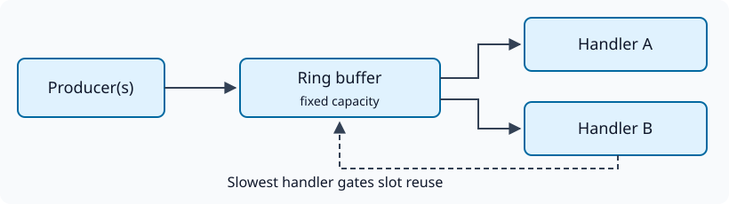

Zigrupt draws on the design described in the
[LMAX Disruptor paper](https://lmax-exchange.github.io/disruptor/disruptor.html)
by Martin Thompson, Dave Farley, Michael Barker, Patricia Gee, and Andrew
Stewart. We are grateful to the authors and the LMAX team for the ring-buffer
and sequencing ideas behind this library.

The Disruptor approach separates claiming a place in an event stream, publishing
its value, and tracking each consumer's progress. zigrupt uses these steps to
reuse a fixed set of event slots across threads. You do not need to understand
atomic memory ordering to get started.

## A ring of reusable slots

A ring buffer wraps around when it reaches capacity. A sequence identifies an
event's position in the stream across those wraps; its slot alone cannot. A
producer cannot overwrite a slot until every handler has acknowledged the
previous event in that slot. Capacity limits the event values stored in the
ring, but not memory they reference elsewhere.

## Broadcast and order

Every registered handler receives every published event, in the same global
sequence order, provided the application follows the lifecycle and callback
contracts. Each registration has its own progress and thread. Handler A may
finish long before handler B. There is no ordering of side effects *between*
handlers, and their batch boundaries may differ.

This suits independent consumers such as an audit stream and a metrics collector.
It does not assign each event to one available worker. If a handler acknowledges
only part of a batch, it may receive the remaining events again. The bus does
not make application side effects transactional.

With multiple producers, sequential calls from one producer remain ordered.
The interleaving between producers is unspecified. An earlier claimed event
must be published before consumers can pass it, even if a later producer's
`produce()` call has already returned.

## Backpressure

The slowest handler controls when slots become reusable. When it falls behind
by the ring's capacity, producers wait. A larger ring can absorb a burst, but
cannot fix a sustained mismatch between producer and consumer rates. A handler
that never acknowledges progress can stall publishing and shutdown indefinitely.

A successful `produce()` means the event is published; handlers may still be
working on it. Publishing has no timeout or nonblocking alternative.

## Threads and coordination

`start()` creates one operating-system thread per handler registration. Producers
are application threads; the library does not create them. Callbacks for one
registration are serial, but separate registrations run concurrently. Registering
the same function twice still creates two concurrent consumers.

The thread that calls `init()` owns `start()` and `stop()`. Producers must finish
before that owner stops the bus. Share results with atomics, locks, or exclusive
ownership followed by thread joins; the bus does not synchronize arbitrary
application accesses outside publication and acknowledgement.

See [producer modes](/zigrupt/guides/producers/),
[batching](/zigrupt/guides/batching/), and [lifecycle](/zigrupt/guides/lifecycle/)
for executable patterns.
