> **Development disclaimer:** Zigrupt is under active development, and these
> results may change as we continue optimizing it. The 2P1C and 2P2C cases
> were measured after optimizing the multi-producer sequencing path.

Zigrupt led Java Disruptor in all four **one-producer, one-consumer**
throughput workloads. With **one producer and
three consumers**, it delivered about 8–10 million unique events/s and trailed
Java in all four workloads. Rust's lead depended on the payload: zigrupt was
faster in two 64 B broadcast cases, while Rust was much faster in both
8 B broadcast cases.

With **two producers and one consumer (2P1C)** or **two producers and two
consumers (2P2C)**, zigrupt led both Java and Rust in all eight throughput
workloads, delivering about **13 million unique events/s** with one consumer
and **8–9 million** with two.

## What was measured

The benchmarks compared zigrupt with [Java Disruptor 4.0.0](https://github.com/LMAX-Exchange/disruptor)
and [disruptor-rs 4.4.0](https://github.com/nicholassm/disruptor-rs), using
2,048 or 32,768 ring slots and 8 B or 64 B payloads. Measured topologies were
1P1C, 1P3C, 2P1C, and 2P2C. Each consumer processed every published event in
multi-consumer cases. Workers were pinned to separate physical cores.

All correctness checks passed. The machine had four eligible physical cores,
so the four-producer/one-consumer and
three-producer/three-consumer workloads could not be measured. Each measured
workload has three independent throughput repeats and three latency repeats
at each offered rate. The
[benchmark methodology](https://github.com/sarthakvk/zigrupt/blob/main/benchmarks/README.md) describes validation,
warmup, and timing.

## Saturated throughput

Throughput counts **unique events completed by every required consumer per
second**. A two- or three-consumer broadcast therefore has two or three
deliveries per event, respectively.
Values below are medians of three repeats, in millions of events/s. The plots
show the median and the minimum–maximum repeat range.

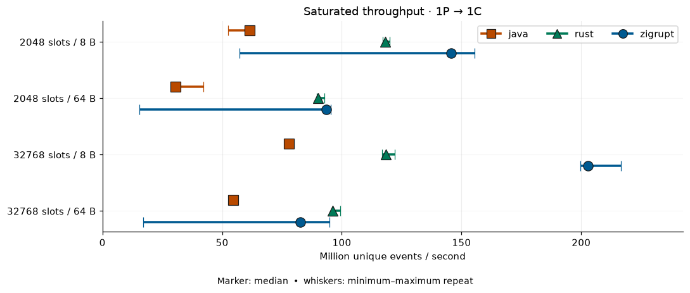

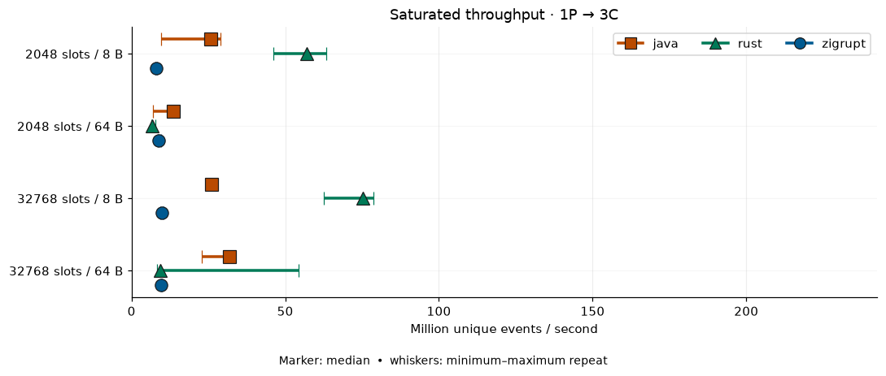

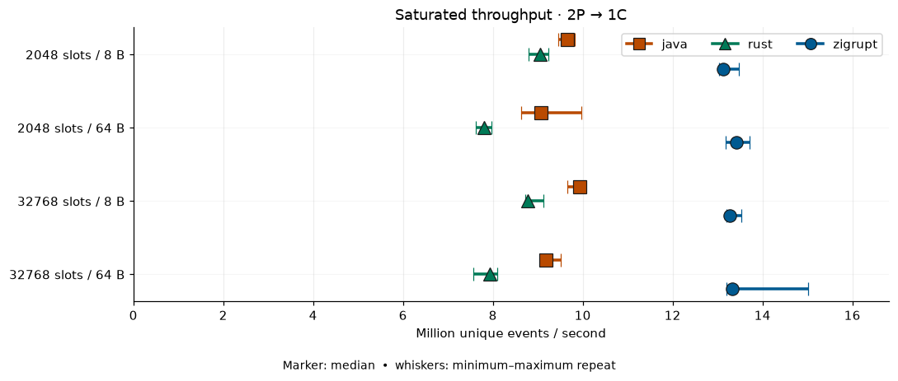

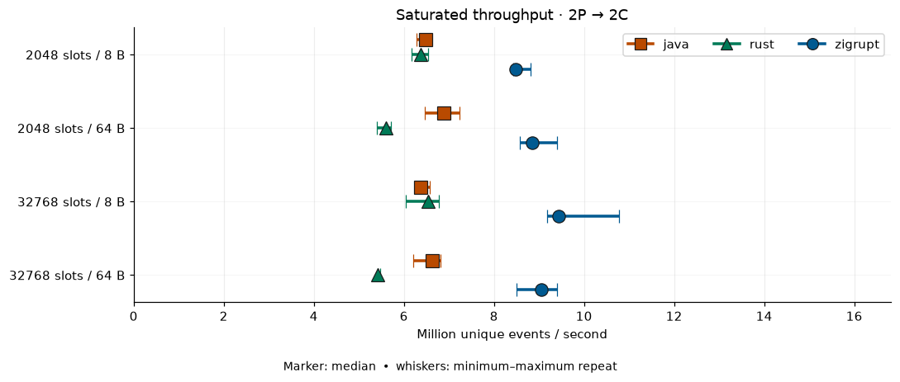

| Producers | Consumers |  Slots | Payload |   zigrupt |     Java |     Rust |
| --------: | --------: | -----: | ------: | --------: | -------: | -------: |
|         1 |         1 |  2,048 |     8 B | **145.7** |     61.4 |    118.3 |
|         1 |         1 |  2,048 |    64 B |  **93.5** |     30.6 |     90.1 |
|         1 |         1 | 32,768 |     8 B | **202.9** |     77.9 |    118.4 |
|         1 |         1 | 32,768 |    64 B |      82.6 |     54.6 | **96.3** |
|         1 |         3 |  2,048 |     8 B |       8.0 |     25.7 | **57.1** |
|         1 |         3 |  2,048 |    64 B |       8.8 | **13.6** |      6.6 |
|         1 |         3 | 32,768 |     8 B |       9.9 |     26.0 | **75.3** |
|         1 |         3 | 32,768 |    64 B |       9.7 | **31.9** |      9.4 |
|         2 |         1 |  2,048 |     8 B |  **13.1** |      9.7 |      9.0 |
|         2 |         1 |  2,048 |    64 B |  **13.4** |      9.1 |      7.8 |
|         2 |         1 | 32,768 |     8 B |  **13.3** |      9.9 |      8.8 |
|         2 |         1 | 32,768 |    64 B |  **13.3** |      9.2 |      7.9 |
|         2 |         2 |  2,048 |     8 B |   **8.5** |      6.5 |      6.4 |
|         2 |         2 |  2,048 |    64 B |   **8.9** |      6.9 |      5.6 |
|         2 |         2 | 32,768 |     8 B |   **9.4** |      6.4 |      6.5 |
|         2 |         2 | 32,768 |    64 B |   **9.0** |      6.6 |      5.4 |

Zigrupt's 1P1C rate ranged from **83 to 203 million events/s**. It was
1.5–3.1× Java's median and 0.86–1.71× Rust's, depending on workload. Its
three-consumer throughput was less than half of Java's in three of four cases.
Several 1P1C repeats varied widely, so the medians should be read
with the plotted ranges.

Zigrupt's 2P1C medians were **13.1–13.4 million
events/s**, 1.34–1.48× Java's and 1.45–1.72× Rust's. Its 2P2C medians were
**8.5–9.4 million events/s**, 1.28–1.48× Java's and 1.33–1.67× Rust's.

## Tail latency and delivered rate

Latency starts at an event's **scheduled arrival** and ends when a consumer
reads the clock after processing it. It includes producer delay, backpressure,
and queueing. The six offered loads range from 50% to 95% of the slowest
implementation's median saturated throughput for each workload. The plots
show the median **worst-consumer p99** across three repeats; shaded bands show
the observed repeat range. The latency axis is logarithmic.

### One-producer results

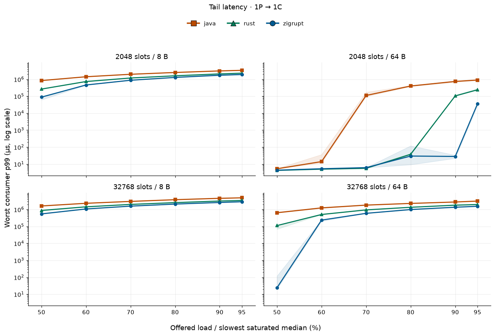

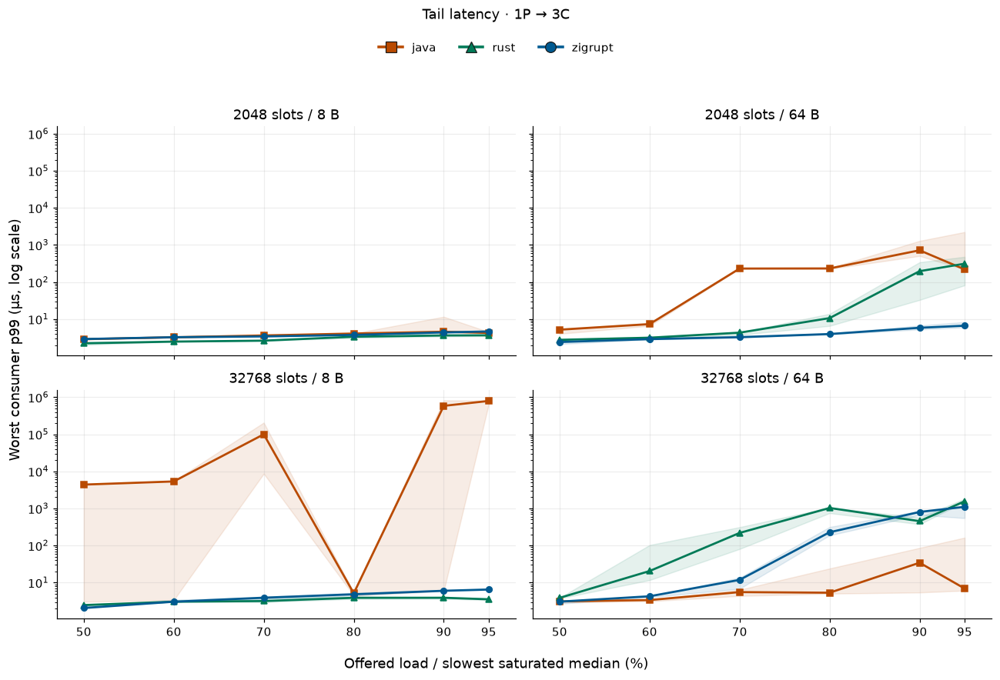

For three consumers, zigrupt's median worst-consumer p99 at 50% offered load
was **2.1–3.1 µs**. At 95%, three workloads were at **4.6–6.6 µs**; the
32,768-slot, 64 B workload rose to **1,104 µs** despite sustaining its offered
rate.

The 1P1C latency curves need their delivered rates alongside them.
At 95% offered load, zigrupt completed only **41–56%** of the schedule in
three of the four workloads. Their large p99 values describe a growing
backlog, rather than steady service at the requested rate. The rate plot
shows this shortfall across all offered loads.

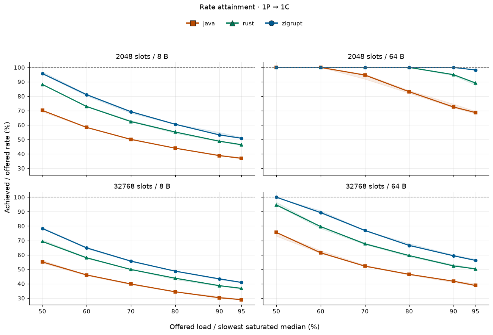

### Two-producer results

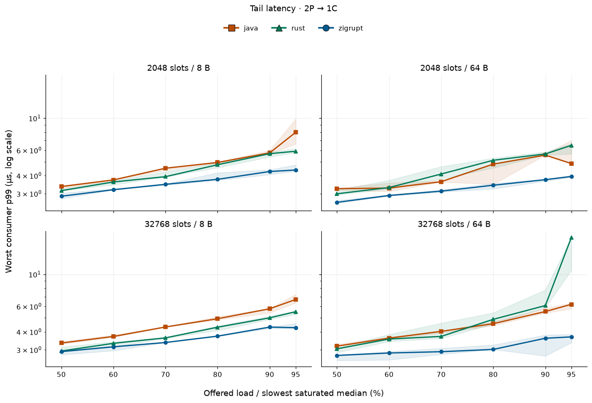

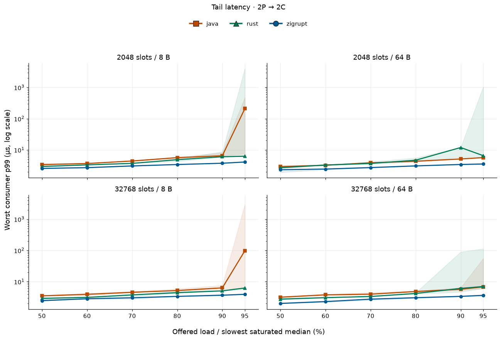

Zigrupt's median worst-consumer p99 at 50% offered load was **2.6–2.9 µs**
for 2P1C and **2.0–2.6 µs** for 2P2C. At 95%, it was **3.7–4.4 µs** and
**3.6–4.1 µs**, respectively, lower than both competitors in every workload.
Java's 2P2C medians at 95% rose to **211 µs** and **98 µs** for the 2,048-
and 32,768-slot 8 B workloads; some Java and Rust repeats had much larger
tails than their medians, as the shaded ranges show.

All **432** complete two-producer latency repeats achieved at least
**99.95%** of their offered rate.
The rate plots zoom in on these small deviations from 100%; the 2P1C plot
uses an axis offset of `+9.9999e1` (99.999%).

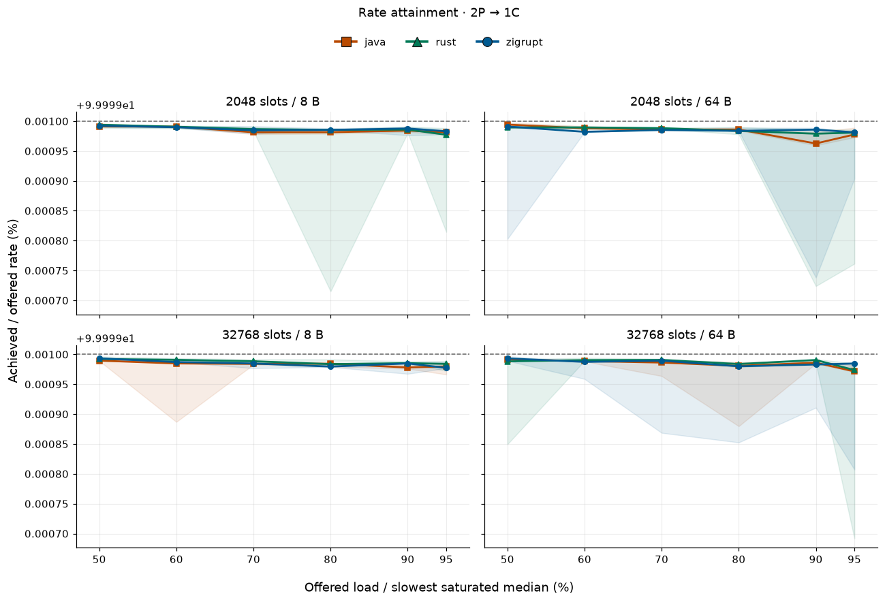

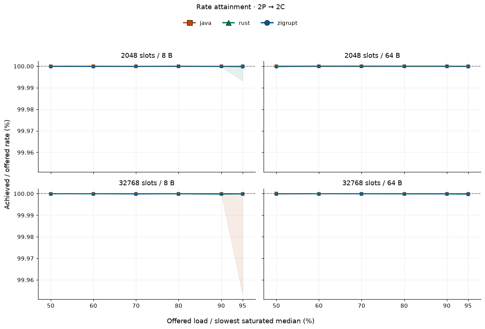

These results describe the measured workloads and machine settings, not a general
ranking. The [analysis notebook](https://github.com/sarthakvk/zigrupt/blob/main/benchmarks/visualize.ipynb)
also provides CPU, memory, and per-consumer plots for the selected run.
